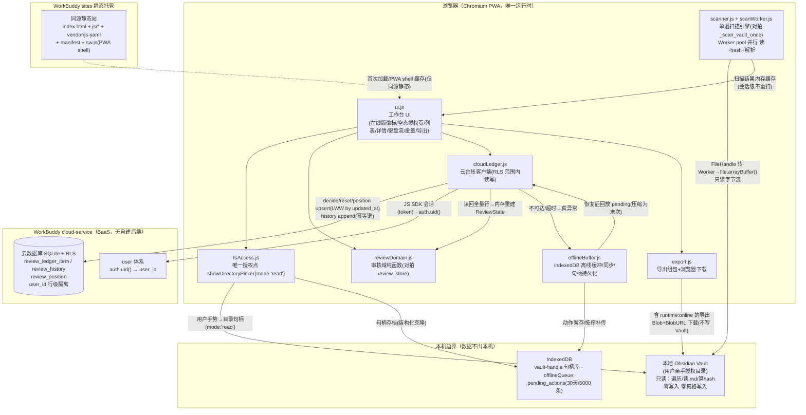
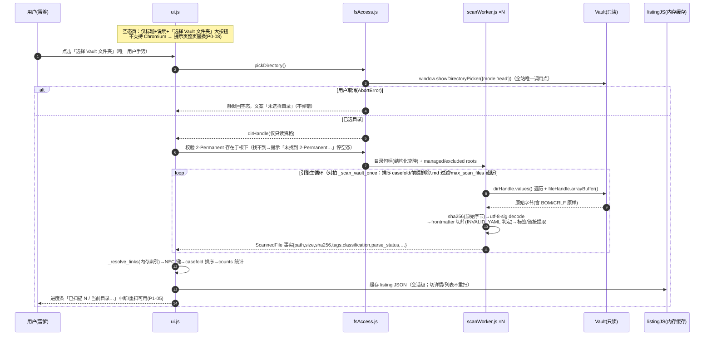
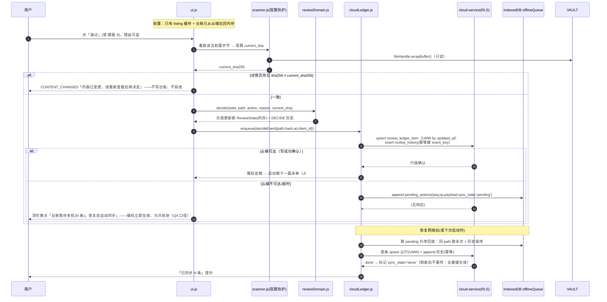
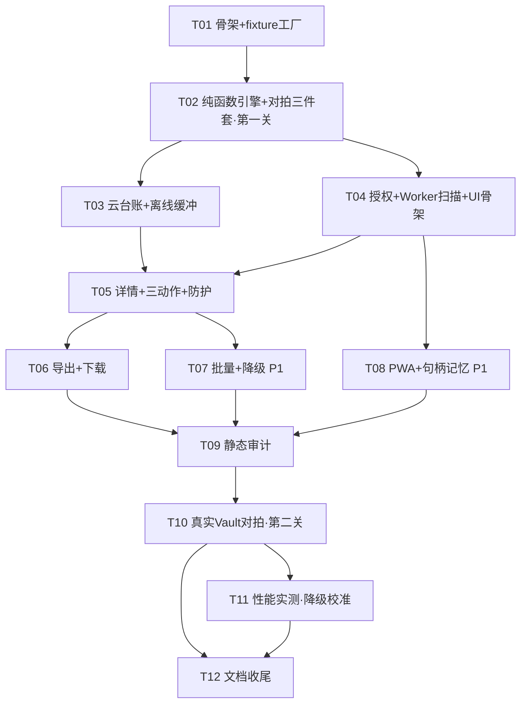

# connect-panel 增量架构设计：审核工作台在线版（FS Access 只读扫描 + 云台账 + PWA）

> 文档类型：增量架构设计与任务分解（feature `online_workbench`）
>
> 状态：**可实施设计（2026-11-20，高见远），寇豆码按 §8 任务表顺序执行，严过关按 §3/§8 验收口径对拍**
>
> 上游：`apps/connect-panel/docs/prd-online-workbench.md`（**已拍板版 2026-11-20，雷爹**：授权仅 `mode:'read'` 零写入；对拍零容差仅豁免时间戳类；vendored 同源 js-yaml；IndexedDB 缓冲 30 天/5000 条；批量硬目标 1000 篇读+hash ≤60s 达不到自动降级；导出 scope 加 `runtime:"online"` 且 schema_version 不升版；PWA P1 同批不阻塞 P0）
>
> 移植参照系（对拍判据）：`apps/connect-panel/panel/vault_check.py`（`_scan_vault_once` 单遍引擎 + `ScannedFile`）、`panel/review_scan.py`（`scan_review_listing` 双口径收集器 / `read_current_file` / `load_file_detail`）、`panel/review_store.py`（`validate_state` / `decide` / `reset` / `compute_progress` 等纯函数）、`panel/review_api.py`（`CONTENT_CHANGED` 三段式防线）、`panel/user_profiles.py`（NFC 键 + 原子写）、`src/mtrp_hub/adapters/obsidian_markdown.py`（frontmatter 切分 + 标签解析）。**对拍判据 = 这些实现的行为本身，本文引用的一切 Python 函数名/常量均出自这些文件。**
>
> 部署事实：发布用 WorkBuddy sites（纯静态托管）；云数据库用 WorkBuddy cloud-service（BaaS：云端 SQLite + RLS 行级隔离 + JS SDK，无自建后端进程）；目标浏览器仅 Chromium（`showDirectoryPicker` + WebCrypto `subtle.digest`）。

---

## 0. 铁边界复述（违反即架构失败，全文有效）

| # | 硬边界 |
|---|---|
| B1 | **交付物全部新文件**，落 `apps/connect-panel/online/`（与本地版 `panel/` 物理隔离）。不改 `panel/`、`static/index.html`、`src/mtrp_hub/`、`config/`、`tests/` 任何既有文件；**共享只允许两类**：① `docs/` 文档（只增不改）；② 对拍 fixture——只读消费 `tests/fixtures/stage2/vault`，产出侧 fixture 落 `online/parity/fixtures/`（T01 自建，见 §3.1） |
| B2 | **零写入红线**：`showDirectoryPicker` 全站**唯一调用点**且参数仅 `{mode:'read'}`（或省略 mode 等价只读）；源码静态审计禁 `createWritable` / `createSyncAccessHandle` / `FileSystemWritableFileStream` / `write(` / `move(` / `remove(` / `removeEntry` / `showSaveFilePicker` / `showOpenFilePicker`（Q/A 静态审计脚本 §3.6）。QA 一票否决项 |
| B3 | **纯静态**：`index.html` + ES modules JS（可多文件）+ vendored `js-yaml` 副本 + `manifest.webmanifest` + `sw.js`。零运行时 CDN、零后端、零服务器代码、零 npm 构建链。HTTP 仅两类：同源静态资源 + cloud-service 云数据库 API；不接 GitHub/乐享/MCP/统计脚本 |
| B4 | **对拍零容差**：同一输入下 JS 引擎输出与 Python 参照逐字段全等，差异数必须为 0；唯一豁免 = 时间戳类字段（§3.5 豁免白名单）。任一条不等即本期不算交付（PRD 成功标准 3） |
| B5 | **台账只写云**：审核动作、理由、位置只写 WorkBuddy cloud-service；云端不可达时落 IndexedDB 离线缓冲（30 天 / 5000 条先到为准），恢复后自动补传，不丢、不重、不乱序。**永不**写 Vault、永不写本地任意文件（导出是浏览器下载，不经 FS Access 写 API） |
| B6 | **云台账行级隔离**：每行带 `user_id`，RLS 保证 A 账号读不到 B 账号任何行；主键唯一性 `UNIQUE(user_id, vault_id, vault_relative_path)`；schema 表级带 `schema_version` |
| B7 | **继承口径不得稀释**（PRD 1.2）：分母 = 扫描总数（含 12 篇 INVALID_YAML）、排除根语义逐字复刻、sha256 = 原始字节（BOM/CRLF 全含）、NFC 路径键 + `casefold()` 排序、理由可选、动作必带客户端所见 sha256 且不符即拒（`CONTENT_CHANGED`）、导出 schema 继承本地版不升版 |
| B8 | **不支持浏览器不做降级**：无 `showDirectoryPicker` 一律提示页（文案含最低版本），无假按钮、无 zip 上传、无只读兜底实现 |
| B9 | 界面全中文、无 emoji、动态值一律 `textContent` 渲染（不拼 innerHTML）、零 traceback 外泄；错误码沿用本地版 10 个新增封闭码命名（K5） |

---

## 1. 总体架构

### 1.1 四方关系图



要点：

- **浏览器是唯一计算运行时**：扫描、hash、frontmatter 解析、进度、导出组包全部在客户端完成；云端只做台账键值存取，无任何业务推理（无后端即无服务端口径漂移）。
- **Vault 数据不出本机**：字节/正文零上传；出本机的数据只有台账六要素（路径、动作、理由、sha256、时间、user_id）。
- **IndexedDB 是三合一存取点**：① 目录句柄持久化（PWA 复用授权）；② 离线动作缓冲队列；③ 会话级扫描缓存不持久化（内存即可）。三者表相互独立（§4.3）。

### 1.2 扫描流（数据流 A：授权 → 遍历 → 清单）



### 1.3 决策流（数据流 B：拍板 → 云台账/离线缓冲 → 恢复同步）



撤销（`UNDO`）、内容已变更重审（`STALE_RESET`）与 decide 同构：均走"现算 sha 防护（undo/stale_reset 不比 sha，对齐本地版 reset 不校验内容）→ 内存状态变换 → cloudLedger 写云端（undo 需 DELETE 该 path 的 ledger 行 + 追加 UNDO 历史）"。

---

## 2. 模块分解（JS 模块清单）

目录总览（全部为新增文件，根 `apps/connect-panel/online/`）：

```
online/
├── index.html                 # 唯一入口（含不支持浏览器条件渲染提示页）
├── manifest.webmanifest       # PWA 清单（中文名称、同源图标）
├── sw.js                      # Service Worker（仅缓存同源静态 shell）
├── css/styles.css             # 样式（复用本地版 CSS 变量体系口径，色带区分在线版）
├── js/
│   ├── app.js                 # ─入口装配（线下）｜列出全部模块装配
│   ├── fsAccess.js            # 唯一授权点 + 句柄校验/持久化/复用
│   ├── hasher.js              # WebCrypto sha256 原始字节（Node/Chromium 通吃）
│   ├── parser.js              # frontmatter 解析 + INVALID_YAML 判定 + 标签/链接（对拍 obsidian_markdown）
│   ├── scanner.js             # 单遍扫描引擎与收集器（对拍 _scan_vault_once + scan_review_listing）
│   ├── scanWorker.js          # Worker：单文件流水线（读+hash+parse）
│   ├── reviewDomain.js        # 审核域纯函数（对拍 review_store）
│   ├── cloudLedger.js          # 云台账客户端（cloud-service SDK 封装、LWW 合并、同步回放）
│   ├── offlineBuffer.js       # IndexedDB 离线缓冲 + 句柄持久化 + 同步驱动
│   ├── export.js              # 导出继承 schema + runtime provenance + 下载
│   ├── ui.js                  # 工作台全部 UI 与交互（列表/详情/键盘/批量/进度/同步状态）
│   └── pwa.js                 # SW 注册 / install 提示 / 权限复用入口
├── vendor/
│   └── js-yaml.min.js         # vendored 固定版本（Q1 裁决；入库；零 CDN）
└── parity/                    # 对拍资产（§3）
    ├── build_fixture.py       # fixture 构造脚本（生成 fixtures/ + manifest）
    ├── fixtures/              # 对拍 vault fixture 树（T01 产出，入库）
    ├── run_python_engine.py   # Python 参照引擎 runner（调 panel 既有实现）
    ├── run_js_engine.mjs      # Node 下的 JS 引擎 runner（import online/js 纯函数模块）
    ├── compare_reports.py     # 逐字段深比对（零容差 + 时间戳豁免白名单）
    ├── audit_no_write.py      # 静态审计：禁写 API 全量扫描（B2）
    └── reports/               # 报告产物（.gitignore；实测报告必须回填差异=0 证据）
```

模块职责表（每模块标注对拍参照、依赖、行数预算）：

| 模块 | 职责 | 对拍 Python 参照 | 依赖 | 行数预算 |
|---|---|---|---|---|
| `fsAccess.js` | `pickOnlyReadDirectory()`：唯一 `showDirectoryPicker({mode:'read'})` 调用点（仅允许用户手势栈内调用，导出布尔 `requiresUserActivation` 约束供审计）；AbortError 静默；`validateVaultRoot(handle)` 校验根下 `2-Permanent` 存在；`storeHandle/loadHandle` 句柄持久化与 `queryPermission/requestPermission({mode:'read'})` 复用流程；`isSupported()` 检测 | 新增能力（本地版无对应；`normalize_local_absolute_path` 的越根/链接防线由"句柄天然不能越授权根"替代） | offlineBuffer（句柄存储） | ~160 |
| `hasher.js` | `sha256Bytes(uint8) → 64 小写 hex`：WebCrypto `subtle.digest('SHA-256')`，输入为原始字节（无解码/重编码/剥离 BOM）；hex 逐字节 `padStart(2,'0')` 小写；Node 18+ 与 Chromium 同源可用 | `review_scan._sha256_bytes` / `hashlib.sha256(...).hexdigest()`（§3.4 等价性证明） | 无（零依赖，Worker 可用） | ~40 |
| `parser.js` | `parseDocument(rawBytes, relativePath) → {tags,title,content_sha256,classification,needs_classification,reason_code}`；frontmatter 切分（首行 `---` 才认、闭合 `---` 扫描、无闭合→INVALID_YAML）；js-yaml load + 重复键拒绝 + 非 mapping 拒绝 + tags 类型判定；行内标签正则、围栏/行内代码/缩进排除；`extractWikiLinks(lines)`；`splitFrontmatter(text, parseStatus)` 详情切片。**锁定 vendored js-yaml** | `ObsidianMarkdownParser.parse` / `_frontmatter_end` / `inline_tags_outside_code`；`review_scan._extract_wiki_links` / `_split_frontmatter` / `_frontmatter_value` | vendor js-yaml；hasher | ~260 |
| `scanner.js` | 双层：① `walkCollect(handle …)` 浏览器遍历（`for await` + `name` casefold 排序 + 前缀排除 + `.md` 后缀大小写不敏感 + `maxScanFiles` 截断），每篇产出 ScannedFile 事实（结构对齐 `ScannedFile` frozen dataclass 全字段）；② `collectListing(facts) → listing JSON` 纯函数（items 构造：NFC 键、`mtr_state=parse_status!=='ok'?'unknown':classification`、`_resolve_links` 反链、casefold 排序、counts/statistics 同键自洽、warnings） | `_scan_vault_once`（walk 语义逐条）；`scan_review_listing` / `_item_from_scanned` / `_resolve_links` / `_empty_counts` | parser、hasher | ~340 |
| `scanWorker.js` | Worker 版单文件流水线：接收 `{fileHandle, relative}` → `arrayBuffer()` → sha256 → parse → 返回事实。与 scanner 主循环共享 parser/hasher 模块（import 同源 ES module）；Worker 池并发度可配（§6） | （同一 parse/hash 逻辑，无独立口径） | parser、hasher | ~120 |
| `reviewDomain.js` | `validateState / decide / reset / reviewStatusFor / computeProgress / coverageByDirectory / buildExportItems / exportStateDict`；常量 `HISTORY_LIMIT=200 / REASON_MAX_CHARS=500 / BATCH_MAX_ITEMS=500 / ACTIONS / HISTORY_OPS`；**零 IO、零 DOM——Node 对拍直接 import** | `review_store.py` 全部纯函数（逐函数对拍，K1–K3 语义沿用） | 无 | ~380 |
| `cloudLedger.js` | cloud-service JS SDK 的台账薄封装：`pullState()`（全行 select → 内存重建 ReviewState，history 合并排序+200 截断）；`upsertItem(path, record)`（LWW by `updated_at`，先读后写）；`removeItem(path)`（undo/stale_reset → DELETE 己方行）；`appendHistory(event)`（幂等键 `event_key` 去重）；`setLastPosition()`；失败判定（网络/超时→抛 `CLOUD_UNREACHABLE` 域内信号给 offlineBuffer） | 语义对齐 `ProfileStore.get_user_review/update_user_review` 的原子性与 `review_store` 校验 | cloud-service SDK；reviewDomain | ~260 |
| `offlineBuffer.js` | IndexedDB（库名 `mtrp-online-workbench`）：表 ① `dir_handle`（授权句柄）；② `pending_actions`（seq 自增、30 天/5000 条、retry、sync_state）；③ `export_backup`（缓冲导出备份暂存）；恢复驱动 `drainQueue()`（升序回放、同 path 压缩末次、历史保序、done 去重）；缓冲导出为文件备份 | 新增能力（本地版无；`user_profiles` 原子写语义→由 IndexedDB 事务天然提供） | cloudLedger、fsAccess | ~300 |
| `export.js` | `buildExportDocument(include)` 继承本地版 schema 逐字段（§7.3）+ `scope.runtime="online"` + `scope.user_agent_family="chromium"` + `vault_id_source`；`dryRun` 预览（剔除 stale 计数）；CSV 平铺（UTF-8 BOM、CRLF、RFC4180 转义、`;` 连接 tags）；触发浏览器下载（Blob+`URL.createObjectURL`，文件名 `review-<user>-<UTC 时间戳>.json/.csv`） | `review_api.export` 端点组装 + `build_export_items` + `_write_export_pair` 的 CSV 口径（CSV 字段列序完全一致） | reviewDomain、scanner（现算 sha 复核） | ~240 |
| `ui.js` | 空态授权页 → 主界面切换；进度七项+通过率（K11 口径）；左栏搜索/过滤/目录树/扁平列表；右栏只读详情（frontmatter 键值表、渲染/原文切换、出/反链、INVALID_YAML 原文模式+提示）；三动作+撤销+理由（拒绝自动展开聚焦）+`CONTENT_CHANGED` 拦截提示；键盘 J/K/A/R/S/U + 焦点保护；stale 黄条+重审；批量确认层（N 篇/M 篇格式异常）+结果摘要；同步状态点（已同步/暂存 N 条/同步中）+明细；导出预览→下载；断点续审（last_position） | 对拍 `static/index.html` 本地版工作台的交互语义（P0-03/04、P1-03） | 全部业务模块 | ~950 |
| `pwa.js` | `navigator.serviceWorker.register('./sw.js')`；`beforeinstallprompt` 捕获延迟触发安装；启动时若 IndexedDB 有句柄→显示「继续使用上次授权的目录（<目录名>）」按钮（**点击后才** `queryPermission`→必要时 `requestPermission`，失效优雅退回手动选择）；离线打开 shell 的空态文案 | 新增能力 | fsAccess、offlineBuffer | ~180 |
| `app.js` | 模块装配与启动序：`isSupported()`→提示页 或 空态；登录态获取（cloud-service SDK）；拉台账→建内存 state；事件接线 | （装配层） | 全部 | ~140 |

**模块依赖原则**（Audit 固化）：`parser/hasher/reviewDomain/scanner.collectListing` 四个模块**不 import 任何 DOM/BOM API**（Node 可直接 import——对拍可行性的结构保证）；DOM 相关全部收敛在 `fsAccess/ui/pwa/export/app/scanWorker 主控侧`。`cloudLedger/offlineBuffer` 不 import scanner/parser（防云层倒灌 IO）。

---

## 3. 对拍测试方案（一票否决项的工程化执行）

**定义**：「对拍」= 同一输入文件集，分别驱动 JS 引擎与 Python 参照实现，输出两份结构化 JSON 报告，逐字段深比对，**差异数必须为 0**（时间戳类字段豁免，白名单 §3.5）。差异数 > 0 → 退出码 1 → QA 判不合格。

### 3.1 fixture 构造（`online/parity/build_fixture.py`，T01）

复用仓内既有 `tests/fixtures/stage2/vault`（7 个 `.md`：unmanaged/trial-inline/rarely/tag-conflict/code-fences/invalid-yaml/中文目录 下 2 篇 + excluded root 内 1 篇 + 非根目录文件），**不复制、只读引用**——生成一份 `stage2_manifest.json`（相对路径清单）供 runner 定位；再由 `build_fixture.py` **程序化构造**扩展 fixture 树落 `online/parity/fixtures/vault/`（入库），覆盖 PRD §8.1 全部异常类型：

| 组 | 用例（每行一个文件，构造为确定字节内容） |
|---|---|
| INVALID_YAML 全类型 | ① 首行 `---` 无闭合；② `---\nkey: [1,2\n---`（YAML 语法错）；③ frontmatter 是序列而非 mapping（`- a`）；④ 重复键（`title: a\ntitle: b`，js-yaml 需显示配置重复键拒绝，见 K8）；⑤ `tags: 12`（int 非法）；⑥ `tags: [a, 2]`（list 混非 str）；⑦ `tags: true`（bool 非法） |
| 编码边界 | ⑧ UTF-8 BOM + CRLF frontmatter；⑨ UTF-8 BOM 无 frontmatter；⑩ 纯 CRLF 多行正文（multi-CRLF 混合 `\r\n`/`\n`）；⑪ 非 UTF-8 字节（Latin-1 高位字节→INVALID_ENCODING）；⑫ 空文件（0 字节） |
| 合法解析界 | ⑬ 无 frontmatter 纯正文；⑭ `tags` 字符串形式（`tags: a b #c`）；⑮ `tags` 列表全 str + `lstrip('#')`；⑯ frontmatter 空 mapping（`---\n---` → js-yaml `null` → Python `data is None → {}` 对齐）；⑰ title 字段 strip 语义；⑱ frontmatter 与正文之间空行 |
| 标签/链接界 | ⑲ 代码围栏内假 `#mtr/trial`（``` 与 ~~~ 双形式、闭合长度≥开启）；⑳ 行内代码内假标签；㉑ 4 空格/tab 缩进行假标签；㉒ 正文 `#mtr/trial` 与 `#mtr/rarely` 同篇（conflict）；㉓ `#mtr/trialx`（负边界不识别）；㉔ wiki 链接 `[[目标|显示]]`、`[[#标题]]`（空目标不计）、围栏内链接不计、`[[中文路径]]` |
| 过滤/排除/大小 | ㉕ `NOTE.MD` 大写后缀（必须入选）；㉖ `.txt` 非 md 排除；㉗ excluded root（`2-Permanent/Resources/MTR-P-System/x.md`、`2-Permanent/Areas/AI-Assets/_templates/y.md`）内文件不进清单；㉘ 1 MiB 整文件（ok 上边界）；㉙ 1 MiB+1 字节（FILE_TOO_LARGE）；㉚ 嵌套子目录 3 层深 |
| 路径 Unicode | ㉛ NFC 中文目录/文件名；㉜ NFD 文件名（`na\u0308ive.md` macOS 分解形）；㉝ 全角字符与空格混排文件名；㉞ NFC 与 NFD 近似对（不同文件，扫描后同 NFC 键→warnings 用例） |

构造器以**确定性脚本**生成字节内容（附件 NFD 支持 Windows NTFS 保留分解形），并产出 `fixtures_manifest.json`（相对路径→意图标注，供报告人工核对）。**fixture 树与 manifest 一起入库**——这使对拍可离线复跑。

**fixture 预期数字（QA 断言）**：stage2 扩展后合计 N 篇（T01 落定后写死在 `compare_reports.py` 常量与验收报告；构造器自带"预期清单"字段，两引擎输出条数必须都等于它）。

### 3.2 两引擎 runner 对拍执行方式

```
python online/parity/run_python_engine.py --vault <fixture路径(或真Vault)> --out reports/py_report.json
node   online/parity/run_js_engine.mjs  --vault <同一路径>          --out reports/js_report.json
python online/parity/compare_reports.py reports/py_report.json reports/js_report.json \
       --expected-total <预期条数> --out reports/diff_report.json
# 退出码：diff==0 → 0（PASS）；任何差异 → 1（FAIL，附逐字段差异路径清单）
```

- **`run_python_engine.py`**：不复制代码，直接 import `panel.review_scan.scan_review_listing` + `panel.review_api` 语义的本地版函数组合，输出扫描清单 + 单篇详情的**合并报告**：
  - `listing`：`scan_review_listing()` 原样输出（含 items[]/counts/statistics）；
  - `details[]`：对清单每篇调 `load_file_detail()`（frontmatter entries、body、links）；
  - `domain_case[]`：用固定输入驱动 `review_store` 纯函数序列（decide→改判→undo→stale_reset→导出选择，覆盖 K1–K3），输出 state 中间态与 export items——**动作语义对拍**。
- **`run_js_engine.mjs`**：Node ≥18 直接 `import` `online/js/scanner.js` 的纯函数层与 `parser.js`、`hasher.js`、`reviewDomain.js`（DOM 隔离原则 §2 保证可 import）；用 `node:fs/promises` 提供 `readdir` 迭代器注入 walk（同一 `collectListing` 管线），输出**同构 schema** 的 `py_report.json` 镜像（键名、嵌套、数组顺序完全一致——reviewDomain 部分**直接复刻 domain_case 输入脚本**，同一份 JSON 输入驱动两域）。
- **`compare_reports.py`**：深度比对器——递归遍历两 JSON 树，对每片叶做严格相等（字符串逐字符、整数值等值、null/缺失区分）；差异输出 `path→(py, js)` 三元组清单 + 计数；豁免白名单（§3.5）路径**跳过比较但仍记录"已豁免"计数**（报告透明）。**零容差 = 非豁免差异计数必须为 0**。

### 3.3 真实 Vault 对拍（第二关，T04 执行）

- 同一对拍三件套，`--vault` 指向本机真实 `Obsidian Vault`；Python 侧跑出基线报告（本地版本身能力），JS 侧 Node runner 跑同树。
- 验收断言（PRD §8.1-2/3）：清单条数 ≥1832 且两端相等；逐篇 `sha256 / parse_status / mtr_state / tags / links_out` 全等；frontmatter 全键全值串全等；计数自洽（1832/1820/12/unmanaged 1820/conflict 0，按当日实扫为准）。
- 报告与结论落 `online/parity/reports/real_vault_report_YYYYMMDD.md`（含两端耗时实测、差异数=0 证据、清单 SHA 汇总），**入库**（不含任何正文，仅清单字段——正文零落库红线不因报告例外）。
- **浏览器版枚举抽验**：真实 Vault 在浏览器内跑全量扫描，与 Node 报告对同一台机器的清单做"条数+逐篇 sha256 摘要哈希"二级比对（浏览器不直接产 JSON 文件，导出经 UI 的调试出口生成清单摘要 JSON 下载后比对）。**证明浏览器路径与 Node 路径同源**（同一组 ES module 与同一 walk 语义的两实现，见 K6）。

### 3.4 sha256 等价性单独证明（技术前提声明）

**命题**：`crypto.subtle.digest('SHA-256', bytes)`（JS）与 `hashlib.sha256(bytes).hexdigest()`（Python）在满足下列前提时输出**逐字符相等**的 64 位小写十六进制串：

| # | 前提 | 工程保障 |
|---|---|---|
| P1 | **输入字节序列完全一致**：两端的 `bytes` 是同一文件的原始磁盘字节，无解码—再编码、无 BOM 剥除、无换行规范化 | Python `read_bytes()`；JS `file.arrayBuffer()` 一次性取满（≤1 MiB 上限内不 chunk）→ `Uint8Array` 直接入 digest；**禁止** `TextDecoder`→`TextEncoder` 往返 |
| P2 | **算法标识一致**：`'SHA-256'` = FIPS 180-4 SHA-256（非 SHA-512/256 等别名族）；两端实现（CPython openssl / Chromium BoringSSL）均为标准实现 | NIST 标准测试向量固化为用例：空串 `e3b0c44298fc1c149afbf4c8996fb92427ae41e4649b934ca495991b7852b855`、`"abc"` `ba7816bf8f01cfea414140de5dae2223b00361a396177a9cb410ff61f20015ad`、1 MiB 全 `0x00`（fixture ㉘ 复用）——两引擎报告内置 vectors 段，比对器对其**不豁免**硬断言 |
| P3 | **hex 编码规则一致**：逐字节展开、小写、无前缀，不允许 `toString(16)` 不补零截断 | `hasher.js` 固定 `Array.from(u8).map(b=>b.toString(16).padStart(2,'0')).join('')`（对齐 `hexdigest()`），并有单测断言首字节 <0x10 的向量 |
| P4 | **大端/字节序无歧义**：SHA-256 对字节流运算，与平台 endianness 无关；JS 端唯一注意点是**不得**把 ArrayBuffer 视为其他类型视图后在数值上转换 | hasher 仅接受 `Uint8Array`/`ArrayBuffer` 入参，类型断言先行 |

证明即对拍本身：fixture ㉘/㉙ 及全 fixture 每篇的 `sha256` 字段在两报告全等（零容差白名单不含 sha256）→ P1–P4 在同一批证据中成立。**vault 全树零写入的 mtime/hash 快照**（QA 用例 6）使用 Python 侧独立脚本（复用现有 QA 资产）在前后各扫一次对比，不经 JS。

### 3.5 豁免白名单（时间戳类，唯一豁免）

`compare_reports.py` 内嵌常量，**除此之外零豁免**：

- `items[].mtime`、`items[].size_bytes`——mtime 两平台读值/分辨率可差（size_bytes 理论一致，仅当第一关实测有平台差时按此记录，默认参与比较）；
- 顶层 `scanned_at`（扫描时刻）；
- 顶层 `path`（-runner 输入的绝对路径，两端 argv 不同）；
- `domain_case[].*.at / decided_at / updated_at`（域对拍输入脚本注入的合成时间戳**两端同值**，本不产生差异；真实时间类仅出现在 listing 三个字段）。

注意：**路径键（vault_relative_path）、sha256、parse_status、mtr_state、tags 序列、linksOut/linksIn、frontmatter 全键值串、counts、statistics 全键——全部参与零容差比较**。

### 3.6 静态审计脚本（`audit_no_write.py`，T12，QA 一票否决项 7/8）

对 `online/`、`sw.js`、`manifest.webmanifest`、`index.html`、全部 `js/*`、`vendor/`（vendored 库同样审计；`js-yaml.min.js` 预扫描并记录基线白名单）做文本扫描：

```
禁止命中（正则，source 中出现即 FAIL）：
  \.createWritable\b   \.createSyncAccessHandle\b   FileSystemWritableFileStream
  showSaveFilePicker   showOpenFilePicker           \.removeEntry\b
  \.createWritable\(    [mode"':\s]+readwrite
  [^a-zA-Z]\.write\(    [^a-zA-Z]\.move\(          [^a-zA-Z]\.remove\(
```

- `\.write\(` 类规则**词边界收紧**避免误伤（如 `subtle.write` 不存在，但 `arrayBuffer().write` 也不存在；对 `export.js` 中 Blob 构造与 `URL.createObjectURL` 不在禁列——下载路径合法）； Vendored js-yaml 若因压缩出现形近串，进白名单并 grep 语义人工复核（T12 产出记录）。
- `showDirectoryPicker` **调用计数 == 1** 且唯一调用点三行窗口内可见 `{mode:'read'}`（或调用形参结构体中 `mode` 字段值 `'read'`）。
- `https?://` 域名白名单：同源（相对路径）+ cloud-service 域（常量单点 `cloudLedger.js` 顶部 `ENDPOINT`）——除此之外命中即 FAIL（B3）。
- 连续交付：脚本进 CI 化的 QA 基线，与对拍三件套并列四件套。

---

## 4. 云台账 schema + RLS + 同步协议

### 4.1 表结构（WorkBuddy cloud-service 云 SQLite DDL）

> 存储模型裁决：**每用户每路径一行的行级模型**（非"每用户一 blob"）。理由：RLS 行级隔离要求行拥有 `user_id` 可逐行授权；两设备并发写不同路径互不整档冲突（整档 blob 会互相覆盖）；LWW 可在行粒度裁决。`ReviewState`（items map + history + last_position）在客户端由这些行**重建**——重建算法在 `cloudLedger.pullState()`，与 `validate_state` 深校验衔接。

```sql
-- ① 篇级结论表（对齐本地版 review.items 语义；undo/stale_reset = DELETE 行）
CREATE TABLE review_ledger_item (
  id                  TEXT PRIMARY KEY,      -- 确定性主键 = user_id || ':' || vault_id || ':' | vault_relative_path →天然幂等 upsert 键
  schema_version      INTEGER NOT NULL DEFAULT 1,
  user_id             TEXT NOT NULL,         -- WorkBuddy cloud-service auth.uid()（§4.4 映射）
  vault_id            TEXT NOT NULL,         -- §5.2 派生的稳定在线 vault 标识
  vault_relative_path TEXT NOT NULL CHECK(length(vault_relative_path) BETWEEN 1 AND 2048),  -- NFC·POSIX 相对路径
  action              TEXT NOT NULL CHECK(action IN ('approved','rejected','skipped')),
  reason              TEXT NOT NULL DEFAULT '' CHECK(length(reason) <= 500),
  content_sha256      TEXT NOT NULL CHECK(length(content_sha256) = 64),
  display_name        TEXT NOT NULL DEFAULT '',   -- 动作发生时的账号展示名（P0-05 要求字段；只存不鉴权）
  role                TEXT NOT NULL DEFAULT 'viewer',  -- 同上
  decided_at          TEXT NOT NULL,              -- ISO8601 UTC（客户端钟）
  updated_at          TEXT NOT NULL,              -- ISO8601 UTC —— LWW 唯一裁决键
  client_id           TEXT NOT NULL,              -- 产生该动作的浏览器实例标识（首次随机 uuid，IndexedDB 持久）
  synced_at           TEXT                              -- 云端接收时刻（服务端/SDK 填充；对拍豁免字段）
);
CREATE UNIQUE INDEX uq_ledger_item ON review_ledger_item(user_id, vault_id, vault_relative_path);
CREATE INDEX idx_ledger_user ON review_ledger_item(user_id, vault_id);

-- ② 审核历史表（追加式、双设备并发各记各的；≤200 条截断在客户端重建时执行）
CREATE TABLE review_history (
  event_key      TEXT PRIMARY KEY,   -- 幂等键 = sha256(user_id + client_id + seq + at + op + path)[0:40] →重放/重传不产生重复行
  user_id        TEXT NOT NULL,
  vault_id       TEXT NOT NULL,
  path           TEXT NOT NULL,
  op             TEXT NOT NULL CHECK(op IN ('DECIDE','UNDO','STALE_RESET')),
  from_action    TEXT CHECK(from_action IS NULL OR from_action IN ('approved','rejected','skipped')),
  to_action      TEXT CHECK(to_action IS NULL OR to_action IN ('approved','rejected','skipped')),
  reason         TEXT,
  content_sha256 TEXT,
  at             TEXT NOT NULL,        -- 事件原时刻（客户端钟）
  updated_at     TEXT NOT NULL,       -- 同步写入时刻
  client_id      TEXT NOT NULL
);
CREATE INDEX idx_history_user ON review_history(user_id, vault_id, at);

-- ③ 续审位置表（每用户每 vault 一行）
CREATE TABLE review_position (
  user_id                 TEXT NOT NULL,
  vault_id                TEXT NOT NULL,
  last_position           TEXT CHECK(last_position IS NULL OR (length(last_position) BETWEEN 1 AND 2048)),
  updated_at              TEXT NOT NULL,
  client_id                TEXT NOT NULL,
  PRIMARY KEY (user_id, vault_id)
);
```

约束说明（与本地版 `review_store` 校验对齐，由 cloudLedger 写入前在客户端执行同套校验）：`ReviewRecord` 五字段全等（`action/reason/content_sha256/decided_at/updated_at`，`set(raw) != expected` 即拒）；历史三 op + from/to 规则（DECIDE 必有 to；UNDO/STALE_RESET 必有 from 且 to 为 null）；路径 NFC 相对 POSIX、无 `..`/空段/反斜杠/盘符/冒号/URL；sha256 64 小写 hex；reason ≤500。

### 4.2 RLS 策略（行级隔离的等价描述）

> 落地载体：WorkBuddy cloud-service 的表级 RLS 规则（以 `user_id = auth.uid()` 为谓词）。三张表统一策略：

```
review_ledger_item / review_history / review_position：
  SELECT ：user_id = auth.uid()
  INSERT ：WITH CHECK user_id = auth.uid()
  UPDATE ：USING user_id = auth.uid() AND WITH CHECK user_id = auth.uid()
  DELETE ：USING user_id = auth.uid()      （仅 item 表需要；history 表客户端不 DELETE）
```

验收映射（PRD §8.2）：账号 A 写 10 条 → B `select` 结果 0 条（RLS 过滤）；B 的会话构造携带 B user_id 的查询查 A 数据 → 0 行（谓词恒假）；**不存在任何"接口层可用参数绕过"**——隔离在存储引擎层而非应用层，应用根本发不出他库请求（BaaS 无自定义后端）。
> 注：表级 `schema_version` 字段即 P0-05 要求的"表级 schema_version"落位；行级 `user_id/vault_relative_path/action/reason/content_sha256/decided_at/updated_at/display_name/role` 八字段全部就位，主键唯一性 `UNIQUE(user_id, vault_id, vault_relative_path)` 与 PRD 主键唯一性条款（user_id+path，多 vault 分区后仍保持全唯一）。

### 4.3 离线缓冲与同步协议（IndexedDB → 云端 upsert → 冲突 LWW）

**IndexedDB 库**：`mtrp-online-workbench`，object stores 三套（同一库，事务分立）：

| store | keyPath | 用途 |
|---|---|---|
| `dir_handle` | `key:"primary"` | 授权目录句柄（结构化克隆持久化；PWA 复用） |
| `pending_actions` | `seq`（自增） | 离线动作队列（30 天/5000 条上限） |
| `export_backup` | `seq`（自增） | 上限触顶时的"导出备份"暂存（下载用） |

**pending_actions 行结构**：

```
{ seq, user_id, vault_id, op: 'DECIDE'|'UNDO'|'STALE_RESET'|'SET_POSITION',
  path, action?, reason?, content_sha256?, at,          // 动作原时刻
  client_id, created_at, retry_count: 0, sync_state: 'pending'|'sending'|'done' }
```

**同步驱动**（`offlineBuffer.drainQueue()`，触发点：网络恢复事件（`navigator.onLine` + 重试轮询）、每次动作写云失败旁路、应用启动）：

1. `getAll(seq 升序, sync_state != 'done')` → 按 `path` 分组压缩：**同 path 只回放末次 op**（中间态消失，与"以最后一次为准"语义一致——本地版同一锁内串行 decide 等价），但全部 op 仍**逐条进入历史**（历史保序合并，不吞事件）。
2. 逐条回放：
   - `DECIDE`：`upsert review_ledger_item`（LWW：先 `select` 当前行，任 `updated_at` 更大则**仍 upsert——服务端时间戳恒大于**不行）。LWW 裁决规则写死：
     - 若远端行不存在或远端 `updated_at <= at`：写入本地值（`updated_at = at`）。
     - 若远端 `updated_at > at`：**跳过行覆盖、但历史照 append**——后写者优先（PRD §8.2-5：两设备并发，items 取 updated_at 后者，历史双记）。
   - `UNDO`/`STALE_RESET`：`DELETE` 对应 item 行（远端行 `updated_at > at` 时**不删**——远端已有更新的决定，撤销过期；历史照 append，`from_action` 取删除前远端值或本地前值）。
   - `SET_POSITION`：直接 upsert position 行（LWW 同上）。
   - 每条写完置 `sync_state='done'`；`retry_count++`（指数退避 `2^n×2s`，上限 5 次→`sync_state` 保持 `pending` 且 UI 报"仍有 N 条未同步"，**不丢不删**）。
3. 幂等性：item 主键确定性（`user_id:vault_id:path`）→ 重放天然去重；history `event_key` → 重传不双记（QA 用例 10：刷新后再跑 drain 不产生重复行）。
4. 上限治理：`pending_actions.count() ≥ 5000` 或最老记录 `created_at` 超 30 天 → UI 顶部红条提示「离线缓冲已达上限，请导出本地备份」，提供"导出备份（JSON 下载）"；**不自动删除**（K–缓冲宁可留多，PRD Q4）。
5. 时钟口径：`at/updated_at` 用客户端钟（ISO8601 UTC）。跨设备 LWW 依赖各端时钟大致同步——在 §9-2 声明该假设与风险（建议登录后用云端回读校准偏移提示）。

### 4.4 账号对接（cloud-service user 体系 → user_id）

- 登录：WorkBuddy cloud-service JS SDK 既有用户认证（本设计不实现自研登录——B8 口径）。会话建立后取 `auth.uid()` 等价的**稳定用户标识**（`getCurrentUser()` 通道），映射为台账 `user_id`（字符串原样存）。
- **映射单点**：`cloudLedger.currentUserId()` 是全站唯一取 `user_id` 的函数（ui/export/台账写入都从它取，防散落拼装）。
- `display_name / role`：登录后取用户资料写入台账行（只存不鉴权，role 本期不拦截——PRD §3 persona 口径；owner 全局汇总是 P2-02，本期云端不做跨用户查询）。
- 切换账号：pwa.js/ui.js 层登出→清内存 state→新 user_id 重新 `pullState()`；**目录授权与账号解耦**（PRD §5.3：界面提示"当前目录授权仍有效"），但台账读写全部自动切到新 user_id（RLS 保证视野随即一致）。
- 首次登录 + 已有 IndexedDB pending：pending 行的 `user_id` 若与当前登录不符（换账号后遗留下来的缓冲）→ UI 明确提示「有 N 条旧账号待同步动作，请重新登录原账号同步」并暂存不回放（不做跨账号写入——隔离红线延伸到缓冲层）。

---

## 5. 授权与 PWA 设计

### 5.1 授权：`showDirectoryPicker` 全站唯一调用点

- **唯一性**：`fsAccess.js::pickOnlyReadDirectory()` 是全站唯一的 `showDirectoryPicker` 调用点（静态审计断言：全 `online/` 源码出现次数 == 1，见 §3.6）。入参恒为 `{mode:'read'}`（显式写出，不做"省略即默认"——审计面可见零写入意图）。
- **用户手势约束**：仅在 `ui.js` 的「选择 Vault 文件夹」按钮 click 处理函数调用栈内执行（Transient Activation 内）；页面加载、定时器、Promise 链迟到回调一律不允许出现该调用——代码顺序上 `pickOnlyReadDirectory` 的调用点只有一处且在事件处理器内，审计可查（P0-01 验收①）。
- **选错目录防线**：授权成功后立即 `validateVaultRoot(handle)`——`getDirectoryHandle('2-Permanent')` 不存在 → 返回结构化失败（不是异常崩溃），UI 提示「未找到 2-Permanent，请重新选择 Vault 根目录」，**停在空态**，不静默继续、不清 UI 状态（P0-01 ③）。
- **取消路径**：`AbortError`（用户在系统弹窗点取消）→ 静默回空态、文案「未选择目录」保留（Q/A 用例来自 P0-01 ⑤）。
- **隐私**：UI 任何位置只回显目录名（`handle.name`），不展示绝对路径（绝对路径在所有数据契约中以目录名或占位替代，见 §7.3 注）。
- **权限失效路径**：后续任何文件操作抛 `NotAllowedError`/`NotFoundError` → 顶部黄条「目录授权已失效，请重新选择」+ 重试按钮；**不清空已有台账**（台账在云端，与授权解耦——PRD §5.3）。

### 5.2 授权句柄持久化（PWA 的授权记忆）

- Chromium 支持 `FileSystemDirectoryHandle` 经**结构化克隆算法**存入 IndexedDB（§4.3 `dir_handle` store，key `"primary"`）。存入时机 = 授权成功 + 首次扫描完成之后（避免存无效授权）。
- 句柄持久化 ≠ 权限持久化：**句柄可恢复，权限不能**。每次会话复用必须走 §5.3 的 `queryPermission → requestPermission` 二段流程（requestPermission 本身就是用户手势点）。
- 句柄失效（浏览器数据清理、磁盘已卸载、Vault 被移走）→ `loadHandle()` 捕获 `NotFoundError` → 静默清除 `dir_handle` 行并回空态（不报未捕获异常——PRD P1-01 口径）。

### 5.3 PWA（P1-01，同批交付不阻塞 P0）

- **`manifest.webmanifest`**：`name:"MTR-P 审核工作台（在线版）"`、`short_name:"审核工作台"`、`start_url:"./index.html"`（保持静态托管根相对路径，兼容 sites 子路径发布）、`display:"standalone"`、`scope:"./"`、图标 2 枚同源 SVG/PNG（`online/icons/`，不引外链）。
- **`sw.js`**：`install` 预缓存 shell 白名单（`index.html / css / js 全模块 / vendor/js-yaml / manifest / icons / sw.js` 自身）——清单**静态内联在 sw.js**，版本号 = 构建时手更的 `CACHE_VERSION` 常量（零构建链约束下不做 hash 自动化）；`fetch` 策略：同源静态请求 cache-first（命中后后台更新）、云数据库 API 请求 `pass-through`（**绝不缓存台账响应**——防读到他人/旧数据）；跨域非 cloud-service 请求直接放行给网络（本站不该产生——静态审计兜底）；`activate` 清旧版本 cache。**不缓存用户笔记内容**（扫描数据只在内存，无缓存层）。
- **安装提示**：`beforeinstallprompt` 捕获后延迟到 UI 完成 + 2s 静默期再展示自定义「安装到桌面」按钮（不打断首次核心流程）。
- **「继续使用上次授权的目录」**：启动时 `loadHandle()` 有值 → 空态页主按钮旁出现次按钮「继续使用上次授权的目录（<目录名>）」；点击 → `queryPermission({mode:'read'})`：`granted` 直接进入并自动扫描（复用本地版"授权后自动首次扫描"；`prompt` → `requestPermission({mode:'read'})`（仍需用户点击确认，浏览器策略）；被拒/失效 → 按钮消失、回手动选择主流程，**无未捕获异常**（PRD 用例 11）。
- **离线打开**：shell 可离线打开（sw 缓存），进入空态但可点击「选择 Vault 文件夹」（目录访问不需要网络）；台账拉取失败 → 「无网络，可继续本地审，动作暂存本机」（IndexedDB 路径天然可用）。

---

## 6. 性能设计

### 6.1 批量硬目标的实现路径（1000 篇读+hash ≤ 60s）

- **Worker 池并行读+hash**：`scanWorker.js` 单文件流水线（`arrayBuffer()` → sha256 → parse 三步全部在 Worker）；Worker 数 = `min(8, max(2, navigator.hardwareConcurrency ?? 4))`（concurrency 上限 8，防止句柄调度饥饿）。
- **调度与背压**：主线程 `async walk` 产出文件扫描项 → 环形任务队列（容量 32×worker）→ Worker 取走执行 → 事实回传（transferable 无所谓，结果小）；队列满则暂停 `for await` 遍历（backpressure），防 1832 个 `File` 句柄全量驻留。
- **内存策略**：字节只活在 Worker 流水线栈内——hash 完即弃，事实（path/sha/tags/parse_status）回传，主线程 peak ≈ 文章平均 30 KB × 活跃窗口 ≈ 数 MB + 事实数组；**清洗输入端不缓存正文**（正文仅详情按需单篇重读）。
- **写侧节奏**（Q7 台账）：decide 逐行为 upsert（无批量 RPC 语义），客户端批处理 = 并发 4 写 + 50 条/批的进度刷新节流；`REVIEW_BATCH_LIMIT=500` 沿用本地版（K13）。

### 6.2 降级检测与触发（Q7 拍板：达不到自动降级）

- **探针计**：批量执行前，先取范围前 100 篇作 timed probe（同一 Worker 池读+hash），估算 1000 篇耗时 = 实测×10。
- **触发规则**：估算 > 60s 或 probe 本身 > 6s → 本次批量**不整批提交**，自动切换**降级模式**：① 批量读 hash（多读确认内容未变）→ ② 生成逐篇待决列表 → ③ 逐篇 `decide` 弹层人工确认每一篇（去自动化）。UI 顶部持久标注「已启用降级批量模式（目录读取性能不足，改为逐篇确认）」，直至下次 probe 达标才自动恢复。
- **记录**：每次批量记录（耗时/篇数/模式）到内存会话统计，QA 环境将实测值写入 §8 T11 报告页——**PRD Q7 的硬目标要有实测证据链**（达标则保留批量直通路径）。
- **扫描侧**：全量扫描 1832 篇耗时同样记录（PRD 成功标准 1：≤ 本地版实测 2 倍，首版可放宽必须给出实测值，不留空——空缺即不通过）。

### 6.3 扫描进度与续跑（P1-05）

- 进度展示：`已扫描 N / 当前目录 xxx / 已用时 ss.s`（UI 节流 100ms）；扫描可中断（`AbortController`）；会话内 listing 内存缓存（§1.1），列表↔详情切换不重扫，仅「重新扫描」按钮强制全量重扫（`stale` 判定也基于最新基线）。

---

## 7. API / 数据契约（无后端，以数据契约为准）

> 三层契约：① **扫描清单条目**（与本地版 `/api/review/scan` 的 `items[]` 字段全等）；② **台账记录**（与本地版 `review` 结构语义等价，落点换 cloud-service 行模型）；③ **导出 JSON/CSV**（继承本地版 schema_version="1"，仅 scope 增 provenance）。凡"对拍"字段一律以本地版输出 JSON 为真值。

### 7.1 扫描清单条目（listing，单篇 item）

```json
{
  "vault_relative_path": "2-Permanent/Areas/AI-Assets/中文笔记.md",
  "sha256": "3f9a1c…（64 小写 hex·原始字节口径）",
  "size_bytes": 2150,
  "mtime": "2026-11-12T06:03:00.123456+00:00",
  "tags": ["note/seed"],
  "mtr_state": "unmanaged | trial | rarely | conflict | unknown",
  "parse_status": "ok | INVALID_YAML | INVALID_ENCODING | FILE_TOO_LARGE | FILE_READ_FAILED",
  "links_out": 4,
  "links_in": 2
}
```

顶层包络（对齐 `scan_review_listing` 输出键名）：`scanned_at / path(在线版=目录名，runner 模式=argv 绝对路径→对拍豁免) / managed_roots:["2-Permanent"] / excluded_roots:[…2 项…] / status(ok|limited|error) / limit_reached / total / statistics(v1 同构 9 键) / counts{parsed_ok,invalid,file_too_large,mtr{trial,rarely,unmanaged,conflict}} / items[] / warnings[]`。**键名与嵌套结构与本地版逐字段相同**——这是 diff 报告可直接逐字段比对的前提。

### 7.2 台账记录（cloud-service 行 ⇄ 内存 ReviewState）

- **内存态**（与本地版 `state_to_dict` 全等，reviewDomain.js 校验）：`{schema_version:"1", items:{path→{action,reason,content_sha256,decided_at,updated_at}}, history:[{path,op,from,to,reason,content_sha256,at}]≤200, last_position}`。
- **云端行** → 客户端重建（§4.3）：`review_ledger_item` 全行 + `review_history` 按 `at` 升序合并截断 → 上述结构。行 → 态映射是 `cloudLedger.pullState()` 唯一职责，**重建结果必须过 `validateState`**（对齐 `validate_state` 深校验：字段全等、op 规则、NFC 路径、64hex、≤500 字符）。
- 单篇详情响应（UI 内部结构，对齐本地版 `/api/review/item` data 包）：`{item, frontmatter{raw,entries[{key,value,value_type}],parse_status}, body{text,raw_only}, links{out,in}, decision{action,reason,decided_at}|null, stale, read_only:true}`。

### 7.3 导出 JSON / CSV（继承本地版 schema，唯一增量=scope provenance）

```json
{
  "schema_version": "1",
  "exported_at": "2026-11-20T09:00:00.000Z",
  "user_id": "<cloud-service 账号 ID>",
  "vault_id": "8a1f…（16 hex·在线版派生规则 K14）",
  "scope": {
    "vault_root": "Obsidian Vault",
    "managed_roots": ["2-Permanent"],
    "excluded_roots": ["2-Permanent/Resources/MTR-P-System", "2-Permanent/Areas/AI-Assets/_templates"],
    "scanned_at": "…",
    "total_scanned": 1832,
    "include": "approved | all",
    "runtime": "online",
    "user_agent_family": "chromium",
    "vault_id_source": "online"
  },
  "counts": { "exported_items": 121, "approved_total": 124, "excluded_stale": 3, "scope_note": "items 仅含 approved 且当前内容 hash 复核一致" },
  "items": [
    { "vault_relative_path":"…", "action":"approved", "reason":"…", "content_sha256":"…",
      "decided_at":"…", "decided_by":"<账号ID>", "mtr_state":"unmanaged", "tags":["…"],
      "parse_status":"ok", "size_bytes":2150, "mtime":"…" }
  ]
}
```

差异声明（与本地版 `review_api.export` 组包逐字段对照）：**新增仅三个键** `runtime/user_agent_family/vault_id_source`（PRD Q6 裁决，`schema_version` 不升版）；`vault_root` 在线版填**目录名**（不展示绝对路径的安全约束替代本地版绝对路径；下游消费方以 `vault_id` 为稳定身份）；`user_id` 从 `"default"` 换为真实账号 ID（PRD 1.2 拍板）；`include=all` 时 `items[].stale` 现算复核同本地版。**CSV**：列序 12 字段与本地版 `_CSV_FIELDS` 完全一致（`vault_relative_path,action,reason,content_sha256,decided_at,decided_by,mtr_state,tags(;连接),parse_status,stale,size_bytes,mtime`），UTF-8 BOM + CRLF + RFC4180 转义；**行数 == items[] 长度**（K12 断言）。下载文件名 `review-<user_id>-<YYYYMMDD-HHMMSS>(-n?).(json|csv)`——文件名生成逻辑逐字移植 `review_api._write_export_pair` 的 stem 规则。

---

## 8. 任务分解（T01–T12，寇豆码按序串行执行；每任务带对拍/验收点）

| ID | 优先级 | 任务名 | 产出文件（全部相对 `apps/connect-panel/online/` 之外注明） | 做什么 | 依赖 | 验收（对拍/验收点） |
|---|---|---|---|---|---|---|
| **T01** | P0 | 站点骨架 + 对拍 fixture 工厂 | `index.html`（空态页+不支持条件渲染壳）、`css/styles.css` 基件、`manifest.webmanifest` / `sw.js` 占位、`vendor/js-yaml.min.js`（固定版入库+基线记录）、`js/` 空模块占位、`parity/build_fixture.py`、`parity/fixtures/vault/**`、`parity/fixtures/fixtures_manifest.json` | 构造 §3.1 全 34 类 fixture（内容字节定死）；stage2 既有树只读引用生成 stage2_manifest；vendored js-yaml 落位 | —（起点） | **fixture 重跑字节级确定性**（连跑 2 次目录 hash 相等）；manifest 覆盖 §3.1 全部异常类；js-yaml 无网络引用 |
| **T02** | P0 | JS 纯函数引擎层 + 对拍三件套（第一关） | `js/hasher.js`、`js/parser.js`、`js/reviewDomain.js`、`js/scanner.js`(纯函数收集层)、`parity/run_python_engine.py`、`parity/run_js_engine.mjs`、`parity/compare_reports.py` | 实现 §2 纯函数四模块（DOM 隔离原则 K6）；runner 跑 fixture 两引擎出报告；比对器零容差+豁免白名单；domain_case 动作语义序列（decide→改判→undo→stale_reset→export 选择）双引擎同输入驱动 | T01 | **fixture 对拍差异数 = 0**（含 NFD/BOM/multi-CRLF/INVALID_YAML 全类型/重复键/conflict/FILE_TOO_LARGE 边界）；NIST sha256 向量段不豁免全过；`validateState` 深校验非法样例全拒 |
| **T03** | P0 | 云台账 + 离线缓冲 | `js/cloudLedger.js`、`js/offlineBuffer.js`、`docs/` 内建表 DDL 落 `online/parity/schema_notes.md`（供建表操作） | §4 全部：行模型/RLS 策略描述/pullState 重建+校验/LWW upsert/幂等 history/位置表；IndexedDB 三 store/队列回放压缩/30 天 5000 条治理/导出备份 | T02 | 隔离：A 账号视角拉取 B 数据恒空（RLS 生效证据留存）；LWW：两实例并发写同 path，items 取 updated_at 后者、历史双记（不重传、幂等）；断网 5 条→刷新仍 5→恢复按序补传→再刷不重传（QA 用例 9/10） |
| **T04** | P0 | FS Access 授权 + Worker 扫描管线 + 工作台骨架 | `js/fsAccess.js`、`js/scanWorker.js`、`js/app.js`、`js/ui.js`（骨架：空态→授权→进度→列表+汇总）、`js/scanner.js` 补齐 walk 注入层 | §5.1 授权唯一调用点 + 2-Permanent 校验 + AbortError 静默；Worker 池批扫流；listing 缓存；不支持浏览器提示页（整页替换）；同步状态点雏形 | T02, T03 | 手动+自动：授权四路径（正常/取消/选错根/失效）；扫描进度与中断；**真实 Vault 跑条数/sha256 摘要与 Node 报告二级比对一致**（§3.3） |
| **T05** | P0 | 详情 + 三动作 + 撤销 + 防护闭环 | `js/ui.js`（详情面板/动作条/理由/STALE 黄条/键盘流） | 详情按需重读现算（frontmatter 键值表/渲染切换/原文模式/出反链）；decide 带 sha 防护→CONTENT_CHANGED 拦截；undo/STALE_RESET；拒绝自动展开理由；键盘 J/K/A/R/S/U+焦点保护；INVALID_YAML 原文模式三动作可用 | T04 | 拦截链模拟：篡改文件后动作被拒且无台账写入；键盘流全鼠标过审成功；详情分量对 Python `load_file_detail` 抽 10 篇 spot-check 全等（时间戳/decision 除外） |
| **T06** | P0 | 导出 + 下载 | `js/export.js`、`js/ui.js` 接线 | §7.3：dry_run 预览→组包→浏览器下载；run-time provenance 三键；CSV 同构；approved 现算复核剔除 stale；文件名 stem 规则移植 | T05 | 导出 JSON 与本地版同输入对象逐字段 diff：差异仅限 user_id/vault_root/vault_id/scope 三新键/时间戳类（白名单）；CSV 行数==items 长度；导出不写任何文件到 Vault/每下载一次消费一次 BlobURL（回收） |
| **T07** | P1 | 批量 + 降级 | `js/ui.js`（批量入口/确认层/结果摘要/降级标注）、并发写批处理 | §6：probe 探测→直通/降级两模式；500 整拒；确认层 N 篇+M 篇格式异常；结果逐篇摘要+失败重试；INVALID_YAML 批量单列 | T05 | fixture 批：501 篇拒收；混合批（篡改/缺文件/正常）逐篇如实；模拟慢盘触发降级→UI 标注+逐篇确认路径走通 |
| **T08** | P1 | PWA + 授权记忆 | `js/pwa.js`、`manifest.webmanifest` 定稿、`sw.js` 定稿、图标 | §5.2/5.3：句柄存取；queryPermission→requestPermission 流；install 提示；离线 shell；台账 API 不缓存 | T04 | QA 用例 11：安装→重开→"继续上次目录"→一次点击进扫描；浏览器撤销站点权限→优雅回退无未捕获异常（Console 净） |
| **T09** | P0 | 静态审计（零写入/唯一调用点/域名白名单） | `parity/audit_no_write.py`、审计白名单记录 | §3.6 四件：禁写正则族、showDirectoryPicker==1 且 mode:'read'、域名白名单（cloud-service 单点常量）、vendor 基线复核记录 | T06, T07, T08 | **零命中**：禁写 API 0 处；不设白名单即过（确需豁免的 vendored 压缩串逐条人工复核记录在案）；报告入库 `parity/reports/audit_YYYYMMDD.md` |
| **T10** | P0 | 真实 Vault 全量对拍 + QA 联合验收剧本 | `parity/reports/real_vault_report_*.md`（并入QA验证报告） | §3.3 第二关：1832 篇全量 Node↔Python 逐字段 diff=0；计数自洽（1832/1820/12）；浏览器版本 Node 报告二级比对；浏览器全流程前后全树 hash+mtime 快照不变（Python 独立脚本） | T06, T09 | **差异数 = 0（唯一豁免=时间戳类）**；全树快照前后不变；报告含两端实测耗时与差异 0 证据 |
| **T11** | P1 | 性能实测 + 阈值校准 | `parity/reports/perf_report_*.md` | §6 实测：1000 篇 probe（明确记录是否≤60s）、1832 篇全扫耗时、Worker 并发数扫描、内存峰值；若超标固化降级触发线并验证降级路径 | T10 | 硬目标证据链：两数字（全扫实测、1000 篇批量实测）落于报告；超标场景降级单测与 UI 标注可见 |
| **T12** | P0 | 文档收尾 | `online/README.md`、`docs/architecture-online-workbench.md` 状态行更新 | 使用说明（授权/在线版徽标/同步状态/导出）；验收对照表（PRD §8 十二用例逐条可指认证据位置）；部署说明（sites 上线步骤、cloud-service 建表步骤对齐 §4 DDL/RLS） | T10, T11 | README 与实现一致；PRD §8 用例每条有对应产出物路径 |

### 8.1 依赖链



一句话：T01 → T02（对拍第一关Gate）→（T03‖T04）→ T05 → T06/T07/T08 → T09（审计Gate）→ T10（真实对拍Gate）→ T11 → T12，全链可纯串行（T03 与 T04 可并行、T07/T08 可并行，但均不互相阻塞）。

---

## 9. 共享知识（跨模块约定；寇豆码与严过关共同遵守）

| # | 约定 |
|---|---|
| K1 | **sha256 口径（定死）**：`sha256(原始文件字节)`——含 BOM、CRLF 一切原样；JS 端 `hasher.js` 唯一实现（`subtle.digest`+`padStart(2,'0')` 小写 hex），扫描/详情/decide/导出复核四处同一函数，禁止第二实现、禁止 decode→encode 往返 |
| K2 | **NFC 路径键 + POSIX 分隔**：清单键、台账 path、last_position、导出行、frontmatter 全部 `String.prototype.normalize("NFC")`；读入即校验（对齐 `_path`：拒 `..`/空段/反斜杠/盘符冒号/URL/绝对）；**排序**：`vault_relative_path` casefold 升序（排序键定义见 §10-1 拍板项，两引擎报告 items 顺序受此约束参与零容差比对） |
| K3 | **动作与命名**：`action ∈ approved/rejected/skipped`（未审=记录不存在）；history `op ∈ DECIDE/UNDO/STALE_RESET`；派生态 `pending/stale` 不落库不落行（stale 是内存派生，对齐 `review_status_for`） |
| K4 | **时间戳**：UTC、ISO8601；JS 统一 `new Date().toISOString()`（`…Z` 形）；与本地版 `+00:00` 形**语义等价、字面不同**——对拍豁免白名单吸收（§3.5）；台账 `at/decided_at/updated_at` 用客户端钟，LWW 以 `updated_at` 字符串字典序比较（ISO8601 同式可比） |
| K5 | **错误码沿用本地版 10 个**（REVIEW_SCAN_REQUIRED / REVIEW_PATH_INVALID / REVIEW_PATH_NOT_SCANNED / REVIEW_FILE_MISSING / REVIEW_ITEM_NOT_DECIDED / CONTENT_CHANGED / FILE_TOO_LARGE / REVIEW_BATCH_LIMIT / REVIEW_RECORD_INVALID / EXPORT_WRITE_FAILED，语义一字不改）；在线版新增 6 个：`UNSUPPORTED_BROWSER`（提示页）/ `DIRECTORY_NOT_AUTHORIZED`（未授权或失效）/ `VAULT_ROOT_INVALID`（缺 2-Permanent）/ `CLOUD_UNREACHABLE`（云端不可达→切缓冲）/ `SYNC_PARTIAL_FAILED`（补传失败 N 条）/ `BUFFER_LIMIT_REACHED`（30 天/5000 条顶格）——全大写下划线、封闭登记、零 traceback |
| K6 | **Node↔浏览器同构**：`parser/hasher/reviewDomain/scanner(收集层)` 禁 import DOM/BOM；walk 通过注入式遍历器适配（浏览器=FSAccess Worker 管线 / Node=`node:fs/promises` 迭代），**收集器 + parse + domain 是同一段代码**——对拍"Node 全等 ⇒ 浏览器同源"的推理链必须成立（T10 二级比对抽验） |
| K7 | **js-yaml 固定 vendored**：仅 `vendor/js-yaml.min.js` 单文件；行为对齐 `ruamel YAML(typ='safe') + allow_duplicate_keys=False`：重复键→INVALID_YAML、非 mapping→INVALID_YAML、tags 类型判定三行复刻（str 空格拆分 lstrip# / list 全 str / 其余 INVALID）；**版本号与文件 hash 记录在 T01 基线文档**，升级=重跑对拍 |
| K8 | **前端安全**：动态值一律 `textContent`/白名单 DOM；Markdown 渲染先 HTML 转义再受限子集构建（对齐本地版实现思路）；零 emoji、全中文、零 traceback、**零绝对路径回显**（UI 与导出只有目录名） |
| K9 | **台账六要素 + LWW**：`(user_id, 相对路径, 动作, 理由, content_sha256, 时间)` 全要素必在；云端行粒度 LWW by `updated_at`（后者赢），history 永追加（event_key 幂等）；undo/stale_reset = 删 item 行 + 记历史，**远端已有更新决定时不删** |
| K10 | **离线缓冲规则**：30 天 / 5000 条先到为准、不自动删除、提供备份导出；回放=seq 升序、同 path 末次压缩+历史全保序；`sync_state=done` 后不再重传；换账号遗留缓冲不跨账号回放 |
| K11 | **进度口径（唯一）**：分母=实扫 total（含 INVALID_YAML，实测 1832）；已审=approved+rejected+skipped；通过率=approved÷已审（0 时 null）；stale 单列不减分母不并已审；invalid⊂total 单列；脱队记录不计七项计数；目录下钻 coverage 各目录 total 之和=total |
| K12 | **对拍零容差边界**：字段级全等（路径串/sha256/parse_status/mtr_state/tags 序/links 计数/frontmatter 键值串/counts/statistics/items 顺序）；豁免仅 §3.5 白名单；sha256 NIST 向量绝不豁免；差异数>0=QA 失败 |
| K13 | **性能目标**：1000 篇读+hash ≤60s（探针估算制）；批量 decide 分批 50 条并发 4；单批 ≤500 超出整拒；Worker ≤8；超标自动降级+UI 持久标注（§6.2） |
| K14 | **vault_id 在线派生**：`sha256(目录名 + "|2-Permanent" + 首扫文件数)[0:16]`，`vault_id_source:"online"`；同 Vault 换机重扫文件数变化会变 id——记录在导出说明，作为已知限制（P2 多 vault 档案扩容点） |
| K15 | **单遍语义**：一次 walk 同时聚 v1 同构 statistics 与清单 items（对齐 `_collect_file_statistics`）；`.md` 过滤 `name` 大小写不敏感后缀；排除前缀按完整路径段（`A/B` 不误排 `A/B2`）；`max_scan_files=5000 / max_file_bytes=1MiB` 沿用（超限 FILE_TOO_LARGE 入清单不整批失败） |

---

## 10. 待明确事项（给主理人/雷爹，2 项不阻塞 T01 开工、1 项建议 T03 前闭环）

| # | 事项 | 我的建议 |
|---|---|---|
| 1 | **`casefold()` 排序键的字面全等风险（对拍零容差的最后一处理论差异点）**：Python `str.casefold()` 与 JS `toLowerCase()` 在少数 Unicode 字符上不同（典型：德语 `ß→ss`、土耳其 `İ`）。清单 items 顺序参与零容差比对，若真实 Vault 路径含该类字符将出差异。 | **事实检索先行**：T02 第一关在 fixture ㉛–㉞ Unicode 组里显式放入一个 `ß` 用例；若实测有差异，JS 侧在 `scanner.js` 增加一张 ≤20 行的 `toLowerCase` 补丁映射表（显式白名单字符级对齐 Python casefold），并锁进对拍。据仓内既有路径观察（中文/ASCII/空格/全角为主），触发概率接近零，但必须用 fixture 证明"接近零"而非假设。 |
| 2 | **WorkBuddy cloud-service 的 RLS/约束实际能力需一次冒烟确认（T03 开工条件）**：本设计 DDL 使用 CHECK 约束与行级 RLS 谓词（§4.2 是策略的等价描述）。若 cloud-service 建表工具不支持行内 CHECK 或策略语法谓词形态不同，需要降级方案。 | T03 第一步做 5 分钟冒烟：按 §4.1 DDL 建两表（含 CHECK）+ §4.2 RLS + A/B 账号读写探针；**若 CHECK 不支持**：全部约束校验收敛到 `reviewDomain.validateState`（客户端写前拒绝，云端仅保类型唯一性与 UNIQUE 键）——不损隔离红线（隔离靠 RLS 而非 CHECK）。结果（支持的 SQL 子集摘要）记入 `parity/schema_notes.md`，一次确认终身引用。 |
| 3 | **跨设备时钟偏移对 LWW 的边界**（低风险，建议记录不阻塞）：两台设备客户端钟偏差大时，`updated_at` LWW 可能把"实际更早写的"判为后写。 | 登录后用 cloud-service 任一回包时间估算偏移；偏差 >5 分钟则 UI 常驻黄条提示「本机时间与云端偏差较大，跨设备结论合并顺序以云端时间为准」；台账写入原时刻 `at` 不改（证据保全），仅裁决顺序受影响——单用户主场景（雷爹单人审）此风险实际不发生，多设备协作是 P2 之后的事。 |

---

*（完——本文档为 T01–T12 的唯一实现依据；对拍判据=panel/ 既有实现的行为本身；实现与 QA 中发现与本设计冲突处，先回主理人修订本文档，再动代码。）*
