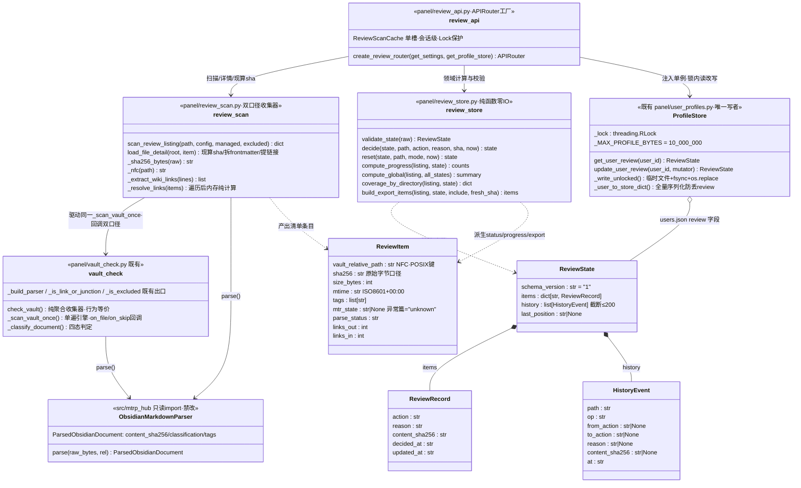
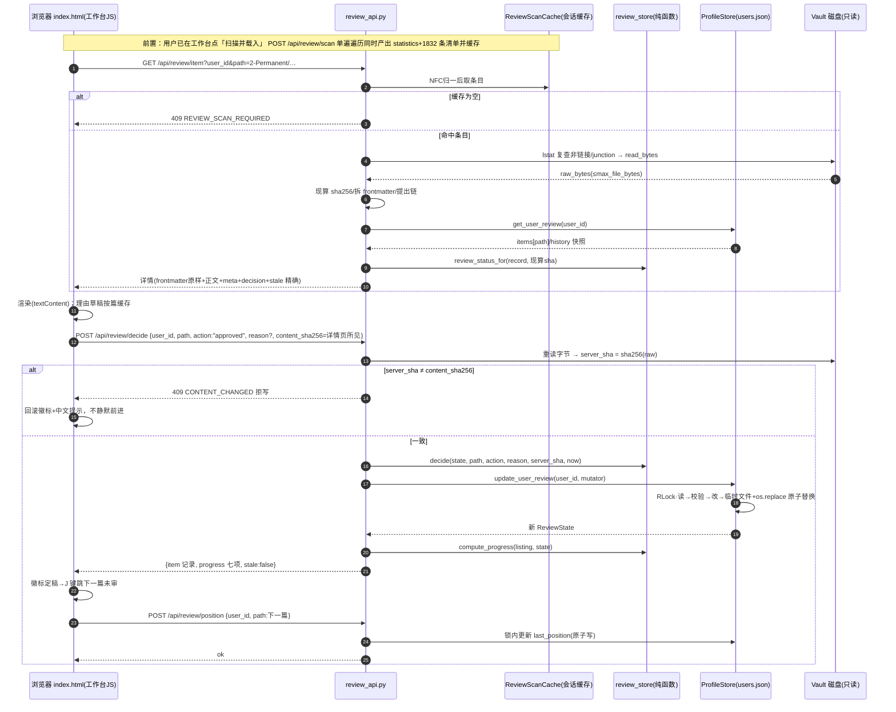
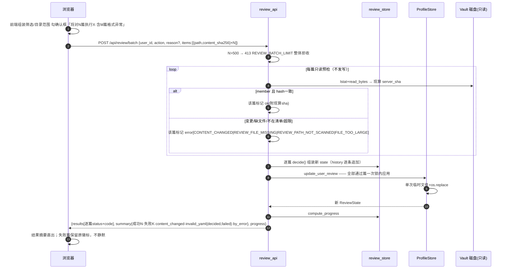
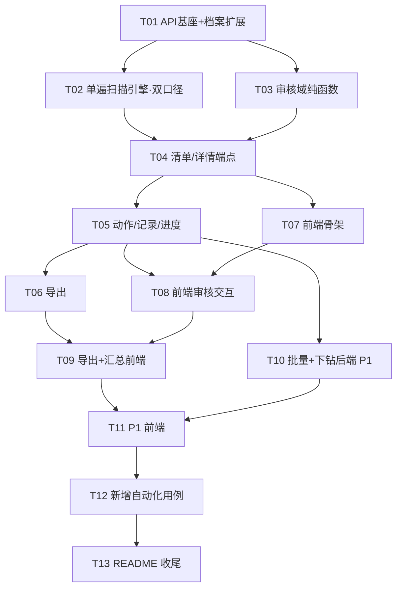

# connect-panel 增量架构设计：Vault→M 库发布前人工审核工作台

> 文档类型：增量架构设计与任务分解（feature `review_workbench`）
>
> 状态：**可实施设计（2026-11-19，高见远，rev.2），寇豆码按 §6 任务表顺序执行**
>
> rev.2 变更：收录 PM 下游定稿追加约束——**逐篇清单与聚合统计必须同一次扫描产出（单遍扫描双口径），禁止扫两遍**（见 §1.1 与共享知识 K14；验收点已进 T02/T12）。
>
> 上游：`apps/connect-panel/docs/prd-review-workbench.md`（已拍板版：队列全体 / 进度分母 = 1832 全部扫描篇；理由可选；跳过=显式搁置独立计数；多用户各自独立 + owner 只读汇总；导出 JSON 主 + CSV 副、默认只导通过集合；12 篇 INVALID_YAML 进队列动作不限）
>
> 上游代码基线：connect-panel v1（43 项 QA 用例两轮全绿；`panel/` 七模块 + 单文件静态前端 + tests fixture server）

---

## 0. 铁边界复述（违反即架构失败，全文有效）

| # | 硬边界 |
|---|---|
| B1 | 只改/增 `apps/connect-panel/` 内文件；`src/mtrp_hub/`、`config/`、`pyproject.toml`、根 `.gitignore` 禁碰（`src/mtrp_hub` 仅允许既有方式的只读 import：`ObsidianMarkdownParser`） |
| B2 | 对 Vault / 乐享零写入：审核动作只写 `apps/connect-panel/data/users.json` 的 `review` 字段；导出文件只写 `data/exports/`（整个 `data/` 已在面板 `.gitignore` 内，不在版本库） |
| B3 | 单文件静态前端：保持 `static/index.html` 单文件自包含，不引入 npm / 构建链 / CDN；JS 继续手写原生化 |
| B4 | 复用既有 FastAPI App（`panel.main:app`），仍仅监听 `127.0.0.1:8765`；统一 `{status, data\|error:{code,message}}` 包裹、封闭错误码、零 traceback 外泄 |
| B5 | v1 的 43 项测试不删不削弱断言；新增用例与之共存同跑全绿 |
| B6 | 中文路径（NFC）、`max_file_bytes=1MB`、`max_scan_files=5000` 沿用 v1 参数与语义 |
| B7 | 正文（body）不落库、不写日志；日志仅记异常类型（沿用 v1 `unexpected_error_handler` 口径） |
| B8 | 所有服务端输出经由 API 返回，不做任何 MCP 调用、不读凭据、不写乐享 |

---

## 1. 实现方案与关键决策

### 1.1 逐篇清单能力：单遍扫描双口径（一次遍历同时产出聚合统计与 1832 条清单）

**现状缺口**：`panel/vault_check.py::check_vault` 只产出聚合统计（`scanned_files / parsed_files / trial_notes / rarely_notes / unmanaged_notes / conflict_notes / error_count / limit_reached` + 最多 20 条 issue 样本），整段目录遍历与逐文件判定都内联在 `check_vault` 函数体里，没有可寻址的逐篇出口。

**方案**：在同文件内向后重构，不动对外行为——

1. 从 `check_vault` 抽出单遍扫描引擎 `vault_check._scan_vault_once(root, managed_parts, excluded_parts, config, trial_tag, rarely_tag, *, on_file, on_skip=None)`：复刻现有 `pending` 栈遍历、`_directory_entries` 排序、`_is_excluded` 前缀排除、`_is_link_or_junction` 链接跳过、`entry.name.lower().endswith(".md")` 过滤与 `max_scan_files` 截断，并保持 v1 的"安全检查 → size 检查 → `read_bytes` → `parser.parse`"逐文件内联顺序不变；对每个进入读取阶段的文件，把**完整事实**打包为 `ScannedFile{relative_posix 原样路径, size_bytes, mtime, content_sha256, tags, classification, parse_status, error_code}` 交给 `on_file` 回调；被排除/链接跳过/目录级异常经 `on_skip(kind)` 上报。**引擎只读盘一遍；两个口径的全部差异都收在回调里。**
2. 抽出 `vault_check._classify_document(document, trial_tag, rarely_tag)`：把 `parsed_files → trial/rarely/unmanaged/conflict` 的四分支判定从主循环提为独立函数（引擎内部调用，聚合与清单同源）。
3. `check_vault` 改为"纯聚合收集器"：`on_file/on_skip` 回调里只做原样的聚合计数与 issue 采样（原逻辑整段搬入回调），**逐分支计数语义与现版本逐行等价**（这是 43 项用例保持全绿的机制保障）；对外 JSON 字节不变。
4. 新模块 `panel/review_scan.py::scan_review_listing(...)` 是"**双口径收集器**"：驱动**同一个** `_scan_vault_once` 引擎，`on_file` 回调里**同时**累加与 check_vault 相同键名的 `statistics{scanned_files, parsed_files, trial_notes, rarely_notes, unmanaged_notes, conflict_notes, error_count, limit_reached}`（v1 同构）并追加逐篇清单条目（NFC 归一在收集时完成）：size 超限 → 条目 `parse_status="FILE_TOO_LARGE"`；`parser.parse` 成功 → `parse_status="ok"`、`mtr_state=parse结果.classification`、`sha256=document.content_sha256`（口径见 K1）；`ValueError(error_code)` → `parse_status=INVALID_YAML|INVALID_ENCODING|…`、`mtr_state="unknown"`。**一次请求、一次遍历，响应里 `statistics` 与 `items[]` 同时到手。**

**自洽机制（P0-01 验收核心）**：清单与统计来自同一批 `on_file` 回调累加，恒等式**按构造成立**，不依赖"两个端口先后扫同一棵树"的事后巧合——

```
同响应内：len(items)                    == statistics.scanned_files   （实测 1832）
清单 mtr_state ∈ {trial,rarely,unmanaged,conflict} 计数之和 == statistics.parsed_files （1820）
清单 parse_status == "ok" 条目数   == statistics.parsed_files （1820）
清单 parse_status != "ok" 条目数   == statistics.error_count 中解析类错误数（12，全 Vault 实测为 INVALID_YAML）
unmanaged 计数（1820）不含 12 篇异常 —— 异常篇 mtr_state="unknown"，不进任何 mtr 分类；两端口互扫恒等式由"同引擎"
直接推论：/api/check/vault 与 /api/review/scan 的 statistics 逐键相等
```

QA 断言升级为两层（fixture vault：6 篇扫描、5 篇可解析、1 篇 INVALID_YAML，trial/rarely/unmanaged/conflict = 1/1/2/1）：(a) `/api/review/scan` **单响应内**逐条恒等式成立；(b) 同 fixture 上 `/api/check/vault` 与 `/api/review/scan` 的 `statistics` 逐键相等（同引擎回归保障）。

**单遍的边界（允许的"内存第二阶段"，不是第二遍扫描）**：`links_in` 解析需要全 vault 路径索引——`on_file` 回调中只把每篇的 wikilink **目标文本**与路径存入内存（不存正文），遍历结束后用内存索引做 `_resolve_links` 纯计算，磁盘 IO 仍然只有一遍；`decide/reset/export` 的按需"现算 sha"是单文件级操作（§1.3），不构成任何全树重扫。

**links_out / links_in**：v1 解析器不产出链接。新增 `review_scan._extract_wiki_links(lines)`（复刻"代码围栏外"规则，同 `ObsidianMarkdownParser.inline_tags_outside_code` 的围栏判定思路），正则抓 `[[目标|显示]]`；`_resolve_links(items)` 建立全vault basename 索引：链接文本先按相对 POSIX 路径整匹配，否则 basename 全局唯一匹配才计 `links_in`，歧义/无匹配仅计 `links_out` 不计反链——该阶段在遍历结束后基于 `on_file` 收集的内存数据做纯计算，**不产生任何二次读盘**。(此为面板侧确定性近似，不承诺与 Obsidian 完全一致，见 §8-2)。INVALID_ENCODING 篇 `links_out/links_in=0`；INVALID_YAML 篇正文可解码，链接照常提取。

**NFC**：`review_scan._nfc(path)` 对每个 `relative_posix` 做 `unicodedata.normalize("NFC", …)` 后才作为清单键。v1 聚合统计**不做**归一（B5 保证 43 项不动）；归一仅存在于 review 域（清单键、记录键、请求路径键）。

### 1.2 审核记录数据结构（users.json `review` 字段）

完整 JSON 示例与字段表在 §4.1；要点：

- 每用户档案新增 `review` 字段：`{schema_version, items, history, last_position}`；`items` 以 NFC 相对路径为键，值为 `ReviewRecord{action, reason, content_sha256, decided_at, updated_at}`；**未审 = 键不存在**（不写空记录），已审 = approved/rejected/skipped 三态之一；撤销/重置 = 删除键 + 追加 history。
- `history` 追加式、截断保留最近 200 条（常量 `REVIEW_HISTORY_LIMIT=200`），事件 `op ∈ {DECIDE, UNDO, STALE_RESET}`。
- 单一写者：`users.json` 只有 `ProfileStore` 持锁写（新增 `update_user_review(user_id, mutator)`/`get_user_review(user_id)`，读-改-写全程在 `threading.RLock` 内，落盘沿用 `_write_unlocked` 的临时文件 + `os.fsync` + `os.replace` 原子替换）。
- 兼容性：旧档无 `review` 字段必须可读（`_parse_user` 把 review 设为可选集）；**所有重建 `raw["users"]` 的写出路径必须走全量序列化器**（新私有 `_user_to_store_dict`，含 review），否则 `create_user/update_preferences/ensure_default` 会静默丢掉审核台账——这是本设计显式标出的高危点，T01 验收覆盖。
- 容量：1832 条记录 × 约 250–700B + 200 条 history ≈ 0.5–1.5MB；因此 `_MAX_PROFILE_BYTES` 从 1,000,000 提升 **10,000,000**（`users.json` 是面板自管文件，量级从"偏好"扩展为"审核台账"必须有此调整；修复口径见 P0-04"损坏即拒绝启动"）。

### 1.3 CONTENT_CHANGED 防护流程（防"基于旧内容拍板"）

所有写动作（单篇 decide / 批量批内每篇）都执行同一三段式：

```
1. 定位        path → NFC 归一 → 拆 "/" 段（拒空段 / "." / ".." / 盘符 / URL / UNC / ADS）
              → 必须是当前扫描清单成员（否则 REVIEW_PATH_NOT_SCANNED）
2. 现算        stat 尺寸（> max_file_bytes → FILE_TOO_LARGE）
              → lstat 复查非 symlink/junction（清单建立后可能被替换）
              → read_bytes 现算 server_sha（原始字节口径）
3. 比对        server_sha == 请求携带的 content_sha256（客户端在详情页/清单里看到的）
              ├─ 一致   → 落记录（记录里存 server_sha）→ 返回新 progress
              └─ 不一致 → 409 CONTENT_CHANGED（拒绝写入，不落任何记录）
```

- 客户端展示的 sha256 由 `GET /api/review/item` **现算返回**（不是扫描缓存值），因此"详情页所见"即审核时刻基线；decide 再独立现算比对，双保险消除"扫描缓存→详情"窗口期的漂移。
- 决定动作成功后**不修改任何 Vault 文件**（QA 全树 hash 前后比对，验收口径 #2）。
- `content_sha256` 是唯一防伪锚点（Q1 拍板 B 方案），不落正文。

### 1.4 STALE 判定流程（内容已变更）

STALE 是**派生态，不落盘**（避免档案与磁盘二次发散），三个判定时机口径分级：

| 时机 | 数据源 | 用途 |
|---|---|---|
| 清单/进度/目录下钻 | 记录 `content_sha256` vs **扫描缓存**条目 `sha256`（快照） | 批量标黄、进度条 `stale` 计数（快照口径，前端提示"基于 HH:MM 扫描"） |
| 打开详情（GET item） | 记录 `content_sha256` vs **现算** `sha256` | 详情页黄色提示条 + "重新审核"（精确） |
| 导出（export） | approved 集合逐篇**现算**复核 | 不一致即剔除出 `items[]`（计入 `excluded_stale`）（收敛，PRD 验收 #4） |

伪代码（`review_store` 纯函数，无 IO）：

```python
def review_status_for(record: ReviewRecord | None, current_sha: str) -> str:
    if record is None:
        return "pending"
    if record.content_sha256 != current_sha:
        return "stale"          # 原动作保留展示（record.action），但不计入已审、不进导出
    return record.action         # approved / rejected / skipped
```

状态机遵循 PRD §5.4：`stale --「重新审核」--> pending`，由 `POST /api/review/reset {mode:"stale_reset"}` 执行：删除 items 键 + 追加 `HistoryEvent{op:"STALE_RESET", from:"<原动作>", to:null, content_sha256:记录旧sha}`。"撤销"（`mode:"undo"`）同构，仅 history op 不同（`UNDO`）。两者都把该篇重新计入 `pending`。

**补充裁决（PRD 未覆盖）**：扫描范围之外的历史记录（文件被删除/移出后重扫）——记录保留在档案中、records 接口可见、可撤销，但**不计入七项进度计数**（分母恒为当前扫描总数；脱队记录不掺水分子）。

### 1.5 批量操作策略

- 上限：请求 `items` 数 > 500 → 整体拒收 `REVIEW_BATCH_LIMIT`（413），客户端分批；不做隐式截断（确定性优于聪明）。
- 范围：后端只收到显式 `items:[{path, content_sha256}]` 清单（前端"按当前目录 / 按当前筛选结果"在客户端组装后提交），每篇携带所见 sha256。
- 每篇独立走 §1.3 三段式：`server_sha` 不匹配 → 该篇单列失败 `CONTENT_CHANGED`，**其余照常落记录**；路径不在清单 → `REVIEW_PATH_NOT_SCANNED` 单列。部分失败如实逐篇报告，绝不吞错、绝不做"一条汇总记录"。
- 12 篇 INVALID_YAML 按拍板可批量（动作不限），`summary.invalid_yaml` 单列其成功/失败数；确认层文案由前端给出（"将对 N 篇执行X，其中含 M 篇格式异常"）。
- 落盘节奏：**一次锁内批量应用**（单次读-改-写 + 一次原子替换），history 逐篇追加；响应含 `results[]` 逐篇状态 + `summary` + 增量后 `progress`。写失败 → `PROFILE_WRITE_FAILED`，档案保持旧貌（原子替换保证不半损）。

### 1.6 导出物 schema

**JSON 主**（文件 `data/exports/review-<user_id>-<YYYYMMDD-HHMMSS>.json`；同秒重名追加 `-2`）：

```json
{
  "schema_version": "1",
  "exported_at": "2026-11-19T12:00:00.000000+00:00",
  "user_id": "default",
  "vault_id": "3f9a1c…（sha256(resolved vault root 绝对路径) 前 16 hex，稳定标识）",
  "scope": {
    "vault_root": "C:/…/Obsidian Vault",
    "managed_roots": ["2-Permanent"],
    "excluded_roots": ["2-Permanent/Resources/MTR-P-System", "2-Permanent/Areas/AI-Assets/_templates"],
    "scanned_at": "2026-11-19T11:58:02.000000+00:00",
    "total_scanned": 1832,
    "include": "approved"
  },
  "counts": { "exported_items": 121, "approved_total": 124, "excluded_stale": 3, "scope_note": "items 仅含 approved 且当前内容 hash 复核一致" },
  "items": [
    {
      "vault_relative_path": "2-Permanent/Areas/xxx.md",
      "action": "approved",
      "reason": "纯素材目录",
      "content_sha256": "3f9a…64hex",
      "decided_at": "2026-11-19T09:00:00.000000+00:00",
      "decided_by": "default",
      "mtr_state": "unmanaged",
      "tags": ["note/seed"],
      "parse_status": "ok",
      "size_bytes": 2150,
      "mtime": "2026-11-12T06:03:00.000000+00:00"
    }
  ]
}
```

- `include=approved`（默认）：仅 `action=approved` **且**导出时现算 hash 与记录一致（剔除进 `excluded_stale`）。
- `include=all`（复盘版）：全部已决篇（approved/rejected/skipped），每项额外字段 `"stale": true|false`（现算复核结果），同样保留 `excluded_stale` 计数字段（值为 0，仅 approved 语义下有剔除）。
- `decided_by=user_id`；导出只读 Vault、只写 `data/exports/`。

**CSV 副**（同名 `.csv`，UTF-8 with BOM 便于 Excel 打开中文，CRLF，逗号分隔，字段按 RFC4180 引号转义）：列 = `vault_relative_path, action, reason, content_sha256, decided_at, decided_by, mtr_state, tags(;连接), parse_status, stale, size_bytes, mtime`（默认导出 `stale` 列恒 `false`）。**行数 == JSON `items[]` 长度**（QA 验收 #5）。

**保留策略**：PRD §6"保留最近 20 份，更早的由人工清理，不自动删除"——设计取**零删除逻辑**（不自动删任何导出文件），见 §8-3 待确认。

### 1.7 扫描缓存策略（会话内复用）

- 进程内单槽 `ReviewScanCache`（`review_api` 工厂闭包持有，`threading.Lock` 保护）：内容 = listing items 列表 + NFC 键索引 `{path: item}` + 扫描参数（resolved root / managed / excluded）+ `scanned_at` 时间戳 + `limit_reached`。
- 语义：`POST /api/review/scan` 总是全量重扫并**替换**缓存；`GET /api/review/listing|item|decide|batch|position|progress|export` 均读缓存，**缓存为空 → 409 `REVIEW_SCAN_REQUIRED`**（错误消息引导"扫描并载入待审清单"）。console 进程重启即清空，不持久化。
- 不做键值分缓存：扫描是用户无关的（仅 `path` 覆盖项来自用户偏好），切换用户**不重扫**，前端切用户只需重拉 `records`/`progress` 做覆盖层。扫描参数以最近一次为准（单机单人工具，序列化无必要）。
- PRD §5.1 硬要求满足：进 tab 不自动扫描；顶栏展示 `scanned_at`（"基于 HH:MM 的扫描结果"）。
- 除法与进度恒等式：分母 = `listing.total`（实测 1832；B6 下 `max_scan_files=5000` 不会截断真实 Vault；命中上限时 `limit_reached=true` 且前端强提示"清单不完整，分母非全集"）。

### 1.8 模块裁决：`review_api` 独立，**不并入** `main.py`

**裁决：新建 `panel/review_api.py`，经 APIRouter 工厂 `create_review_router(get_settings, get_profile_store)` 注入依赖，`main.py` 仅 3 行接线（import + include_router）。**

理由：

1. **体量**：审核域 10 个端点 + 8 个 pydantic 模型 + 扫描缓存类 ≈ 300+ 行，并入后 `main.py` 超 700 行、两个特性域混流，评审与回溯成本显著上升。
2. **v1 面零扰动**：main.py 的中间件 / 异常处理器 / 既有路由一字不动（除改引用 api_common），43 项用例依赖的 HTTP 契约无被触碰的机会；APIRouter 挂到同一 app 后，security_headers、PanelError→封闭错误、422 校验器等中间层对 router 路由全量生效，安全规范自动继承。
3. **单锁不破坏**：注释点——工厂必须**注入** `main.py` 的 `lru_cache` 单例 `get_profile_store`，绝不可在 review_api 内自建 `ProfileStore(...)`（会产生两个锁两份写者，原子性即失效）。工厂注入是无循环依赖（review_api 不 import main）的唯一干净解。
4. **配套抽取**：`_ok/_error/StrictRequest/_USER_ID_PATTERN` 上提 `panel/api_common.py`（约 40 行），main 与 review_api 共用统一包裹与严格模型单一事实源，避免"两套包裹"漂移。

---

## 2. 文件清单

新增（5 个代码/测试文件 + 本文档）：

| 文件 | 职责 |
|---|---|
| `panel/api_common.py` | 共享 API 基座：`StrictRequest`（extra=forbid）、`ok(data)` / `error(code,message)` 包裹、`USER_ID_PATTERN` 常量 |
| `panel/review_scan.py` | 双口径收集器：`scan_review_listing()`（单遍扫描同时产出 statistics+items）、`_sha256_bytes`、`_nfc`、`_extract_wiki_links`、`_resolve_links`（遍历后内存纯计算）、`load_file_detail()`（单篇详情现算） |
| `panel/review_store.py` | 审核域纯函数（零 IO）：`validate_state` / `decide` / `reset` / `compute_progress` / `compute_global` / `build_export_items` / `coverage_by_directory`；常量 `REVIEW_HISTORY_LIMIT=200`、`REVIEW_REASON_MAX_CHARS=500` |
| `panel/review_api.py` | 审核 APIRouter 工厂 + `ReviewScanCache` + 端点实现 + pydantic 请求模型 |
| `tests/test_review_workbench.py` | 新增验收用例（P0×9 全覆盖 + P1 核心；与 43 项同跑） |
| `docs/architecture-review-workbench.md` | 本设计文档 |

修改（6 个）：

| 文件 | 修改内容 |
|---|---|
| `panel/vault_check.py` | 抽出单遍扫描引擎 `_scan_vault_once()`（on_file/on_skip 回调）与 `_classify_document()`；`check_vault` 改为纯聚合收集器（原计数逻辑整段入回调），行为逐字节等价；公开给 review_scan 复用的既有出口不变（`_normalise_roots`、`_resolve_roots_within_vault`、`_is_link_or_junction`、`_build_parser`） |
| `panel/user_profiles.py` | `UserProfile` 增可选 `review`；`_parse_user` 容忍缺 review 的旧档 + 深校验交 review_store 访问时执行；新增全量序列化器 `_user_to_store_dict`（所有 `raw["users"]` 重建点改用，防丢台账）；新增 `get_user_review` / `update_user_review`（锁内读改写 + `_write_unlocked` 原子替换）；`_MAX_PROFILE_BYTES` 1MB→10MB |
| `panel/main.py` | `_ok/_error/StrictRequest` 改引 api_common（对外响应不变）；import 并 `app.include_router(create_review_router(get_settings, get_profile_store))` |
| `static/index.html` | 新增审核工作台 tab + 双栏 UI + 全部工作台 JS（单文件保持） |
| `tests/conftest.py` | teardown 增 `data/exports/` 套件产物清理；基线快照不变 |
| `tests/qa_support.py` | 新增 `EXPORTS_DIR` 常量（如需）与导出文件计数 helper；既有 helper 不动 |

不改动：`panel/settings.py`（无新配置项，限额/截断/批量上限均为 review 域常量，避免主仓 config 面）、`panel/audit_reader.py`、`panel/lexiang_check.py`、`panel/github_check.py`、`panel/git_local_check.py`、`run_panel.py`（端口绑定不动）、`requirements.txt`（零新依赖，全部标准库 + 既有 venv：fastapi/uvicorn/ruamel/pydantic/`mtrp_hub` parser）。

---

## 3. API 契约表

通用约定：写动作用 POST（v1 风格）；全部响应走 `{status, data}` / `{status, error:{code,message}}` 包裹；`user_id` 校验沿用 `^[a-z0-9-]{1,32}$`；未列出错误码继承 v1（`REQUEST_VALIDATION_FAILED` 422、`PANEL_INTERNAL_ERROR` 500、`USER_NOT_FOUND` 404、`PROFILE_STORE_INVALID/PROFILE_READ_FAILED/PROFILE_WRITE_FAILED` 503/500 语义不变）。

### 3.1 端点表

| # | 方法+路径 | 请求体 / 查询 | 成功响应关键字段（data 内） | 错误码（本端点新增/专用） |
|---|---|---|---|---|
| 1 | `POST /api/review/scan` | body `{user_id?, path?, managed_roots?, excluded_roots?}`（path 语义同 `VaultCheckRequest`，支持 fixture 供 QA） | `scanned_at, path, managed_roots, excluded_roots, status(ok\|limited\|error), limit_reached, statistics{scanned_files, parsed_files, trial_notes, rarely_notes, unmanaged_notes, conflict_notes, error_count, limit_reached}(v1 同键·单遍同时产出), total, counts{parsed_ok, invalid, file_too_large, mtr{trial,rarely,unmanaged,conflict}}, items[ReviewItem]`（statistics 与 items 出自同一次遍历） | 继承 v1 扫描族：`ROOT_INVALID / ROOT_MUST_BE_RELATIVE / ROOT_DRIVE_RELATIVE_REJECTED / ROOT_TRAVERSAL_REJECTED / TOO_MANY_ROOTS / MANAGED_ROOT_REQUIRED / VAULT_RESOLVE_FAILED / VAULT_LINK_REJECTED / ROOT_RESOLVE_FAILED / ROOT_OUTSIDE_VAULT`；engine 无 parser 时整体置 `status:"error"` + `error{code: PARSER_UNAVAILABLE}`（沿 `/api/check/vault` 风格） |
| 2 | `GET /api/review/listing` | query `—` | `scanned_at, total, limit_reached, counts, items[ReviewItem]`（含每篇 `sha256` 快照） | `REVIEW_SCAN_REQUIRED(409)` |
| 3 | `GET /api/review/item` | query `user_id, path` | `item{..., sha256(现算)}, frontmatter{raw, entries[{key,value,value_type}], parse_status}, body{text}, links{out,in}, decision{action,reason,decided_at}\|null, stale(精确现算), read_only:true`；INVALID_YAML 篇 `frontmatter.raw` 原文 + `entries=[]`，body 照常预览 | `REVIEW_SCAN_REQUIRED(409)`, `REVIEW_PATH_INVALID(400)`, `REVIEW_PATH_NOT_SCANNED(404)`, `REVIEW_FILE_MISSING(404)`, `FILE_TOO_LARGE(413)` |
| 4 | `POST /api/review/decide` | body `{user_id, path, content_sha256, action(approved\|rejected\|skipped), reason?}` | `item:ReviewRecord(新值), progress{…七项}, stale:false` | `REVIEW_SCAN_REQUIRED(409)`, `REVIEW_PATH_INVALID(400)`, `REVIEW_PATH_NOT_SCANNED(404)`, `REVIEW_FILE_MISSING(404)`, `FILE_TOO_LARGE(413)`, **`CONTENT_CHANGED(409)`** |
| 5 | `POST /api/review/reset` | body `{user_id, path, mode(undo\|stale_reset)}` | `reset:true, removed:ReviewRecord(前值), history_tail[该条], progress` | `REVIEW_SCAN_REQUIRED`, `REVIEW_PATH_INVALID`, `REVIEW_PATH_NOT_SCANNED`, `REVIEW_ITEM_NOT_DECIDED(404，本篇无在档记录)` |
| 6 | `GET /api/review/records` | query `user_id, history_limit?(1–200,默认 50)` | `schema_version:"1", items{path→ReviewRecord}, history[HistoryEvent 逆序], last_position` | 无专用（`USER_NOT_FOUND` 沿用） |
| 7 | `POST /api/review/position` | body `{user_id, path\|null}` | `last_position` | `REVIEW_SCAN_REQUIRED`, `REVIEW_PATH_INVALID`, `REVIEW_PATH_NOT_SCANNED` |
| 8 | `GET /api/review/progress` | query `user_id, view(summary\|directory,默认 summary)` | summary：`total, scanned_at, user{reviewed, approved, rejected, skipped, pending, stale, invalid, pass_rate}, global{approved, rejected, skipped, diverged, pending, per_user[{user_id,counts}], conflicts[], conflicts_truncated}`；directory：另含 `directories{dir→{total, reviewed, approved, rejected, skipped, pending, stale, invalid}}` | `REVIEW_SCAN_REQUIRED(409)` |
| 9 | `POST /api/review/batch` | body `{user_id, action(approved\|rejected\|skipped), reason?, items[{path, content_sha256}]}` | `results[{path, status(ok\|error), code?, item?}], summary{total, succeeded, failed, content_changed, invalid_yaml{decided, failed}, by_error{code→n}}, progress` | `REVIEW_BATCH_LIMIT(413，items>500 整体拒收)`, 批内路径类错误逐篇单列（`REVIEW_PATH_NOT_SCANNED/CONTENT_CHANGED/REVIEW_FILE_MISSING/FILE_TOO_LARGE`） |
| 10 | `POST /api/review/export` | body `{user_id, include(approved\|all，默认 approved), dry_run?(默认 false)}` | dry_run：`preview{items_count, excluded_stale, include}`；正式：`files{json:"data/exports/xxx.json", csv:"…csv"}, counts{exported_items, excluded_stale}, exported_at` | `REVIEW_SCAN_REQUIRED(409)`, `EXPORT_WRITE_FAILED(500)`（写入失败原档案不损，exports 目录不残留半文件——临时名+替换） |

### 3.2 新增封闭错误码登记（10 个；命名风格对齐 v1 全大写下划线）

| 错误码 | HTTP | 语义 |
|---|---|---|
| `REVIEW_SCAN_REQUIRED` | 409 | 会话内尚无扫描缓存，先进工作台"扫描并载入" |
| `REVIEW_PATH_INVALID` | 400 | 路径含逃逸段/绝对/URL/UNC/盘符/ADS（v1 安全族的具体化） |
| `REVIEW_PATH_NOT_SCANNED` | 404 | 路径不在当前扫描清单中（NFC 归一后仍未命中） |
| `REVIEW_FILE_MISSING` | 404 | 清单有、磁盘已消失 |
| `REVIEW_ITEM_NOT_DECIDED` | 404 | 撤销/重置目标本无在档记录 |
| `CONTENT_CHANGED` | 409 | 客户端所见 sha256 ≠ 服务端现算（拒绝写入，PRD 验收 #6） |
| `FILE_TOO_LARGE` | 413 | 超 `max_file_bytes` 拒读全量（复用 v1 issue 码名，升级为 HTTP 错误码；清单条目内则作为 `parse_status` 值） |
| `REVIEW_BATCH_LIMIT` | 413 | 批量超 500，整体拒收要求分批 |
| `REVIEW_RECORD_INVALID` | 503 | 读取到的 review 结构损坏（拒绝操作、不静默重建，对齐 `PROFILE_STORE_INVALID` 风格） |
| `EXPORT_WRITE_FAILED` | 500 | 导出文件写盘失败（临时文件清理，不留半文件） |

---

## 4. 数据结构

### 4.1 users.json 扩展后完整示例（含 review 嵌套）

```json
{
  "schema_version": "1",
  "users": [
    {
      "user_id": "default",
      "display_name": "本机默认用户",
      "role": "owner",
      "preferences": {
        "vault_root": "C:/Users/Administrator/Nutstore/1/我的坚果云/Obsidian Vault",
        "git_local_path": "E:/ASoftwareManage/Agithub/MTR-P-hub",
        "github_repos": [{"owner": "xxx", "repo": "yyy"}],
        "auto_refresh_minutes": 0
      },
      "review": {
        "schema_version": "1",
        "items": {
          "2-Permanent/Areas/AI-Assets/种子库.md": {
            "action": "approved",
            "reason": "纯素材，格式正常",
            "content_sha256": "3f9a1c7e…（64 hex，原始文件字节口径）",
            "decided_at": "2026-11-19T09:00:00.000000+00:00",
            "updated_at": "2026-11-19T09:00:00.000000+00:00"
          },
          "2-Permanent/Projects/草稿.md": {
            "action": "rejected",
            "reason": "含未核实的内部坐标",
            "content_sha256": "a1b2…",
            "decided_at": "2026-11-19T09:05:00.000000+00:00",
            "updated_at": "2026-11-19T10:12:00.000000+00:00"
          },
          "2-Permanent/Areas/旧记录.md": {
            "action": "skipped",
            "reason": "先搁置，等目录整理结论",
            "content_sha256": "c3d4…",
            "decided_at": "2026-11-19T11:00:00.000000+00:00",
            "updated_at": "2026-11-19T11:00:00.000000+00:00"
          }
        },
        "history": [
          {"path": "2-Permanent/Areas/AI-Assets/种子库.md", "op": "DECIDE", "from": null, "to": "approved", "reason": "纯素材，格式正常", "content_sha256": "3f9a…", "at": "2026-11-19T09:00:00.000000+00:00"},
          {"path": "2-Permanent/Projects/草稿.md", "op": "DECIDE", "from": null, "to": "rejected", "reason": "初判拒绝", "content_sha256": "a1b2…", "at": "2026-11-19T09:05:00.000000+00:00"},
          {"path": "2-Permanent/Projects/草稿.md", "op": "DECIDE", "from": "rejected", "to": "rejected", "reason": "含未核实的内部坐标", "content_sha256": "a1b2…", "at": "2026-11-19T10:12:00.000000+00:00"},
          {"path": "2-Permanent/Areas/备忘.md", "op": "UNDO", "from": "approved", "to": null, "reason": null, "content_sha256": "ff01…", "at": "2026-11-19T10:30:00.000000+00:00"},
          {"path": "2-Permanent/Areas/备忘.md", "op": "STALE_RESET", "from": "approved", "to": null, "reason": null, "content_sha256": "ff01…", "at": "2026-11-19T10:31:00.000000+00:00"}
        ],
        "last_position": "2-Permanent/Areas/归档/下篇.md"
      }
    },
    {
      "user_id": "u-abc123",
      "display_name": "第二审核人",
      "role": "editor",
      "preferences": { "…": "同上，各用户独立" },
      "review": {"schema_version": "1", "items": {}, "history": [], "last_position": null}
    }
  ]
}
```

字段表（关键约束）：

| 层级 | 字段 | 类型/约束 | 说明 |
|---|---|---|---|
| review | `schema_version` | `"1"` | review 域自身版本，独立于档案顶层 `"1"` |
| review | `items` | `dict< NFC相对路径, ReviewRecord>` | **键 = `vault_relative_path`（NFC、POSIX 分隔）**；未审即无键；撤销/重置删键 |
| ReviewRecord | `action` | `approved\|rejected\|skipped` | 三动作互斥、可改判（以最后为准） |
| ReviewRecord | `reason` | `str ≤500 字符` | 可选（Q2 拍板），空串与缺省等价存 `""` |
| ReviewRecord | `content_sha256` | 64 hex | 拍板时服务端现算原始字节口径 |
| ReviewRecord | `decided_at` / `updated_at` | ISO8601 带 `+00:00` | decided_at=当前动作生效时刻（改判刷新）；updated_at=最后写时刻 |
| review | `history` | `list<HistoryEvent>` ≤200 | 追加式；超出丢最旧（环形截断），每条 `at` 保证可回查 |
| HistoryEvent | `op` | `DECIDE\|UNDO\|STALE_RESET` | 事件命名沿 PRD 文案大写风 |
| review | `last_position` | NFC 相对路径 \| null | P1-05 续审锚点；指向扫描内路径，失效（重扫后不在清单）时前端回退到首篇并提示 |

### 4.2 类图



---

## 5. 时序图

### 5.1 单篇审核全流程（读详情 → 拍板 → 落账 → 前进）



### 5.2 批量审核流程（确认 → 逐篇校验 → 单锁落账 → 如实汇总）



---

## 6. 任务分解（T01–T13，寇豆码按序串行执行）

规模控制：P0 九条全覆盖于 T01–T09、T12；P1 五条收拢进 T10（后端）+ T11（前端）两个任务，排 P0 后、不挤占。

### 6.1 任务表

| ID | 优先级 | 任务名 | 文件（相对 `apps/connect-panel/`） | 做什么 | 依赖 | 验收（一句） |
|---|---|---|---|---|---|---|
| **T01** | P0 | 共享 API 基座 + 档案层 review 扩展 | 新 `panel/api_common.py`；改 `panel/main.py`、`panel/user_profiles.py` | 抽取 StrictRequest/包裹/USER_ID_PATTERN 并让 main 改引用（对外响应字节不变）；UserProfile 增可选 review、`_user_to_store_dict` 全量序列化替换所有 `raw["users"]` 重建点、`get_user_review/update_user_review`（锁内读改写复用 `_write_unlocked`）、`_MAX_PROFILE_BYTES→10MB` | —（起点） | 旧档（无 review）可读写；写后 review 全量回写不丢；43 项同跑全绿 |
| **T02** | P0 | 单遍扫描引擎（双口径） | 改 `panel/vault_check.py`；新 `panel/review_scan.py` | `check_vault` 抽出单遍引擎 `_scan_vault_once`(on_file/on_skip) + `_classify_document` 并改为纯聚合收集器（行为等价）；`scan_review_listing` 以双口径收集器驱动同一引擎：**一次遍历**同时产出 v1 同键 statistics 与 1832 条清单（NFC 键、sha256 原始字节口径、tags/mtr_state/parse_status、FILE_TOO_LARGE 条目、异常篇 mtr_state="unknown"、wikilink 出/反链——遍历后内存纯计算不二次读盘） | T01 | fixture 上 `/api/review/scan` **单响应内** len(items)==scanned_files(6)、5+1 分类恒等式成立，且其 statistics 与 `/api/check/vault` 逐键相等、invalid-yaml 篇 `parse_status=INVALID_YAML 且 mtr_state="unknown"`；43 项全绿 |
| **T03** | P0 | 审核域纯函数库 | 新 `panel/review_store.py` | ReviewState/HistoryEvent 校验器、decide/reset、compute_progress（七项+通过率）、compute_global（含分歧）、coverage_by_directory、build_export_items（stale 剔除/标注）、历史 200 截断、reason 500 上限 | T01 | 样例输入输出与 §4.1 示例逐字段一致（工程师自查清单交付 T12 固化为用例） |
| **T04** | P0 | 清单/详情只读端点 + 扫描缓存 | 新 `panel/review_api.py`；改 `panel/main.py`(include_router 3 行) | APIRouter 工厂注入 get_settings/get_profile_store（禁自建实例）；实现 scan/listing/item 三端点 + 单槽 ReviewScanCache；单篇详情现算 sha/frontmatter 原样/链接/用户 decision/精确 stale | T02, T03 | 三端点响应与 §3.1 契约一致；空缓存 409 REVIEW_SCAN_REQUIRED；`../` 与越根路径 400；INVALID_YAML 篇可按原文预览；正文不出现在任何日志 |
| **T05** | P0 | 审核动作 + 记录 + 进度端点 | 改 `panel/review_api.py` | decide（三段式 sha 防护→锁内 decide→progress 回传）、reset（undo/stale_reset→history 落 STALE_RESET）、records、position、progress(summary + global 分歧只读) | T04 | 篡改文件后 decide 返回 409 CONTENT_CHANGED 且档案无写入；两用户各自记录互不影响、progress 切换用户即时变化、分歧篇进 global.conflicts；撤销后回 pending 且 history 含 UNDO 前值 |
| **T06** | P0 | 导出端点 | 改 `panel/review_api.py` | export：dry_run 预览（N 篇·已排除 X 篇 stale）；正式导出 approved 默认（逐篇现算复核剔除 stale）/include=all 复盘版；JSON+CSV 同 stem 成对落 `data/exports/`（运行时 mkdir），文件名含 UTC 时间戳 | T05 | JSON 可按 schema_version 独立解析字段无缺；CSV 行数==items 长度；已篡改的通过篇不进 items 且计入 excluded_stale；导出过程 Vault 零写 |
| **T07** | P0 | 工作台前端骨架 | 改 `static/index.html` | 顶部双 tab（四库状态默认）、进度条 sticky（含分项+异常+已变更计数）、左列表（目录树/扁平切换、目录节点已审/总数、NFC 路径排序）右详情双栏（<1100px 退化覆盖式）、状态过滤器（命中 N/总数）、扫描载入按钮+「基于 HH:MM」提示；全部 textContent | T04 | 手动：tab 切换不自动扫描；列表=清单全体且过滤计数与实际行数一致；无任何 CDN/构建产物 |
| **T08** | P0 | 前端审核交互闭环 | 改 `static/index.html` | 详情面板（只读徽标、frontmatter 折叠表、受限 Markdown 子集渲染器+原文切换——先转义后白名单建 DOM）、理由框（拒绝时自动展开聚焦、按篇草稿缓存）、A/R/S/U + J/K 键盘（焦点保护）、乐观更新失败回滚不静默前进、STALE 黄条+重新审核、续审按钮（last_position） | T05, T07 | 手动：键盘流 J→A 连续过审无鼠标；React 式回滚：断网/409 时徽标复原并出封闭错误中文说明；焦点在输入框时按键不触发 |
| **T09** | P0 | 导出 + 全局汇总前端接线 | 改 `static/index.html` | 导出按钮：预览（含排除数）→确认→生成→文件名+复制路径；汇总视图（只读）：四项计数 x/分母 + 按用户分解 + 分歧标记 | T06, T08 | 手动：汇总视图不可改他人结论；导出后 files 路径可直接在资源管理器定位 |
| **T10** | P1 | 批量 + 进度下钻后端 | 改 `panel/review_api.py` | batch 端点（≤500 整拒、逐篇预检、单锁批量落账、逐篇 results+summary 含 invalid_yaml 单列、progress?view=directory 覆盖率表） | T05 | fixture 级用例：501 篇 413；混合批（1 篇篡改+1 篇缺文件+N 篇正常）逐篇如实、正常篇已落账；含 invalid-yaml 篇的批 summary.invalid_yaml 正确 |
| **T11** | P1 | P1 前端全家桶 | 改 `static/index.html` | 批量入口（按当前目录/按筛选结果）+二次确认层（N 篇·含 M 篇格式异常）+结果摘要；文件名/路径即时搜索（本地过滤）；格式异常专区一键筛；覆盖率仪表（目录下钻表+异常分布+最近 20 条动作时间线，路径+动作不显正文） | T09, T10 | 手动：批量含 12 篇异常时的确认文案与摘要单列正确；搜索支持中文子目录片段、空结果明确提示 |
| **T12** | P0+P1 | 新增自动化验收用例 | 新 `tests/test_review_workbench.py`；改 `tests/conftest.py`、`tests/qa_support.py` | P0-01…09 与 P1-01/04/05 全部建用例（fixture vault 硬编码预期：6/5/1、trial/rarely/conflict/unmanaged=1/1/1/2）；**单遍历双口径两层断言**（(a) review/scan 单响应内恒等式；(b) 与 check/vault statistics 逐键相等）；交叉断言清单×聚合自洽；路径逃逸/CONTENT_CHANGED/原子写失败不损档（USER 目录写失败注入）/STALE 剔除导出/批量部分失败/多用户隔离与分歧/records 键为 NFC；teardown 清 exports | T11（功能全量就绪） | 新旧全部用例同跑全绿（43+N≥…），PRD §8 六条验收逐条可指认 |
| **T13** | P0 | 文档与收尾 | 改 `README.md`；必要时同步本设计文档状态 | README 增补：审核工作台能力口径、错误码表、API 概览、导出格式说明、data/exports 说明；PRD §8 验收六条对照留档 | T12 | README 与实现一致；全绿状态截屏/记录回传主理人 |

### 6.2 任务依赖图



依赖链一句话：T01 →（T02‖T03）→ T04 → T05 → T06/T07/T08 汇于 T09，T10 与 T09 汇于 T11 → T12 → T13；全程可纯串行执行。

---

## 7. 共享知识（跨文件约定，寇豆码与严过关共同遵守）

| # | 约定 |
|---|---|
| K1 | **sha256 口径（定死）**：`sha256(原始文件字节)`——含 BOM、含 CRLF 等一切字节原样。与 `src/mtrp_hub/adapters/obsidian_markdown.py::ObsidianMarkdownParser.parse` 产出的 `content_sha256` 完全同源（`sha256_bytes(raw_bytes)`），因此清单条目 sha 可直接复用解析器结果，STALE/CONTENT_CHANGED/导出复核三处同一函数，不得出现第二种口径（例如"解码后重编码"） |
| K2 | **NFC**：review 域一切路径键（清单条目键、users.json items 键、请求 path 查找键、导出行、last_position）一律 `unicodedata.normalize("NFC", …)` + POSIX `/` 分隔；服务端收到请求先归一再查。v1 聚合统计不做归一（B5） |
| K3 | **动作与状态命名**：记录 `action ∈ approved/rejected/skipped`，未审=记录不存在；history `op ∈ DECIDE/UNDO/STALE_RESET`（大写，对齐 PRD 文案）；派生态 `pending/stale` 不落盘 |
| K4 | **时间戳**：一律 `datetime.now(timezone.utc).isoformat()`（UTC `+00:00`，与 v1 `generated_at` 同式），不使用本地时区字符串 |
| K5 | **包裹与错误**：`{status, data}` / `{status, error:{code,message}}`；错误码全大写下划线封闭枚举（§3.2 登记 10 新码）；业务错误抛 `PanelError(code, message, http_status)`；零 traceback；日志只记异常类型名 |
| K6 | **唯一写者**：`users.json` 仅 `ProfileStore` 实例（main 的 `lru_cache` 单例）持锁写；review_api 通过注入引用该单例，绝不再 new；所有重建 `raw["users"]` 的路径必须用 `_user_to_store_dict` 全量序列化 |
| K7 | **requestBody**：全部 POST 模型继承 `StrictRequest`（extra=forbid）；`user_id` 用 `^user_id` 模式校验；`reason ≤ 500` 字符；batch `items ≤ 500` 条（元素逐一 pydantic 校验）；`include/appearance` 用 `Literal` |
| K8 | **Vault 只读**：任何 review 代码路径不得出现对 Vault 的 open(w)/write/delete/rename/tempfile；详情正文与 frontmatter 只随响应返回，不落库不进日志 |
| K9 | **导出**：仅写 `apps/connect-panel/data/exports/`；文件名 `review-<user_id>-<YYYYMMDD-HHMMSS>(-n?).(json|csv)`；写盘"临时名+os.replace"；**不做任何自动删除**（PRD"不自动删除"口径，见 §8-3） |
| K10 | **扫描缓存**：进程内单槽、会话级、不持久化；空缓存一律 409 `REVIEW_SCAN_REQUIRED`；`limit_reached=true` 时前端必须强提示分母不完整 |
| K11 | **进度口径（唯一）**：分母 = 清单 total（实测 1832 = 1820 可解析 + 12 异常，异常篇在队列、单独计数、动作不限）；已审 = approved+rejected+skipped；通过率 = approved ÷ 已审（已审=0 时 null）；stale 单列不并已审不减分母；脱队记录不计七项计数 |
| K12 | **前端安全**：一切动态文本 `textContent` / 白名单 DOM 构造；Markdown 渲染先 HTML 转义再按受限子集构建；无 emoji、无 CDN、无外部字体；键盘监听全局单点注册并做焦点守卫 |
| K13 | **B6 参数**：`max_file_bytes=1_048_576`、`max_scan_files=5000` 沿用 settings；review 域常量（HISTORY 200 / REASON 500 / BATCH 500）定义在 `review_store.py` 模块头，不进 config |
| K14 | **单遍扫描双口径（一等公民约束）**：聚合统计与逐篇清单必须出自**同一次遍历**（`_scan_vault_once` 引擎 + on_file 回调同时累加两个口径），禁止任何"先聚合后清单"的两遍扫描实现——两次遍历间 Vault 可能被 Nutstore 同步改动，会产生互不自洽的窗口，且 1832 篇白耗一倍时间。允许的例外仅两类：(a) 遍历后基于内存索引的纯计算（links_in）；(b) 单文件级现算（详情/decide/export 的 sha 复核），它们不构成全树重扫 |

---

## 8. 待明确事项（给主理人 / 雷爹，均不阻塞 T01–T05 开工）

| # | 事项 | 我的建议 |
|---|---|---|
| 1 | **PRD 内部数字残留**：P0-05 写"分母…（实测 1820）"、§5.2 草图"已审 137 / 1820"，与 §1.3 拍板"分母 = 1832（唯一口径）"冲突。两处应为 Q6 拍板前的旧数字未同步。 | 按拍板版 §1.3 执行：**分母 = 1832**（含 12 篇异常、单独计数），P0-05/5.2 的 1820 由许清楚在 PRD 勘误后自然消失；架构与实现均按 1832，QA 断言用 fixture 等价口径。 |
| 2 | **links_in 解析口径**：`[[basename]]` 采用"相对路径整匹配，否则 basename 全局唯一匹配才计反链；歧义不计"的确定性近似，不保证与 Obsidian 内置反链 100% 一致（同 basename 冲突时 Obsidian 有子路径算法）。另 NFC 归一后理论上可能发生两条路径同键（极小概率，需同名同内容异 Unicode 形态），设计选"保留双条目+扫描 warning，不硬拒"。 | 接受近似：反链数仅作审核参考信息，PRD 未承诺与 Obsidian 对齐；QA 用 fixture 固定断言 + `sum(links_in) == 可解析出链命中数` 不变式。若雷爹要求与 Obsidian 全等，属 P2 增量，建议不改本期范围。 |
| 3 | **导出保留策略二义**：PRD §6"保留最近 20 份"与同一句"更早的由人工清理，不自动删除"并存——自动清理与零删除互斥。 | 采**零删除**（不自动删任何导出文件）："不自动删除"是明确安全边界，实现零风险；"保留 20 份"解读为至少保留、而非上限。若雷爹确认要滚动清理，T13 前加 20 行即可（按 mtime 淘汰最旧），单点改动。</br>另附一条实现层小裁决（无需拍板，仅备查）：`_MAX_PROFILE_BYTES` 1MB→10MB 是为 1832 条台账量级预留（见 §1.2），如认为夸张可压到 5MB，功能不受影响。 |

---

*（完——本文档为 T01–T13 的唯一实现依据；实现与 QA 中发现与本设计冲突处，先回主理人修订本文档，再动代码。）*
