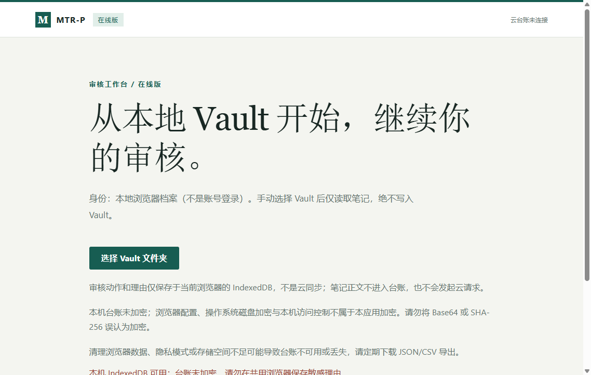
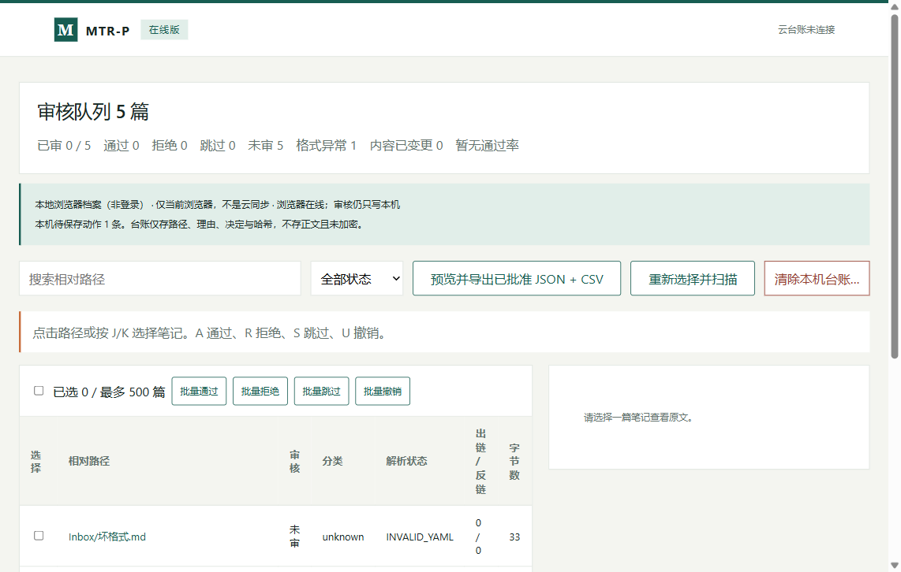
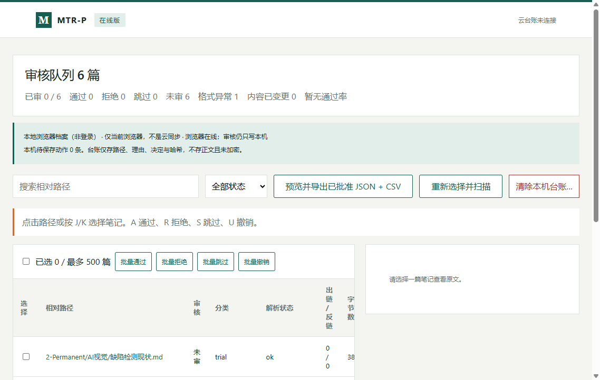
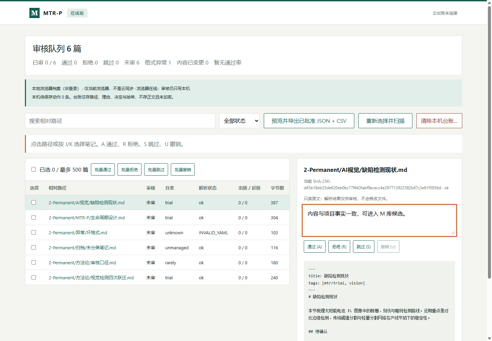
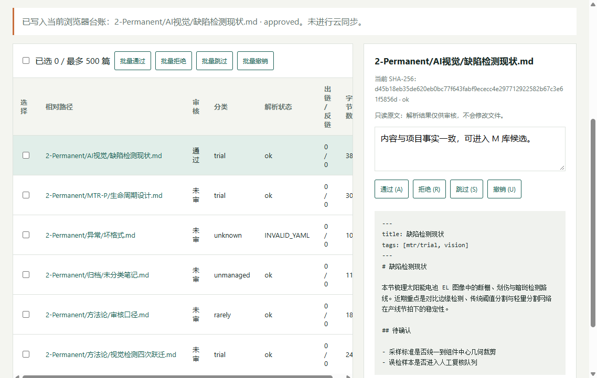

# MTR-P 审核工作台使用说明书

> 适用范围：本地 Windows 便携版 + 浏览器静态版。
>
> 截图来源：本机真实界面，使用合成的 6 篇演示笔记生成；不代表任何真实个人 Vault 的内容。
> 当前版本不执行发布，只生成本地审核台账和 JSON/CSV 导出的放行清单。

## 1. 先选使用方式

| 方式 | 适合场景 | 打开入口 | 数据存在哪里 | 账号与同步 |
| --- | --- | --- | --- | --- |
| 公开分享链接 | 把界面发给同事或换台机器打开，不装任何东西 | `https://mtrp-review-workbench.app.workbuddy.host/?sharecode=R6JHCUP2WX` | 每个访问者**自己浏览器**的 IndexedDB | **没有账号、没有云台账、没有跨设备同步** |
| 浏览器静态版（本机） | 内网使用、不想走公网 | `http://127.0.0.1:8766/` 或按本文命令另起端口 | 当前浏览器的 IndexedDB | 同上 |
| Windows 便携版 | 希望双击启动独立程序，暂时不依赖 Python 环境 | `MTRP-ReviewWorkbench.exe` | 默认 `%LOCALAPPDATA%\MTRP-ReviewWorkbench\`，也可显式 `--data-dir` | 本机回环服务，无登录认证 |



三种形态的代码和存储相互独立，不会自动合并审核进度。公开链接与每台机器的本机版**也不是同一个台账**：谁在哪台浏览器里审核，记录就只留在那台浏览器里。把链接发给别人，只是让对方能打开同一个界面，不是共享你的审核结果。

## 2. 界面总览


首页的几项信息需要先说明：

- **身份：本地浏览器档案（不是账号登录）**：没有 Auth，也没有云同步。
- **选择 Vault 文件夹**：必须由你在 Chromium 的系统目录对话框中主动授权；网页不能自行枚举磁盘。
- **云台账未连接**：这是当前版本的明确边界，不是网络故障，也不是“登录后可恢复”的状态。
- **IndexedDB 可用**：审核动作保存在当前 Origin 的本机浏览器数据库。更换浏览器、清理站点数据或无痕模式会导致记录不可用。

## 3. 浏览器版启动与扫描

### 3.1 打开

**公开链接（推荐发给他人）**

直接打开：

```text
https://mtrp-review-workbench.app.workbuddy.host/?sharecode=R6JHCUP2WX
```

链接是 HTTPS，满足目录读写 API 的安全上下文要求。打开后仍需你手动点“选择 Vault 文件夹”并授权，链接本身**不会**自动读取任何人的磁盘。访问者各自的审核记录只存在于**自己浏览器**，互不可见；这个链接不是共享台账。

**本机启动**

从仓库根目录执行：

```bash
./.venv/Scripts/python.exe apps/connect-panel/online/serve.py --port 8080
```

浏览器打开终端输出的地址，例如 `http://127.0.0.1:8080/`。当前本机预览在 `http://127.0.0.1:8766/`。

> 不要双击 `index.html` 以 `file://` 打开，也不要用普通的 `python -m http.server` 替代。Windows 上部分 Python 环境会把 `.mjs` 返回成 `text/plain`，浏览器会拒绝 ES module，页面会一直停在“正在检查浏览器目录读取能力”。`serve.py` 固定只监听 `127.0.0.1`，并为 `.js/.mjs/.webmanifest/.css/.svg/.png` 设置正确 MIME。

### 3.2 授权 Obsidian 库

1. 点击“选择 Obsidian 库文件夹”。
2. 在系统目录对话框中选择 **Obsidian 库的根目录**，也就是包含 `.obsidian` 文件夹的那一层；不要选到某个子目录，也不要把单个笔记拖进来。
3. 只授予**读取**权限，不要授予写入权限。
4. 选错目录、取消授权或权限失效时，页面会提示重新选择；不要继续在异常状态审核。

应用会**递归遍历库内所有子文件夹**下的 Markdown，因此 PARA（`0-Inbox`/`1-Fleeting`/`2-Permanent`…）、Zettelkasten 扁平结构、纯中文目录、深层日期目录都能直接用，不要求库里有任何固定目录名。

自动跳过以下目录（隐藏目录与回收站不应进入审核队列）：

- `.obsidian`
- `.trash`
- `.git`、`.github`、`.obsidian-git`

此外仍排除 MTR-P 自己的系统区：`2-Permanent/Resources/MTR-P-System`、`2-Permanent/Areas/AI-Assets/_templates`（若库内存在）。



上面这张图用的是刻意打乱结构的演示库：库根直接放笔记、四层嵌套的 `项目/AI视觉/子课题/`、纯中文目录、深层日期目录和无 ASCII 路径，全部正常进入队列，`.obsidian` 与 `.trash` 被排除。

### 3.3 审核队列



扫描完成后，页面分为三层：

1. **统计区**：已审、通过、拒绝、跳过、未审、格式异常、内容已变更和通过率。
2. **操作区**：路径搜索、按状态筛选、导出、重新扫描、清除本机台账。
3. **队列与详情**：左侧浏览和批量选择，右侧查看原文并作出决定。

表格中的字段含义：

| 字段 | 含义 |
| --- | --- |
| 相对路径 | 相对 Vault 根的路径，不显示或上传本机绝对路径 |
| 审核 | 未审 / 通过 / 拒绝 / 跳过 |
| 分类 | `trial`、`rarely`、`unmanaged` 等标签分类 |
| 解析状态 | `ok`、`INVALID_YAML` 等 |
| 出链 / 反链 | 当前扫描清单内的链接统计 |
| 字节数 | 原始文件字节数，不经过文本重写 |

`INVALID_YAML` 仍计入分母，并允许人工查看原文后审核；它不是自动跳过项。

### 3.4 单篇审核



1. 点击左侧任意路径，右侧显示当前 SHA-256、解析状态和只读原文。
2. 在“审核理由”中填写可复核的原因。理由可为空，最多 500 字符；它只保存在本机，并且**不存正文**。
3. 点击：
   - **通过 (A)**：进入 M 库候选；
   - **拒绝 (R)**：不进入候选；
   - **跳过 (S)**：暂不决定；
   - **撤销 (U)**：撤销当前结论并保留历史。

键盘操作要先让焦点离开文字输入框：`J/K` 切换笔记，`A/R/S/U` 对应通过、拒绝、跳过、撤销。

每次详情读取、决定和撤销都会重新读取文件字节并计算 SHA-256。如果详情打开后文件被外部修改，旧 SHA 的决定或撤销会被拒绝，队列不会被清空；刷新详情后重新审核即可。



通过成功后，页面明确提示“已写入当前浏览器台账，未进行云同步”。这是本版本的预期行为，不是同步失败。

### 3.5 批量审核

1. 使用搜索框和状态筛选缩小范围。
2. 可勾选“选择当前筛选全部笔记”，单批最多 500 篇。
3. 选择批量通过、拒绝、跳过或撤销。
4. 批量操作遇到单篇内容冲突时，已成功提交的其他笔记不回滚；冲突项保留在队列中等待重新查看。

### 3.6 导出 JSON + CSV

点击“预览并导出已批准 JSON + CSV”后：

1. 页面先按当前台账做一次 dry-run，并显示将下载的篇数、剔除的 stale 数量和确认提示。
2. 确认后由浏览器原生下载两个文件：
   - 一个 JSON：审核结论与放行清单；
   - 一个 CSV：便于表格查看。
3. 文件进入**浏览器下载目录**，不会写入 Vault，也不会生成公网下载链接。

导出前会再次核对当前内容。stale 项不会作为“已批准”导出；`INVALID_YAML` 在人工处理后可以包含在导出结果中。

### 3.7 刷新、恢复与清除

- 刷新页面后，如果此前授权过目录，可点击“继续使用上次目录”，恢复 IndexedDB 中的审核记录；权限失效时需要重新授权。
- 断网不会伪造云端成功。已经缓存的应用壳可继续打开，但审核记录仍只在本机浏览器。
- “清除本机台账…”有两次确认，只删除本应用的 `dir_handle / pending_actions / export_backup`，**不会删除 Vault 文件、浏览器下载或其他站点数据**。
- 清除浏览器站点数据会丢失本机台账；没有云端备份可以恢复。

## 4. Windows 便携版使用

### 4.1 启动前

交付目录是：

```text
apps/connect-panel/packaging/dist-v1/MTRP-ReviewWorkbench/
```

必须保留整个目录，其中包含：

```text
MTRP-ReviewWorkbench.exe
_internal/
```

**不能只复制 EXE，也不能把 `_internal/` 移走。** 当前交付是便携目录，不是安装器，没有安装向导、自动更新、卸载程序或代码签名。

### 4.2 启动

直接双击 `MTRP-ReviewWorkbench.exe`，默认打开：

```text
http://127.0.0.1:8765/
```

建议为台账和导出显式指定独立数据目录：

```powershell
.\MTRP-ReviewWorkbench.exe --data-dir "E:\MTRP-local-data" --port 8766 --no-browser
```

然后手动打开终端显示的地址。数据目录中会出现：

```text
users.json       用户、审核台账和历史
exports/         正式 JSON/CSV 导出
```

未指定数据目录时，便携版使用 `%LOCALAPPDATA%\MTRP-ReviewWorkbench\`。程序目录、数据目录和 Vault 是三套不同位置，不要混用。

### 4.3 首次扫描

1. 打开面板后填写本机 Vault 的绝对路径并保存偏好。
2. 点击扫描；扫描只读，不会修改 Vault。
3. 审核、批量操作和导出的流程与浏览器版一致，但台账在本机数据目录，不在浏览器 IndexedDB。
4. 若检测到旧版 `data/users.json`，页面会让你明确选择“确认复制旧版档案”或“暂不迁移”；迁移前不会创建目标档案，也不会覆盖已有目标。

### 4.4 备份与升级

- 定期备份整个数据目录，尤其是 `users.json` 和 `exports/`。
- 升级时先退出旧程序，新建目录解压新版，再使用**同一个数据目录**启动。
- 不要用新版目录覆盖正在运行的旧目录。
- 真实旧版升级后保留真实台账与配置尚未验收；正式使用前先备份并做小范围试运行。

## 5. 推荐工作流

1. 先备份数据目录或确认浏览器台账已有导出。
2. 启动界面，只读授权 Vault。
3. 搜索或按 `INVALID_YAML`、`未审` 等状态筛选。
4. 单篇查看原文和当前 SHA，填写理由后逐篇决定。
5. 对低风险条目使用批量通过；冲突项逐篇重审。
6. 导出 JSON + CSV，保存在受控目录。
7. 需要发布时，由后续阶段消费放行清单；本工作台本身不执行发布。

## 6. 常见问题

### 页面一直显示“正在检查浏览器目录读取能力”

优先检查是否用了错误静态服务器：

```bash
curl -I http://127.0.0.1:端口/vendor/js-yaml.mjs
```

`Content-Type` 必须是 `text/javascript`，不能是 `text/plain`。重新使用：

```bash
./.venv/Scripts/python.exe apps/connect-panel/online/serve.py --port 8080
```

### 无法选择目录或授权后失效

使用最新版 Chrome 或 Edge，通过 `127.0.0.1` 或 HTTPS 打开；普通局域网 HTTP 不满足目录 API 的安全上下文要求。取消授权或权限失效时重新选择目录，不要继续审核。

### 显示“本机 IndexedDB 不可用”

退出无痕模式，检查浏览器是否允许站点存储、磁盘空间是否充足。页面不会把这种情况伪报为已保存；此时应停止审核并先处理存储问题。

### 提示当前内容与详情 SHA 不一致

文件在详情打开后被外部修改。关闭提示，重新选择该笔记，查看最新内容后再决定；不要重复点击旧的通过或撤销。

### 找不到导出的 JSON/CSV

浏览器版在浏览器下载目录；Windows 便携版在数据目录的 `exports/`。导出不会写回 Vault。

### Windows EXE 双击没有启动

确认 `_internal/` 仍与 EXE 在同一目录；检查端口是否被占用，可加 `--port 0` 让系统分配空闲端口。当前产物只验证了 Windows x64 合成 Vault 的启动、扫描、审核和导出，不保证未测机器环境。

## 7. 当前验收边界

- 本地版独立 QA：**64 项专项、136 项面板、225 项主仓测试通过**，最终路由 NoOne。
- 浏览器版：Node **66 项**、对拍比较 **5 项**通过；50 篇双引擎夹具差异 **0**。
- 真实 Chrome：**11/11 组断言完整通过**，页面错误为空，Service Worker 注册正常。
- Windows 便携 EXE：真实启动、合成 Vault 扫描、审核、导出、独立数据目录及 Vault SHA 不变通过。
- 公开链接：已用真实浏览器在 HTTPS 下打开，界面正常进入“选择 Vault 文件夹”，模块 MIME 与静态资源均正常。
- 仍未验收：真实个人 Vault、原生系统目录选择器、跨浏览器、安装/卸载、真实旧版升级保留、掉电和目录 fsync。
- 公开链接是**静态页面**，没有 Auth 或云同步；它不保存服务端台账，也不等于原 PRD 的云账号版。链接是公网可达的，任何拿到链接的人都能打开界面，但看不到别人的审核记录。

## 8. 相关文档

- 本地版与便携版说明：[`../../README.md`](../../README.md)
- 浏览器版使用与隐私边界：[`../../online/README.md`](../../online/README.md)
- 本地 QA 报告：[`../qa-local-runtime.md`](../qa-local-runtime.md)
- 原在线版目标文档：[`../prd-online-workbench.md`](../prd-online-workbench.md)
