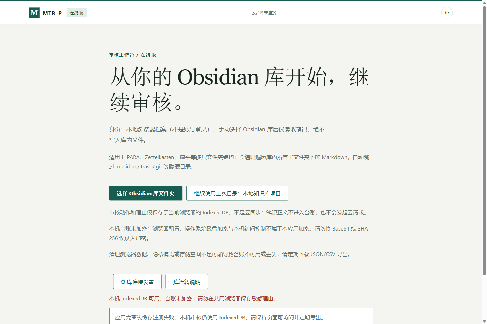
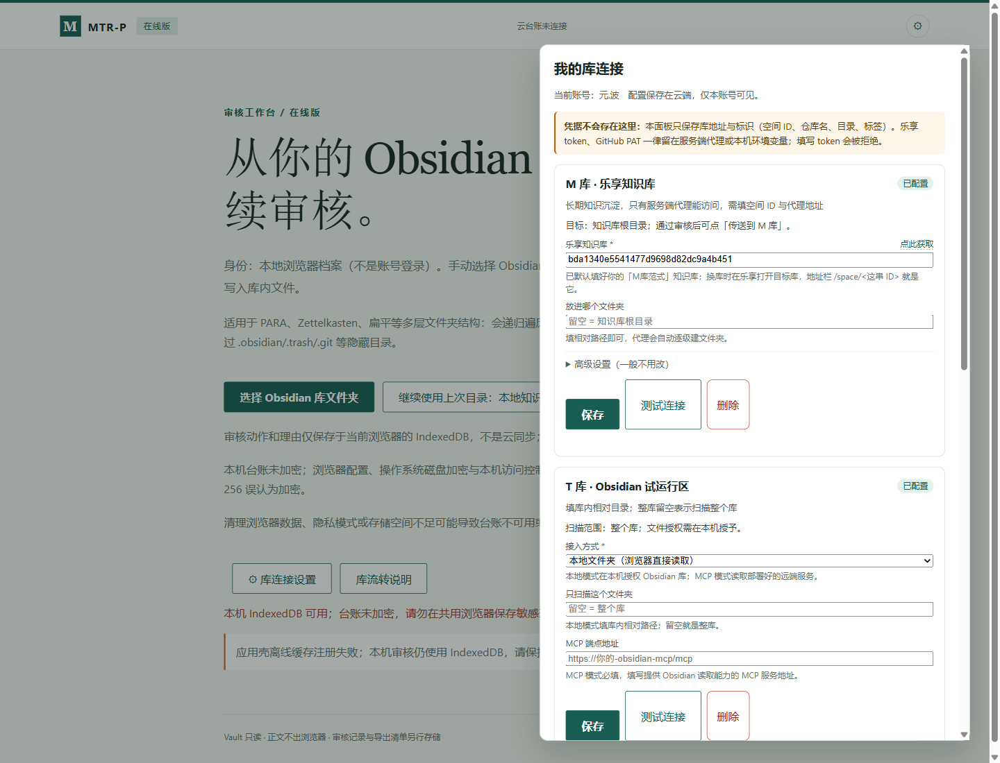
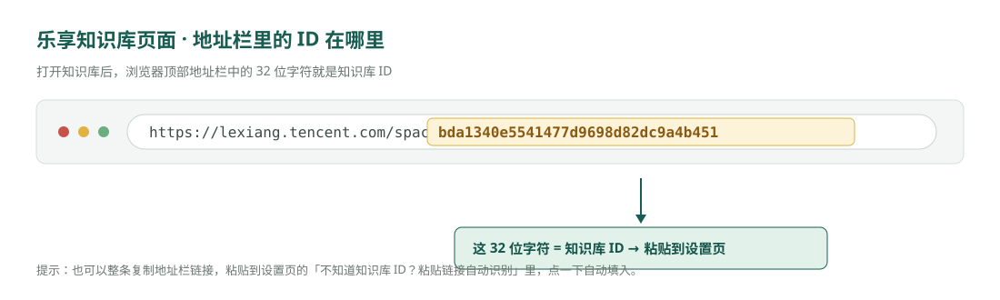
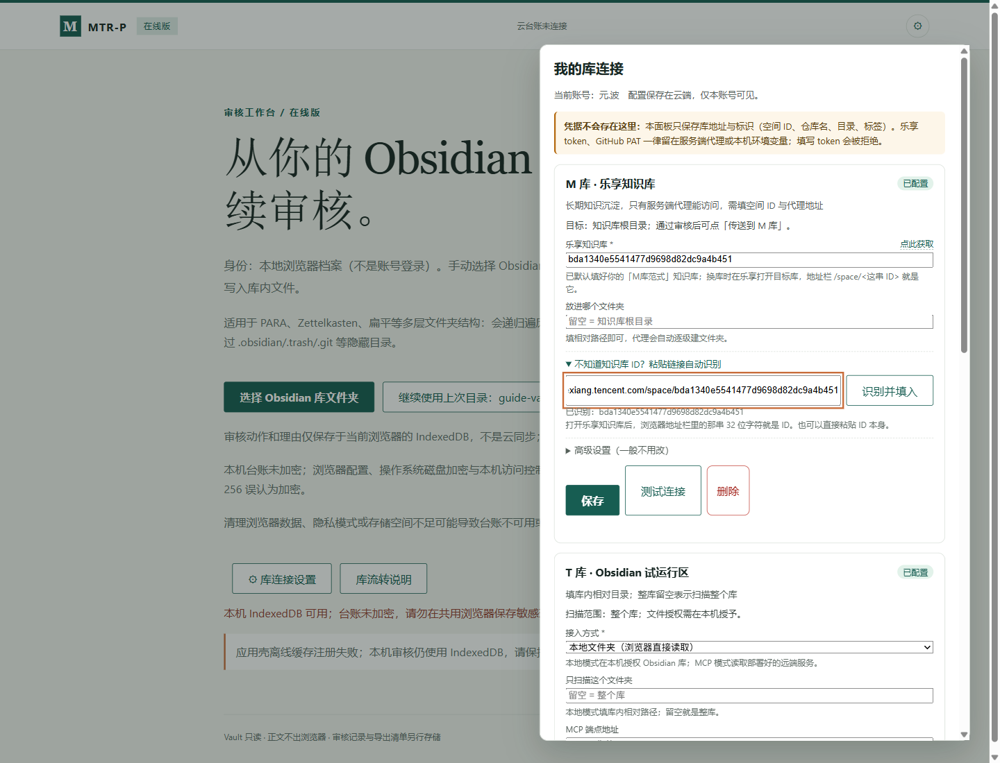
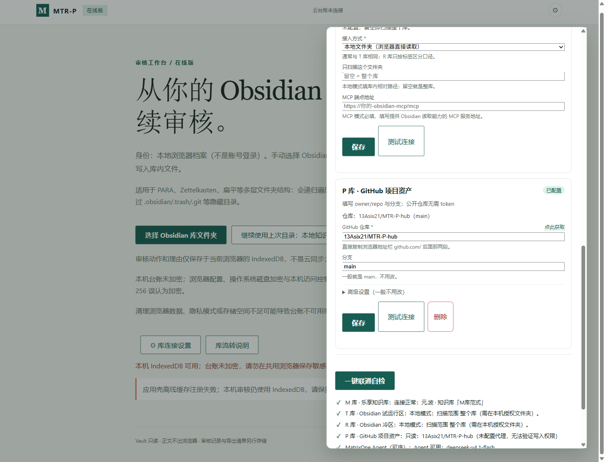
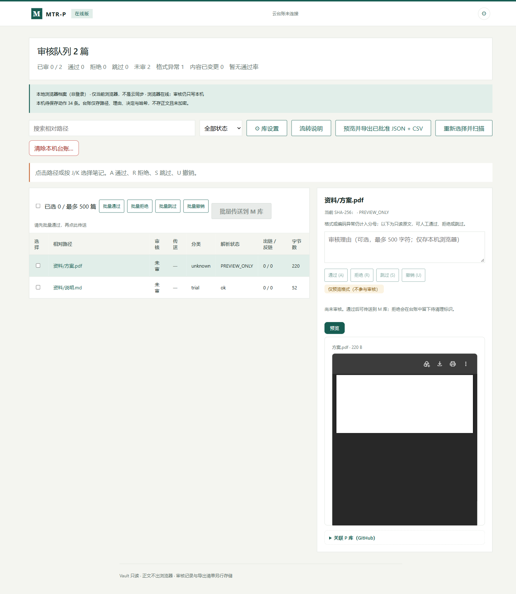
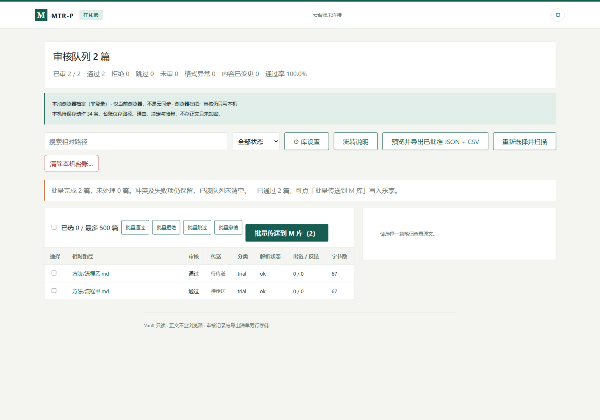
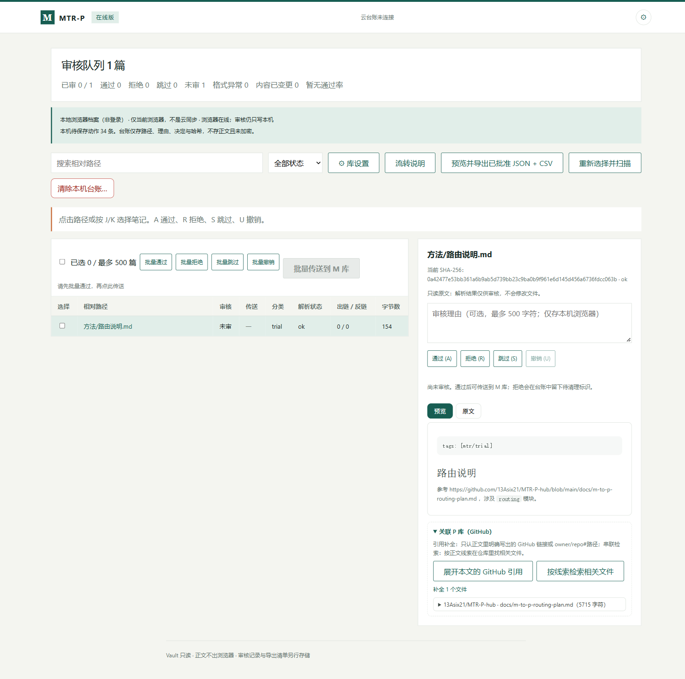

# MTR-P 审核工作台 · 从零配置全流程说明书

> 适用对象：**第一次使用**这个工作台的人。
> 目标：从打开链接开始，配置好你的四个库，完成一次"审核通过 → 传送到乐享知识库"的完整闭环。
>
> 对应版本：代码提交 `2a183ae`，线上模块 `20261124f`。

---

## 0. 你会得到什么

一条真实可跑通的流水线：

**Obsidian 库（只读） → 人工审核 → 通过 → 一键传送到乐享知识库**

此外还有三项配套能力：多格式文件预览（PDF / DOCX / XLSX / 图片）、GitHub 经 MCP 连接并列出账号下全部仓库、以及从笔记自动关联 GitHub 代码（M→P 路由）。

过程中：不会修改你的 Obsidian 笔记；不会把笔记正文上传到云端；token 不会出现在浏览器里。

---

## 1. 打开工作台

访问地址（请完整复制，`sharecode` 不能丢）：

```
https://mtrp-review-workbench.app.workbuddy.host/?sharecode=R6JHCUP2WX
```



首页上有三个关键点：

- **右上角的 ⚙ 图标**：所有配置都在这里，随时可点开。
- **「选择 Obsidian 库文件夹」**：主操作入口。
- 页面说明：支持 PARA、Zettelkasten、扁平等各种结构，会递归遍历所有子文件夹。

> ⚠️ 必须用 Chrome 或 Edge（108+）。Firefox、Safari 不支持本地目录读取。

---

## 2. 登录（配置要跟账号走，先登录）

点右上角 ⚙，第一次会看到登录界面：


两种登录方式，任选其一：

| 方式 | 操作 |
| --- | --- |
| **手机号验证码**（推荐） | 填 11 位手机号 → 点「获取验证码」→ 填收到的 6 位码 → 点「登录 / 注册」 |
| **微信扫码** | 点「微信扫码登录」，按提示扫码授权 |

为什么必须登录：四个库的配置按账号存在云端，**换台电脑登录同一账号就能恢复**，不用重新填。

> Obsidian 的文件夹读取授权是另一回事，它只能在本机授权，不随账号同步——这是浏览器的安全限制。

---

## 3. 配置四个库

登录后进入「我的库连接」面板，四张卡片对应四个库：



**关键：M 库和 P 库已经预填好了默认值，你通常什么都不用改。**

### 3.1 M 库（乐享知识库）

| 字段 | 默认值 | 说明 |
| --- | --- | --- |
| 乐享知识库 | 已填 `bda1340e...`（M库范式） | 你的目标知识库 |
| 放进哪个文件夹 | 空 = 知识库根目录 | 想放到子文件夹就填相对路径 |

**代理地址和访问码藏在「高级设置」里**，已经填好，不用动：


#### ⭐ 关键一步：怎么知道你自己的乐享知识库 ID

这是最容易卡住的地方。**ID 就是那串 32 位十六进制字符**（例如 `bda1340e5541477d9698d82dc9a4b451`），它藏在知识库页面的网址里。

**方法一：看地址栏（最直接）**

1. 浏览器打开乐享：`https://lexiang.tencent.com/`
2. 登录后进入你的知识库（比如"我的知识库"）
3. 此时看地址栏，URL 里的那串 32 位字符就是 ID：

```
https://lexiang.tencent.com/space/bda1340e5541477d9698d82dc9a4b451
                                   └────────── 这一串就是 ID ──────────┘
```

4. 复制这 32 位字符，粘贴到设置页的「乐享知识库」输入框



**方法二：用页面里的识别助手（推荐，不会抄错）**

在 M 库卡片下方，点开 **「不知道知识库 ID？粘贴链接自动识别」**：



1. 从浏览器地址栏**整条复制**知识库页面链接
2. 粘贴进输入框
3. 点「识别并填入」
4. 显示「已识别：bda1340e...」即成功，ID 已自动填入上方字段

助手支持这几种格式，都能识别：

| 你粘贴的内容 | 结果 |
| --- | --- |
| `https://lexiang.tencent.com/space/<32位>` | ✅ 识别 |
| `https://xxx.com/kb/<32位>?tab=1` | ✅ 识别 |
| `https://xxx.com/page?space_id=<32位>` | ✅ 识别 |
| 只有 32 位 ID 本身 | ✅ 识别 |
| 一段普通文字 | ❌ 提示"没能识别"，不会乱填 |

**方法三：从别的知识库链接反推**

如果你手上只有某个条目（文章）的链接，URL 里通常也带知识库 ID；实在找不到，就在乐享里重新打开知识库首页，用方法一看地址栏。

> ⚠️ 认错库的典型症状：ID 填成了"个人知识库"，但你想传到"团队知识库"。这时「测试连接」会显示成另一个库的名字——**看到名字不对就说明 ID 填错了**，改回来即可。

#### 怎么确认填对了

点 M 库卡片上的 **「测试连接」**，看到类似：

```
连接正常：元.波 · 知识库「M库范式」
```

**重点是引号里的知识库名字**。名字和你要传的目标库一致，才算真的填对了。

### 3.2 T 库 / R 库（Obsidian）

先选**接入方式**：

| 方式 | 何时用 | 填什么 |
| --- | --- | --- |
| **本地文件夹**（默认） | 你的 Obsidian 库在这台电脑上 | 可留空（=扫描整个库），或填子目录如 `2-Permanent` |
| **MCP 服务** | 库在远端、由别的服务提供 | 填 MCP 端点地址（http/https 开头） |

选了模式后，界面只显示相关字段，不会两套一起出现。

### 3.3 P 库（GitHub，经 MCP 连接）

GitHub 现在**通过官方 MCP 服务访问**，不再直连 API。这意味着只要填对 Token，就能读到该账号下的**全部仓库，包括私有仓库**。

| 字段 | 默认值 | 说明 |
| --- | --- | --- |
| GitHub 仓库 | `13Asix21/MTR-P-hub` | 可从下拉选择，也可手填 |
| 分支 | `main` | 一般不用改 |

「高级设置」里有三项，前两项已经填好：

| 字段 | 默认值 | 说明 |
| --- | --- | --- |
| MTR-P 代理地址 | `https://mtrp-lexiang-proxy.app.workbuddy.host` | GitHub 请求经此代理转发 |
| 代理访问码 | `QOPTB45RQL` | 与乐享共用同一个代理 |
| GitHub Token | 空 | **需要你填**，见下 |

#### ⭐ 怎么用 Token 看到全部仓库

1. 在「高级设置」的 **GitHub Token** 里填入你的 PAT（`ghp_` 或 `github_pat_` 开头）
2. 点卡片下方的 **「加载我的仓库」**
3. 下拉框会列出该 Token 能访问的**所有仓库**，私有仓库带「（私有）」标注
4. 点选任一项，自动填入上方「GitHub 仓库」字段

实测效果（7 个仓库全部列出）：

```
13Asix21/MTR-P
13Asix21/py_datastrucure
13Asix21/MTR-P-hub
13Asix21/CourseS（私有）
13Asix21/thinkloop（私有）
13Asix21/Pydantic-Agent-Worker
13Asix21/fb（私有）
```

**Token 存在哪**：只存你本机浏览器（localStorage），**不写入云端配置**。换电脑或换浏览器需要重新填。

**Token 从哪来**：点字段右侧「创建 Token」会跳到 GitHub 新建页面（已预选 `repo` 权限）。只读用途可以只勾 `public_repo`。

> 如果提示「GitHub MCP 连接失败：请确认 Token 有效」，通常是 Token 太短（真实 PAT 一般 40 位以上）或已过期。

---

## 4. 一键联通自检（强烈建议做）

配置填好后，滚到面板底部，点 **「一键联通自检」**：



它会按固定顺序真实检查五步，每步都给出真实回执：

```
✓ M 库 · 乐享知识库：连接正常：元.波 · 知识库「M库范式」
✓ T 库 · Obsidian 试运行区：本地模式：扫描范围 整个库
✓ R 库 · Obsidian 冷区：本地模式：扫描范围 整个库
✓ P 库 · GitHub 项目资产：只读：13Asix21/MTR-P-hub
✓ MatrixOne Agent（可选）：Agent 可用：deepseek-v4.1-flash
全部通过（5 项）
```

只要 M 库那行显示的是**你真实的知识库名字**，就说明乐享通道是通的。

> 如果 M 库显示失败，多半是空间 ID 填错，或代理配置被改了。回到高级设置检查。

---

## 5. 选择 Obsidian 库并扫描

关闭设置面板，点 **「选择 Obsidian 库文件夹」**：

1. 在系统对话框里选中**库的根目录**（就是包含 `.obsidian` 文件夹的那一层）
2. 只授予**读取**权限
3. 等待扫描完成


扫描后你能看到：

- **统计区**：已审 / 通过 / 拒绝 / 跳过 / 未审 / 格式异常
- **表格**：每篇的相对路径、审核状态、**传送状态**、解析状态
- **右侧详情**：Markdown **预览**（默认）和**原文**两个视图

> 自动跳过 `.obsidian`、`.trash`、`.git` 等隐藏目录，不会把配置和回收站当成笔记。

### 5.1 能扫描哪些文件

| 类型 | 是否进队列 | 能否审核 |
| --- | --- | --- |
| `.md` | 进 | **能审核**，走完整流程 |
| `.pdf` | 进 | 仅预览，**不能审核** |
| `.docx` / `.xlsx` | 进 | 仅预览，**不能审核** |
| 图片（png / jpg / gif / webp / svg） | 进 | 仅预览，**不能审核** |
| 旧格式 `.doc` / `.xls` / `.pptx` | 进 | 只提示不支持，可下载后本地打开 |

**为什么 PDF / Office 不能审核**：它们是二进制文件，没有 frontmatter 标签，无法判断该不该进 M 库。若允许审核，会把一堆 PDF 当知识条目传进乐享，而系统无法校验内容。因此这些文件的审核按钮全部置灰，并标注「仅预览格式（不参与审核）」。

### 5.2 多格式预览

点开任意非 Markdown 文件，右侧按类型给出不同视图：

| 格式 | 预览方式 |
| --- | --- |
| **PDF** | 浏览器原生渲染，可翻页、缩放 |
| **图片** | 原尺寸显示 |
| **DOCX** | 解析出段落文本、表格数量、总字数 |
| **XLSX** | **完整表格渲染**，多工作表分别显示，行列对齐 |



PDF 直接在页面内渲染，无需下载；表格文件按工作表分组，空单元格保持位置不左移。

---

## 6. 审核

### 单篇审核

点左侧任意路径 → 右侧看预览 → 填理由（可选）→ 点：

| 按钮 | 快捷键 | 含义 |
| --- | --- | --- |
| 通过 | A | 可以进入 M 库 |
| 拒绝 | R | 不通过，会留下待清理标识 |
| 跳过 | S | 暂不决定 |
| 撤销 | U | 撤销之前的结论 |

**拒绝会留下什么**：详情区会显示"已留下待清理标识"，含路径、拒绝时的 SHA、理由和时间——后续要删除或修改，就照这个清单来。页面本身**不会**改你的 Obsidian 文件。

### 批量审核

1. 勾选「选择当前筛选全部笔记」，或逐条勾选
2. 点 **「批量通过」**
3. 完成后的提示会告诉你：**已通过 N 篇，可点「批量传送到 M 库」写入乐享**



注意此时「批量传送到 M 库」按钮变成 **`批量传送到 M 库（2）`** —— 括号里是待传送篇数。

---

## 7. 传送到乐享知识库

点 **「批量传送到 M 库」**，等待进度条走完。


完成后你会看到三重反馈：

| 反馈位置 | 显示内容 |
| --- | --- |
| **顶部横幅** | ✓ 传送成功：2 篇笔记已写入乐享知识库「M库范式」 |
| **状态栏** | ✓ 传送成功：2 篇已写入乐享知识库「M库范式」 |
| **表格「传送」列** | 每行变成 ✓ 已传送 |

同时按钮变成 **`已全部传送到 M 库`** 并且**置灰不可点**——表示这批已经送完了。

### 去乐享确认

打开乐享知识库「M库范式」，在对应文件夹下就能看到刚传进去的文件，文件名与 Obsidian 里一致。

---

## 8. 关联 P 库（从笔记找 GitHub 代码）

审核详情页底部有一个 **「关联 P 库（GitHub）」** 折叠面板，提供两种查法。



### 8.1 展开本文的 GitHub 引用（精确）

笔记里如果写了 GitHub 链接，点「展开本文的 GitHub 引用」，系统会：

1. 解析正文中明确写出的 GitHub 引用
2. 逐个取回对应文件内容
3. 直接展开查看，不用跳转到 GitHub

支持的写法：

| 写法 | 示例 |
| --- | --- |
| 完整文件链接 | `https://github.com/o/r/blob/main/src/a.py` |
| 仓库链接 | `https://github.com/o/r` |
| 锚点简写 | `o/r#docs/plan.md`、`o/r:src/x.py` |
| 描述式 | `repo: o/r` |

实测：一条带完整链接的笔记，取回 `docs/m-to-p-routing-plan.md`（5715 字符）。

> **刻意不支持**裸写 `owner/repo`。因为 `2-Permanent/note.md` 这类本地路径与仓库名在文本上无法区分，识别它会把本地路径误判成仓库。宁可少认，不误认。

### 8.2 按线索检索相关文件（模糊）

笔记里没写链接、但提到了项目名或模块名时，用「按线索检索相关文件」。

它会从正文里提取线索（反引号里的代码名、`项目：X`、驼峰命名等），再到 P 库目录树里匹配路径。实测匹配到 7 个文件，并给出命中线索与得分。

结果表里每条都有「GitHub」链接可直接跳过去。

**两个功能的区别**：

| | 引用补全 | 串联检索 |
| --- | --- | --- |
| 依赖 | 正文里的显式链接 | 正文里的项目/模块名 |
| 准确度 | 高（精确到文件） | 中（可能召回相关但不精确） |
| 何时用 | 笔记里贴了链接 | 笔记只提到名字 |

> 串联检索对仓库规模敏感：小仓库约 20 秒，超大仓库可能匹配不全。

---

## 9. 常见问题

| 现象 | 原因 | 处理 |
| --- | --- | --- |
| 点 ⚙ 看不到四库卡片 | 未登录或登录过期 | 重新登录 |
| 「批量传送到 M 库」是灰的 | ①没批量通过 ②已全部传完 ③M 库没配好 | 看按钮右侧的提示文字 |
| **不知道自己的知识库 ID** | — | 打开乐享知识库，看地址栏 `/space/` 后面那 32 位；或用 M 库卡片下的「粘贴链接自动识别」 |
| 填了 ID 但测试连接显示的是别的库 | ID 填错了库 | 看提示里引号中的库名，和你要传的目标不一致就重填 |
| 粘贴链接识别失败 | 复制的内容里没有 32 位 ID | 确认复制的是知识库页面地址，而不是首页或文章页 |
| 传送失败 403 | 代理访问码不对 | 去高级设置检查 |
| 传送失败 413 | 文件超过 2 MiB | 拆分文件，或 M 库存摘要、原文留 Obsidian |
| 扫描不到笔记 | 选的不是库根目录 | 重新选包含 `.obsidian` 的那一层 |
| 扫描结果比预期多 | 目录留空 = 整库 | 在 T 库填具体子目录 |
| 刷新后按钮又变可点 | 传送记录只存当前会话 | 属正常；表格「已传送」列也会重置 |
| 换电脑后要重新选文件夹 | 目录授权不随账号同步 | 正常现象，重新授权即可 |
| **「加载我的仓库」列出 0 个** | Token 未填或已失效 | 在高级设置填有效 PAT（`ghp_` / `github_pat_` 开头，40 位以上） |
| **提示「GitHub MCP 连接失败」** | Token 太短或过期 | 重新生成 Token，确认有 `repo` 权限 |
| **P 库一直提示「未配置代理」** | 代理地址或访问码为空 | 打开高级设置，点「保存」把默认值写进云端 |
| **点「展开引用」说没有引用** | 正文里没有显式 GitHub 链接 | 用「按线索检索」代替，或在笔记里补上链接 |
| **串联检索很慢或报超时** | 仓库太大，遍历超出时间预算 | 缩小到具体仓库，或改用引用补全 |
| **PDF 预览一片空白** | 该 PDF 可能是加密或不规范 | 下载后本地打开；页面内渲染受浏览器能力限制 |

---

## 10. 几条边界，先知道少踩坑

1. **不会改你的 Obsidian 文件**。全程只读，拒绝也只是写台账。
2. **笔记正文不上传云端**。只有你主动点"传送到 M 库"时，才会把这篇内容写进乐享。
3. **token 不经过浏览器**。乐享的凭据在服务端代理里，代理链接本身有访问码保护。
4. **单文件上限 2 MiB**。超了会明确报错，不会静默截断。
5. **Obsidian 授权是逐机器的**。换电脑需要重新点一次"选择 Obsidian 库文件夹"。
6. **PDF / Office 只能看，不能审**。它们没有 frontmatter，无法判断是否该进 M 库；审核按钮会置灰。
7. **GitHub Token 只在本机**。不入云端配置，换浏览器需重填；泄露风险由 Token 自身的 scope 控制，建议只给最小权限。
8. **串联检索对超大仓库会打折**。受网关单次请求时限约束，当前限制遍历深度 3 层、约 120 个条目。

---

## 11. 快速上手清单

- [ ] 用 Chrome/Edge 打开带 `sharecode` 的链接
- [ ] 点右上角 ⚙ → 手机号验证码登录
- [ ] 检查 M 库显示的是你要的知识库（默认已填好）
- [ ] 点「一键联通自检」，确认 M 库那行显示真实知识库名
- [ ] 关闭面板 → 选择 Obsidian 库文件夹（只读授权）
- [ ] 批量通过若干篇
- [ ] 点「批量传送到 M 库（N）」
- [ ] 看到 ✓ 传送成功，去乐享确认文件已到
- [ ] （可选）在 P 库高级设置填 GitHub Token → 点「加载我的仓库」确认能列出全部仓库
- [ ] （可选）在笔记详情里点「展开本文的 GitHub 引用」验证 M→P 关联

---

## 附：说明书中截图的来源

全部为线上真实界面截图（`https://mtrp-review-workbench.app.workbuddy.host`），使用合成演示笔记，**未接触真实个人 Vault 内容**。乐享侧写入已实际核对：条目出现在「M库范式」对应目录下。
