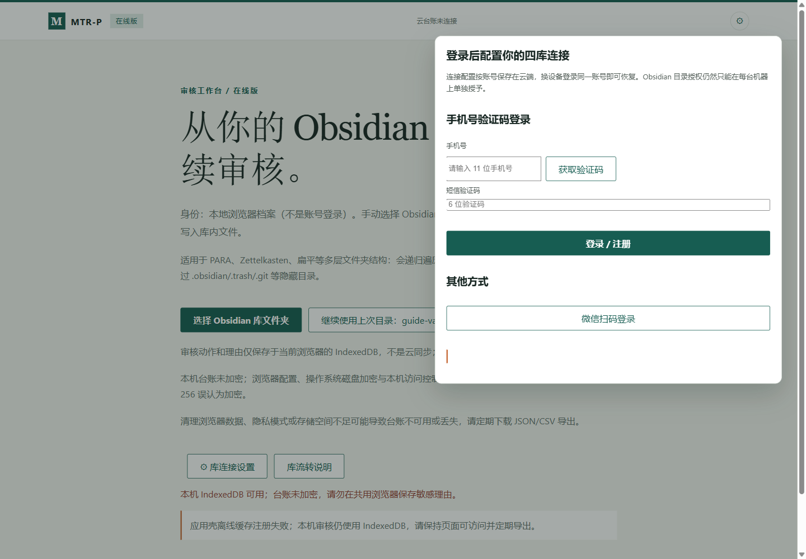
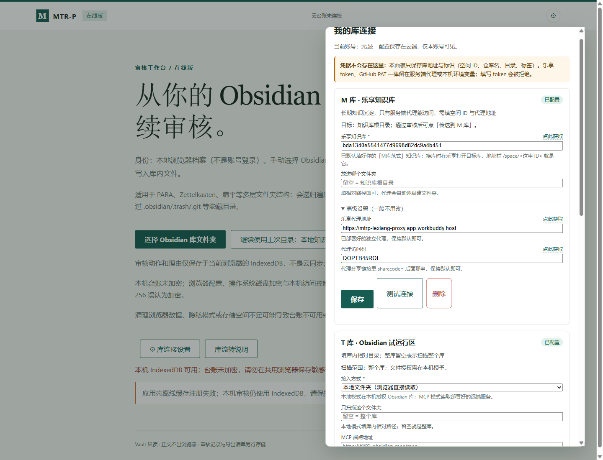
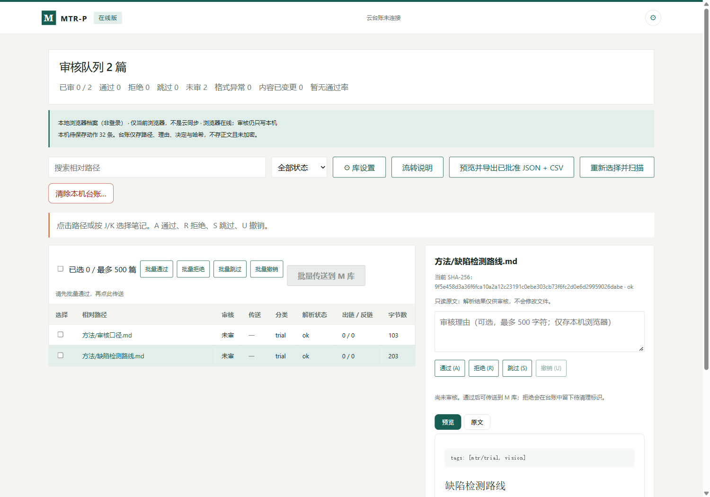
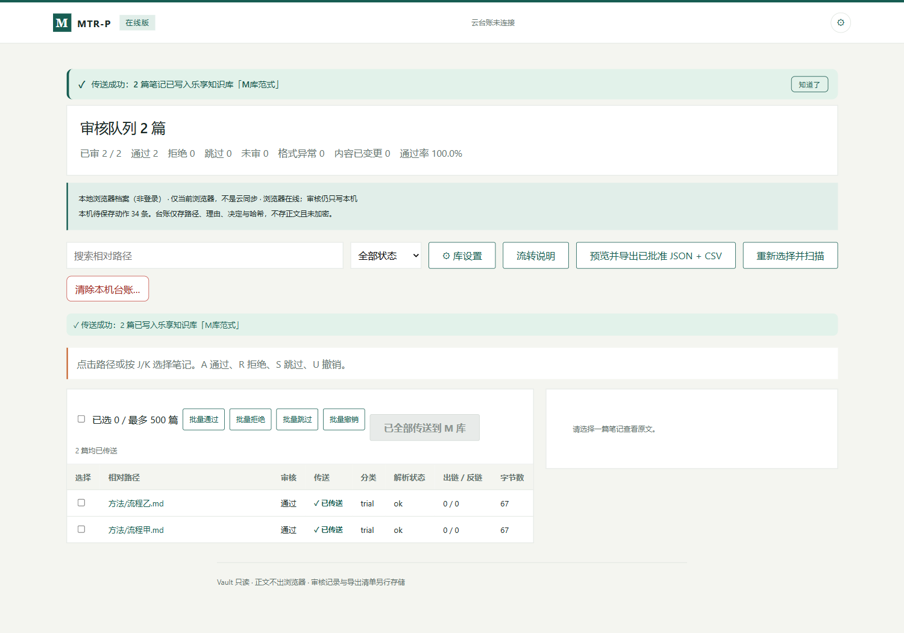

# MTR-P 审核工作台 · 从零配置全流程说明书

> 适用对象：**第一次使用**这个工作台的人。
> 目标：从打开链接开始，配置好你的四个库，完成一次"审核通过 → 传送到乐享知识库"的完整闭环。
>
> 对应版本：代码提交 `40b423b`，线上模块 `20261123p`。

---

## 0. 你会得到什么

一条真实可跑通的流水线：

**Obsidian 库（只读） → 人工审核 → 通过 → 一键传送到乐享知识库**

过程中：不会修改你的 Obsidian 笔记；不会把笔记正文上传到云端；token 不会出现在浏览器里。

---

## 1. 打开工作台

访问地址（请完整复制，`sharecode` 不能丢）：

```
https://mtrp-review-workbench.app.workbuddy.host/?sharecode=R6JHCUP2WX
```


首页上有三个关键点：

- **右上角的 ⚙ 图标**：所有配置都在这里，随时可点开。
- **「选择 Obsidian 库文件夹」**：主操作入口。
- 页面说明：支持 PARA、Zettelkasten、扁平等各种结构，会递归遍历所有子文件夹。

> ⚠️ 必须用 Chrome 或 Edge（108+）。Firefox、Safari 不支持本地目录读取。

---

## 2. 登录（配置要跟账号走，先登录）

点右上角 ⚙，第一次会看到登录界面：



两种登录方式，任选其一：

| 方式 | 操作 |
| --- | --- |
| **手机号验证码**（推荐） | 填 11 位手机号 → 点「获取验证码」→ 填收到的 6 位码 → 点「登录 / 注册」 |
| **微信扫码** | 点「微信扫码登录」，按提示扫码授权 |

为什么必须登录：四个库的配置按账号存在云端，**换台电脑登录同一账号就能恢复**，不用重新填。

> Obsidian 的文件夹读取授权是另一回事，它只能在本机授权，不随账号同步——这是浏览器的安全限制。

---

## 3. 配置四个库

登录后进入「我的库连接」面板，四张卡片对应四个库：


**关键：M 库和 P 库已经预填好了默认值，你通常什么都不用改。**

### 3.1 M 库（乐享知识库）— 默认已配好

| 字段 | 默认值 | 说明 |
| --- | --- | --- |
| 乐享知识库 | 已填 `bda1340e...`（M库范式） | 你的目标知识库 |
| 放进哪个文件夹 | 空 = 知识库根目录 | 想放到子文件夹就填相对路径 |

**代理地址和访问码藏在「高级设置」里**，已经填好，不用动：



### 3.2 T 库 / R 库（Obsidian）

先选**接入方式**：

| 方式 | 何时用 | 填什么 |
| --- | --- | --- |
| **本地文件夹**（默认） | 你的 Obsidian 库在这台电脑上 | 可留空（=扫描整个库），或填子目录如 `2-Permanent` |
| **MCP 服务** | 库在远端、由别的服务提供 | 填 MCP 端点地址（http/https 开头） |

选了模式后，界面只显示相关字段，不会两套一起出现。

### 3.3 P 库（GitHub）

| 字段 | 默认值 |
| --- | --- |
| GitHub 仓库 | `13Asix21/MTR-P-hub` |
| 分支 | `main` |

如果要提交到私有仓库或遇到 GitHub 限流，在「高级设置」里填 GitHub Token（只存你本机浏览器，不进云端）。

---

## 4. 一键联通自检（强烈建议做）

配置填好后，滚到面板底部，点 **「一键联通自检」**：


它会按固定顺序真实检查五步，每步都给出真实回执：

```
✓ M 库 · 乐享知识库：连接正常：元.波 · 知识库「M库范式」
✓ T 库 · Obsidian 试运行区：本地模式：扫描范围 整个库
✓ R 库 · Obsidian 冷区：本地模式：扫描范围 整个库
✓ P 库 · GitHub 项目资产：只读：13Asix21/MTR-P-hub
✓ MatrixOne Agent（可选）：Agent 可用：deepseek-v4.1-flash
全部通过（5 项）
```

只要 M 库那行显示的是**你真实的知识库名字**，就说明乐享通道是通的。

> 如果 M 库显示失败，多半是空间 ID 填错，或代理配置被改了。回到高级设置检查。

---

## 5. 选择 Obsidian 库并扫描

关闭设置面板，点 **「选择 Obsidian 库文件夹」**：

1. 在系统对话框里选中**库的根目录**（就是包含 `.obsidian` 文件夹的那一层）
2. 只授予**读取**权限
3. 等待扫描完成



扫描后你能看到：

- **统计区**：已审 / 通过 / 拒绝 / 跳过 / 未审 / 格式异常
- **表格**：每篇的相对路径、审核状态、**传送状态**、解析状态
- **右侧详情**：Markdown **预览**（默认）和**原文**两个视图

> 自动跳过 `.obsidian`、`.trash`、`.git` 等隐藏目录，不会把配置和回收站当成笔记。

---

## 6. 审核

### 单篇审核

点左侧任意路径 → 右侧看预览 → 填理由（可选）→ 点：

| 按钮 | 快捷键 | 含义 |
| --- | --- | --- |
| 通过 | A | 可以进入 M 库 |
| 拒绝 | R | 不通过，会留下待清理标识 |
| 跳过 | S | 暂不决定 |
| 撤销 | U | 撤销之前的结论 |

**拒绝会留下什么**：详情区会显示"已留下待清理标识"，含路径、拒绝时的 SHA、理由和时间——后续要删除或修改，就照这个清单来。页面本身**不会**改你的 Obsidian 文件。

### 批量审核

1. 勾选「选择当前筛选全部笔记」，或逐条勾选
2. 点 **「批量通过」**
3. 完成后的提示会告诉你：**已通过 N 篇，可点「批量传送到 M 库」写入乐享**


注意此时「批量传送到 M 库」按钮变成 **`批量传送到 M 库（2）`** —— 括号里是待传送篇数。

---

## 7. 传送到乐享知识库

点 **「批量传送到 M 库」**，等待进度条走完。



完成后你会看到三重反馈：

| 反馈位置 | 显示内容 |
| --- | --- |
| **顶部横幅** | ✓ 传送成功：2 篇笔记已写入乐享知识库「M库范式」 |
| **状态栏** | ✓ 传送成功：2 篇已写入乐享知识库「M库范式」 |
| **表格「传送」列** | 每行变成 ✓ 已传送 |

同时按钮变成 **`已全部传送到 M 库`** 并且**置灰不可点**——表示这批已经送完了。

### 去乐享确认

打开乐享知识库「M库范式」，在对应文件夹下就能看到刚传进去的文件，文件名与 Obsidian 里一致。

---

## 8. 常见问题

| 现象 | 原因 | 处理 |
| --- | --- | --- |
| 点 ⚙ 看不到四库卡片 | 未登录或登录过期 | 重新登录 |
| 「批量传送到 M 库」是灰的 | ①没批量通过 ②已全部传完 ③M 库没配好 | 看按钮右侧的提示文字 |
| 传送失败 403 | 代理访问码不对 | 去高级设置检查 |
| 传送失败 413 | 文件超过 2 MiB | 拆分文件，或 M 库存摘要、原文留 Obsidian |
| 扫描不到笔记 | 选的不是库根目录 | 重新选包含 `.obsidian` 的那一层 |
| 扫描结果比预期多 | 目录留空 = 整库 | 在 T 库填具体子目录 |
| 刷新后按钮又变可点 | 传送记录只存当前会话 | 属正常；表格「已传送」列也会重置 |
| 换电脑后要重新选文件夹 | 目录授权不随账号同步 | 正常现象，重新授权即可 |

---

## 9. 几条边界，先知道少踩坑

1. **不会改你的 Obsidian 文件**。全程只读，拒绝也只是写台账。
2. **笔记正文不上传云端**。只有你主动点"传送到 M 库"时，才会把这篇内容写进乐享。
3. **token 不经过浏览器**。乐享的凭据在服务端代理里，代理链接本身有访问码保护。
4. **单文件上限 2 MiB**。超了会明确报错，不会静默截断。
5. **Obsidian 授权是逐机器的**。换电脑需要重新点一次"选择 Obsidian 库文件夹"。

---

## 10. 快速上手清单

- [ ] 用 Chrome/Edge 打开带 `sharecode` 的链接
- [ ] 点右上角 ⚙ → 手机号验证码登录
- [ ] 检查 M 库显示的是你要的知识库（默认已填好）
- [ ] 点「一键联通自检」，确认 M 库那行显示真实知识库名
- [ ] 关闭面板 → 选择 Obsidian 库文件夹（只读授权）
- [ ] 批量通过若干篇
- [ ] 点「批量传送到 M 库（N）」
- [ ] 看到 ✓ 传送成功，去乐享确认文件已到

---

## 附：说明书中截图的来源

全部为线上真实界面截图（`https://mtrp-review-workbench.app.workbuddy.host`），使用合成演示笔记，**未接触真实个人 Vault 内容**。乐享侧写入已实际核对：条目出现在「M库范式」对应目录下。
