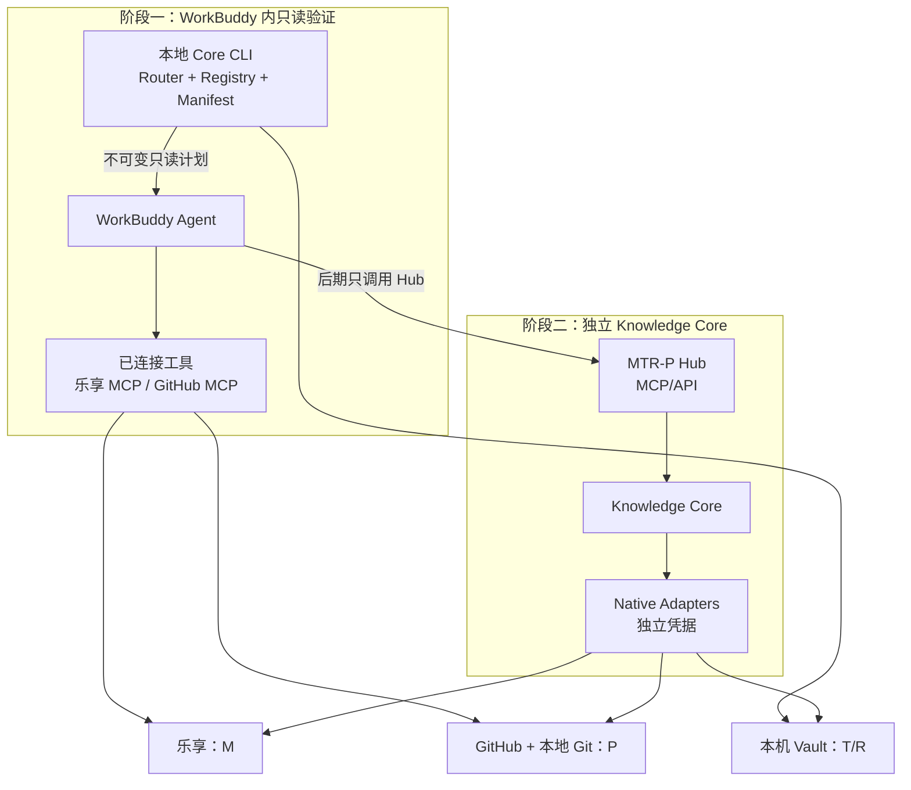

# MTR-P 数据中台及中间件开发实施计划

> 架构基线：`MTR-P数据中台及中间件设计-v2.md`。
>
> 实施仓：`13Asix21/MTR-P-hub`；本地工作区：`E:\ASoftwareManage\Agithub\MTR-P-hub`。
>
> 实测时间：2026-11-18。本文区分“已实测”“连接器已提供但尚未实测”“后续需要独立配置”，不把连接能力写成既得生产能力。

## 0. 实施结论

采用两步走：

1. **WorkBuddy 内验证阶段**：本地确定性 Router/Registry/CLI + WorkBuddy 连接器只读执行，先打通 Obsidian T/R、乐享 M、GitHub P 的查询与审计。
2. **独立服务阶段**：Knowledge Core 使用自己的乐享/GitHub 凭据和正式 Adapter，WorkBuddy 只通过 MCP/API 调用 Core，不再依赖当前聊天会话中的连接器状态。

第一版坚持：

- M 库只读；GitHub 默认只读；P 库只生成 diff/PR 提案。
- T/R 在同一 Obsidian Vault 中，通过受控标签更新完成下沉与复活，不移动文件。
- 生命周期先生成 dry-run 提案，人工确认后分批执行；每批不超过 10 个文件。
- 不自动扫描全盘、不自动给整个 Vault 打标签、不自动发布 M、不自动 commit/push/merge。
- 从第一天保留 Canonical Resource、ProjectCoordinate、Evidence、Audit，但图数据库和正式本体推理后置。

---

## 1. WorkBuddy 当前连接能力与功能边界

### 1.1 已核实的连接状态

| 能力 | 当前载体 | WorkBuddy 中已实测的能力 | 不能据此假设的能力 |
|---|---|---|---|
| T/R：Obsidian Vault | 本地文件系统与 Nutstore 同步目录 | 可直接读取、搜索和编辑本地 Markdown；可解析 frontmatter | 不是乐享/GitHub 式连接器；没有现成的 Obsidian 内部 API、Dataview、文件变更事件或冲突自动处理能力 |
| M：乐享知识库 | 已启用并连接的乐享 MCP | `whoami`、空间检索、空间详情、目录、普通搜索、向量搜索、AI 内容解析工具可用 | 不能直接访问底层向量库或数据库；不能把 MCP 返回当成本地文件；不能假设已有知识图谱或自动写 M 权限 |
| P：GitHub | 已启用并连接的 GitHub MCP | 当前账户、仓库检索、分支列表、按 ref/SHA 读取文件已实测 | 看不到本机未提交修改；不能把连接器当成任意本地 Git 工作区；不能默认拥有独立服务的同等凭据 |
| 本地 P 工作区 | WorkBuddy 本地 Bash/Git/文件能力 | 可在登记路径后执行 Git status、diff、worktree 等本地操作 | 不应自动扫描个人目录寻找仓库；GitHub 连接器无法替代这部分 |
| Core 对 WorkBuddy 暴露能力 | 后续自定义 MCP/API | 开发完成后可注册为自定义 MCP | 写入配置后仍需在连接器管理中手动 Trust；不会自动激活 |

### 1.2 关键边界：Agent 工具能力不等于 Core 内部 SDK

当前 WorkBuddy 会话可以调用乐享和 GitHub 工具，但独立运行的 Python/Node Core **不会天然继承这些工具调用通道和登录态**。

因此执行层分为两种模式：

| 模式 | 用途 | 执行方式 | 限制 |
|---|---|---|---|
| `workbuddy-manifest` | MVI 只读验证 | Core 输出不可变 ExecutionManifest，WorkBuddy 按步骤调用已连接工具 | 依赖当前 WorkBuddy 会话；只允许白名单只读工具；不作为无人值守生产服务 |
| `native` | 独立 Core 服务 | Core 通过自己的乐享/GitHub 凭据调用官方 API 或独立 MCP Client | 需要单独配置凭据、权限、超时、重试和密钥管理 |

**不允许让 Agent 自由决定查哪个库。**Agent 只能执行 Router 已生成的 Manifest；参数校验、库顺序、R 是否启用和结果审计都由 Core 规则约束。

### 1.3 建议的双阶段拓扑



---

## 2. 当前真实资产与初始化口径

### 2.1 T/R：本机 Obsidian Vault

已确认 Vault：

```text
C:\Users\Administrator\Nutstore\1\我的坚果云\Obsidian Vault
```

现有标签规范包含 `L0/L1/L2/L3`、`type/*`、`status/*`，其中 `status/stale` 已表示“过时/需要更新”。本次未发现 `mtr/trial`、`mtr/rarely` 或 `mtr_state` 已有使用记录。

因此新增 MTR 标签时不能复用 `status/stale` 代替 R：

| MTR 标签 | 逻辑库 | 含义 |
|---|---|---|
| `mtr/trial` | T | 待验证、可参与常规次级检索 |
| `mtr/rarely` | R | 低频归档，只在显式冷门查询中检索 |
| `mtr/pin` | 附加标记 | 防止生命周期自动提出下沉提案，可选 |

约束：

- T/R 是**同一 Vault 中的两个逻辑视图**，不是两个物理目录。
- 下沉只把 `mtr/trial` 改为 `mtr/rarely`；复活反向修改。路径、文件名和其他标签保持不变。
- 本地不设置 `mtr/master`；M 的权威载体是乐享指定空间。
- 命中次数、`last_hit_at`、审批和历史保存在 Core SQLite/Audit 中，**不因每次命中而改写笔记**。
- 未带 MTR 标签的笔记属于 `unmanaged / needs_classification`，不能默认全量视为 T。
- `2-Permanent/Resources/MTR-P-System/` 是仓库到 Vault 的单向镜像，保持只读，排除生命周期标签修改。

建议初始管理范围：

```yaml
managed_roots:
  - 2-Permanent
excluded_roots:
  - 2-Permanent/Resources/MTR-P-System
  - 2-Permanent/Areas/AI-Assets/_templates
```

> 最终 `managed_roots` 和排除项是实施前的人工确认门，不自动扩展到整个磁盘或其他 PARA 目录。

### 2.2 M：乐享团队空间

已实测：

| 项 | 值 |
|---|---|
| 团队 | 文化建设 |
| `team_id` | `35b01c02c45811f1b66546bc50a37e22` |
| 空间 | M库范式 |
| `space_id` | `bda1340e5541477d9698d82dc9a4b451` |
| `root_entry_id` | `03560d98485a4dd9b90f40de26277c83` |
| 外部访问 | `none` |
| 内置 Ask AI | 未启用 |
| 内置知识图谱 | 未启用 |

只读能力实测：

- 空间详情和团队信息读取成功。
- 根节点目录调用成功，当前未返回可见条目。
- 普通搜索与向量搜索均调用成功，当前返回空结果。

因此 M Adapter 必须把“**空库**”当正常状态，不得报错或伪造命中。第一批 M 内容未写入前，集成测试使用 Fixture；真实空间只验证连接、权限、空结果和审计。

第一阶段 M 只读，不调用创建条目、编辑 Block、发布等写工具。

### 2.3 P：当前 GitHub 账户

当前 GitHub 登录：`13Asix21`。本次仓库检索返回三个公开仓库：

| 仓库 | 默认分支 | 当前状态 | 实施口径 |
|---|---|---|---|
| `13Asix21/MTR-P` | `main` | 非空，README 和分支读取成功 | 登记为权威 GitHub Location |
| `13Asix21/py_datastrucure` | `main` | 非空 | 登记为权威 GitHub Location，按需索引 |
| `13Asix21/MTR-P-hub` | 本地 HEAD 已设为 main，远端尚无提交 | 本地已克隆，远端仍为空 | 作为正式实施仓；首个提交推送后再登记可检索快照 |

补充边界：

- 已于 2026-11-18 克隆到 `E:\ASoftwareManage\Agithub\MTR-P-hub`；本实施计划已同步到 `docs/`，当前尚未 commit/push。
- 其他本地 Workspace 不自动扫描，通过 `projects.yaml` 人工登记。
- 每个仓库配置一个 `authoritative_location_id`；GitHub 为主时，本地路径只是 Workspace。
- 本地 dirty 内容只能由 LocalGitAdapter 读取，GitHubAdapter 不可见。

---

## 3. 技术选型与代码结构

### 3.1 建议技术栈

- Python 3.11，模块化单体。
- Pydantic：Resource、Relation、ProjectCoordinate、Plan、Proposal 校验。
- Typer：第一阶段 CLI 与 dry-run。
- SQLite：Registry、命中统计、Proposal、Approval、Audit、可选 Outbox。
- `ruamel.yaml`：尽量保留 Obsidian frontmatter 注释与格式，避免简单文本替换破坏 YAML。
- Pytest：单元、契约、集成和安全回归。
- FastAPI + MCP Adapter：独立服务阶段再加入，不阻塞第一阶段 CLI。

### 3.2 建议目录

```text
mtrp-hub/
├── pyproject.toml
├── src/mtrp_hub/
│   ├── cli.py
│   ├── domain/          # Resource、Relation、Coordinate、Proposal
│   ├── routing/         # 确定性 Read/Write/Lifecycle Policy
│   ├── registry/        # Store、Project、Repository、Workspace
│   ├── adapters/
│   │   ├── obsidian.py
│   │   ├── lexiang.py
│   │   ├── github.py
│   │   └── local_git.py
│   ├── execution/       # Manifest、Native Executor、超时与幂等
│   ├── approval/        # 提案、审批、过期判定
│   └── audit/           # SQLite、JSONL、证据与统计
├── config/
│   ├── stores.example.yaml
│   ├── projects.example.yaml
│   └── routing.yaml
├── tests/
│   ├── unit/
│   ├── contract/
│   ├── integration/
│   └── fixtures/
└── docs/
    ├── capability-matrix.md
    ├── runbook.md
    └── recovery.md
```

---

## 4. 最小配置契约

### 4.1 `stores.yaml`

```yaml
obsidian:
  vault_root: C:/Users/Administrator/Nutstore/1/我的坚果云/Obsidian Vault
  managed_roots: [2-Permanent]
  excluded_roots:
    - 2-Permanent/Resources/MTR-P-System
    - 2-Permanent/Areas/AI-Assets/_templates
  trial_tag: mtr/trial
  rarely_tag: mtr/rarely
  apply_batch_limit: 10
  write_mode: proposal_only

lexiang_m:
  team_id: 35b01c02c45811f1b66546bc50a37e22
  space_id: bda1340e5541477d9698d82dc9a4b451
  root_entry_id: 03560d98485a4dd9b90f40de26277c83
  read_only: true
  allow_empty: true

github_p:
  owner: 13Asix21
  read_only: true
  default_location_role: authoritative
```

### 4.2 `projects.yaml`

```yaml
projects:
  - project_id: mtrp
    repositories:
      - repo_id: mtrp-principles
        remote: https://github.com/13Asix21/MTR-P
        authoritative_location_id: github-main
        default_branch: main
        workspaces: []
      - repo_id: mtrp-hub
        remote: https://github.com/13Asix21/MTR-P-hub
        authoritative_location_id: github-main
        default_branch: main
        state: empty
        workspaces: []
  - project_id: py-datastrucure
    repositories:
      - repo_id: py-datastrucure
        remote: https://github.com/13Asix21/py_datastrucure
        authoritative_location_id: github-main
        default_branch: main
        workspaces: []
```

`workspaces: []` 是刻意的安全默认。本地路径只有在用户明确登记后才进入 ProjectRegistry。

---

## 5. Adapter 功能边界与接口

| Adapter | 第一阶段实现 | 后续实现 | 明确禁止 |
|---|---|---|---|
| ObsidianAdapter | Vault 清单、MTR 标签过滤、读取、hash、T/R Fixture | 标签变更提案、审批后原子更新、变更监视与冲突检测 | 不移动文件；不改写整个 Vault；不依赖 Obsidian 内部插件 |
| LexiangMAdapter | 空间解析、目录、普通/向量搜索、AI 内容解析、空结果处理 | 经明确批准后生成 M 发布提案；独立 native 凭据 | 第一阶段不创建/编辑条目；不依赖内置知识图谱 |
| GitHubPAdapter | 仓库清单、分支、ref→SHA、按 SHA 读文件、空仓识别 | compare、diff/PR 提案、独立 native 凭据 | 不读取本地 dirty；不自动创建分支、提交、推送或合并 |
| LocalGitAdapter | 登记 Workspace、status、HEAD、dirty diff | worktree、patch、与远程快照对照 | 不自动扫描磁盘，不自动 pull/rebase/push |
| WorkBuddyManifestExecutor | 执行白名单只读工具、记录原始响应引用 | 仅作为人工辅助运行模式 | 不改变计划、不执行写工具、不作为生产后台依赖 |

### 5.1 ExecutionManifest 示例

```json
{
  "execution_id": "exe_001",
  "mode": "workbuddy-manifest",
  "read_only": true,
  "steps": [
    {
      "step_id": "m-search",
      "adapter": "lexiang-m",
      "operation": "search_kb_embedding_search",
      "arguments": {
        "filters": {"keyword": "知识路由"},
        "space_id": "bda1340e5541477d9698d82dc9a4b451",
        "limit": 5,
        "threshold": 0.3
      },
      "on_empty": "continue"
    },
    {
      "step_id": "p-read",
      "adapter": "github-p",
      "operation": "get_file_contents",
      "arguments": {
        "owner": "13Asix21",
        "repo": "MTR-P",
        "path": "README.md",
        "sha": "c3a6c7b83ced99a01b2b51039e87a40ee29df6a5"
      }
    }
  ]
}
```

Manifest 一旦生成就计算 hash。执行者不得更改库、仓库、分支、工具名称或参数；任何变更都必须回到 Router 重新生成。

---

## 6. 分阶段开发计划

### 阶段 0：冻结边界与初始化实施仓

**任务**

1. 将本文件中的能力矩阵整理为 `docs/capability-matrix.md`，标注 `tested / available / not-tested / disabled`。
2. 本地克隆与 main HEAD 已建立；后续经用户确认完成首个 main 提交和远端推送。
3. 建立 Python 包、配置示例、日志目录规则、`.gitignore` 和密钥环境变量模板。
4. 将真实空间 ID 等非密钥配置写入本地 `stores.yaml`；凭据只进环境变量，不进 Git。
5. 固化三个只读冒烟测试：Vault 可解析、乐享空间可解析、GitHub README 可按 SHA 读取。

**验收**

- 空仓库初始化完成前，不把 `MTR-P-hub` 当可读 P 资产。
- 乐享空空间返回成功空结果，测试不失败。
- 全程没有对 M、GitHub 或 Vault 的写操作。

### 阶段 1：Canonical Model + Registry + Router CLI

**任务**

1. 实现 Resource、Relation、Evidence、ProjectCoordinate、ReadPlan、WriteProposal。
2. 实现 StoreRegistry、ProjectRegistry、Repository/Location/Workspace 和默认坐标解析。
3. 实现确定性 Read Policy 与版本化 YAML 规则。
4. 实现 Fake Adapters、Decision Log 和 `mtrp route query` CLI。
5. 为 M 空库、P 空仓、同名分支不同 SHA、未登记本地路径建立 Fixture。

**验收**

- 同一请求连续三次生成完全相同的计划。
- 默认路由不包含 R；只有 `cold_detail` 或显式 R 才包含 `mtr/rarely`。
- 本地未登记路径、任意 URL、任意绝对路径都会被拒绝。
- M 空结果和 P 空仓都有明确状态，不影响其他库降级查询。

### 阶段 2：只读查询闭环

**任务**

1. 完成 ObsidianAdapter 的 managed roots、标签过滤、正文读取和内容 hash。
2. 完成 LexiangMAdapter 的普通搜索、向量搜索、条目解析和空结果处理。
3. 完成 GitHubPAdapter 的仓库、分支、ref→SHA 和文件读取。
4. 实现 WorkBuddyManifestExecutor，只允许白名单只读工具。
5. 统一返回 Resource[]、source_ref、snapshot_ref、score、Evidence 和 trace_id。

**验收用例**

- `project_context`：P → M → T；M 为空时继续 T，不报错。
- `general_knowledge`：M → T；不默认查 P 全部分支。
- `cold_detail`：只查询带 `mtr/rarely` 的 Vault 笔记。
- P 查询返回 repo、ref、commit、path，而不是只返回 GitHub URL。
- 所有工具调用都能通过 `request_id / route_id / execution_id` 追溯。

### 阶段 3：T ↔ R 生命周期与标签安全更新

**任务**

1. 在 SQLite 记录命中次数、`last_hit_at`、状态提案和审批历史。
2. 初始规则可配置：180 天未命中生成 T→R 提案；30 天内命中至少 2 次生成 R→T 提案。
3. `mtr/pin`、活动项目、未处理冲突和未核验文件不得自动进入提案。
4. 先输出 dry-run 清单：文件、旧标签、新标签、理由、当前 hash、备份路径。
5. 人工明确确认文件清单后，备份并分批执行，每批最多 10 个文件。
6. 使用 `ruamel.yaml` 保留其他 frontmatter 与标签，采用临时文件 + 原子替换；写前 hash 不一致则终止。
7. 每批执行后重新读取验证；失败即停止后续批次，并按备份恢复本批。

**验收**

- 文件路径、文件名、稳定 URI 和其他标签不变。
- `status/stale` 不被误删或当作 R 标签。
- `MTR-P-System` 镜像目录永不进入标签修改清单。
- hash 变化、Nutstore 冲突副本、无法解析的 frontmatter 都会中止对应批次。
- R 被重新命中后只提出 R→T，不直接发布到 M。

### 阶段 4：受控回写与多分支 P

**任务**

1. T：生成新笔记或内容变更 Proposal，经人工审批后受控写入。
2. P：实现 LocalGitAdapter、独立 worktree、base commit、dirty diff 和 patch Artifact。
3. GitHub：生成 diff/PR 提案所需数据；远程创建分支、文件或 PR 仍是单独授权动作。
4. M：T→M 只生成“候选发布包”和证据清单，第一阶段不自动发布乐享。
5. `impl_ref` 同时写逻辑引用与 commit 快照引用，并做悬空/过期检测。

**验收**

- 分支前进或 dirty diff 改变后，旧审批自动变成 `stale`。
- 多个 Agent Attempt 不共享可写工作目录。
- 没有审批就不发生 T/P/M 的真实写入。
- 默认不执行 commit、push、merge、rebase 或乐享发布。

### 阶段 5：独立 Knowledge Core 与 MCP/API Hub

**任务**

1. 为乐享和 GitHub 配置独立服务凭据与最小权限，不能复用聊天中不可导出的登录态作假设。
2. 实现 Native Lexiang/GitHub Adapter，并复用同一契约测试。
3. 用 FastAPI/MCP 暴露 `query`、`route`、`propose`、`status` 等少量接口。
4. 注册自定义 MCP 后，由用户在 WorkBuddy 连接器管理中手动 Trust。
5. 只有真实异步需求出现时再增加 Outbox + Worker；ThinkLoop 只消费只读状态投影。

**验收**

- 关闭当前聊天连接后，Native Adapter 仍能独立完成只读契约测试。
- WorkBuddy 只依赖 MTR-P Hub，不再逐库代替 Core 做路由。
- 凭据不进入 Git、日志、Resource 或 decision log。
- 服务重启后 Registry、Proposal、Approval 和 Audit 可恢复。

### 阶段 6：按需扩展，不属于首个可用版本

- Canonical Resource/Relation 的 Graph/RDF 只读投影。
- 需求—设计—代码—测试—缺陷的多跳追踪。
- SHACL/SPARQL/推理。
- 多团队、多租户和独立扩缩容。

---

## 7. 首版路由规则

| intent | 主路 | 空结果与降级 | R 规则 |
|---|---|---|---|
| `project_context` | P 权威默认分支 → M → T | P 空/不可达则 M；M 空则 T | 仅显式启用 |
| `general_knowledge` | M → T | M 空则 T | 仅显式启用 |
| `method_skill` | M → T | M 空则 T | 仅显式启用 |
| `decision_history` | P(ADR) → T → M | 无 ADR 记录缺失，继续 T/M | 仅显式启用 |
| `cold_detail` | R → T | R 空可回查 T | 默认只查 `mtr/rarely` |

任何路由结果都要记录规则版本、实际执行位置、命中数量、空结果、降级原因和耗时。

---

## 8. 测试与可靠性矩阵

| 类别 | 必须覆盖的用例 |
|---|---|
| 确定性 | 相同输入计划一致；LLM 不参与主路由；Manifest 不可篡改 |
| 空库/空仓 | 乐享无条目、搜索空结果、GitHub 空仓、分支不存在 |
| Vault 格式 | 无 frontmatter、YAML 异常、多标签、行内标签、中文路径、只读文件 |
| 生命周期 | T→R、R→T、pin 排除、镜像目录排除、批次失败与恢复 |
| 并发与同步 | Nutstore 延迟、写前 hash 改变、冲突副本、Watcher 重复事件 |
| P 版本 | 本地/GitHub 同名分支不同 SHA、分支前进、dirty diff、worktree 隔离 |
| 权限 | 未登记 Vault 根目录、路径逃逸、未登记 repo、只读 M/GitHub 写请求被拒绝 |
| 外部故障 | 乐享超时、GitHub 限流、无效条目、空响应、权限不足；按策略降级且不伪造结果 |
| 可恢复 | SQLite 备份恢复、Artifact 校验、审计重放、语义索引可删除重建 |

最低可观测指标：请求量、P95 延迟、各 Adapter 错误率、空结果率、降级率、待审批数、stale proposal 数、悬空引用数、标签更新失败数。

---

## 9. 首个可用版本的完成定义

首个版本不需要图数据库，也不需要自动写 M，但必须能演示以下闭环：

1. 输入一个项目问题，Core 生成稳定计划并按 P → M → T 返回带来源的结果。
2. M 当前为空时仍能正常降级到 T，不伪造“已验证知识”。
3. P 的结果能定位到具体 GitHub repo、branch、commit 和 path。
4. T/R 通过 `mtr/trial`、`mtr/rarely` 正确过滤，R 默认不参与普通检索。
5. 低频笔记能生成 dry-run 下沉清单；经确认后只改标签、可审计、可回滚。
6. R 重新命中后只提出复活到 T 的提案。
7. 所有外部写能力保持关闭，所有查询可通过 trace_id 和 decision log 重放。

---

## 10. 实施前需要人工确认的四个门

| 门 | 需要确认的内容 | 默认建议 |
|---|---|---|
| G0：实施仓 | 已确认 `MTR-P-hub` 为正式 Core 实现仓并完成本地克隆 | `E:\ASoftwareManage\Agithub\MTR-P-hub`；首个 commit/push 仍待审 |
| G1：T/R 范围 | 哪些 Vault 目录属于 managed roots，哪些明确排除 | 先限定 `2-Permanent` 的子集，镜像目录排除 |
| G2：标签与阈值 | `mtr/trial`、`mtr/rarely`、180 天下沉、30 天 2 次复活 | 先 dry-run 运行一轮，用真实分布再调阈值 |
| G3：首批样本 | 用于标签提案测试的 5–10 篇笔记 | 只读生成清单，人工逐篇确认后才执行 |

这四个门未确认前，只开发 Router、Registry、Fake Adapters 和只读能力，不执行任何批量标签修改或外部写入。

---

## 11. 明确不在首版范围内

- 自动给整个 Obsidian Vault 分类或打标签。
- 自动移动、删除或重命名个人知识文件。
- 自动向乐享 M 库发布内容。
- 自动创建 GitHub 分支、提交、推送或合并 PR。
- 自动同步本地与远程分歧。
- 依赖乐享内置知识图谱或 Ask AI。
- 把 WorkBuddy 当前聊天连接器当成独立服务的永久认证通道。
- 提前引入 Kafka、Kubernetes、独立图数据库或本体推理平台。

> 最短的可靠路径是：**只读验证 → 确定性路由 → T/R dry-run → 受控标签更新 → 提案式回写 → 独立 Native Core。**
