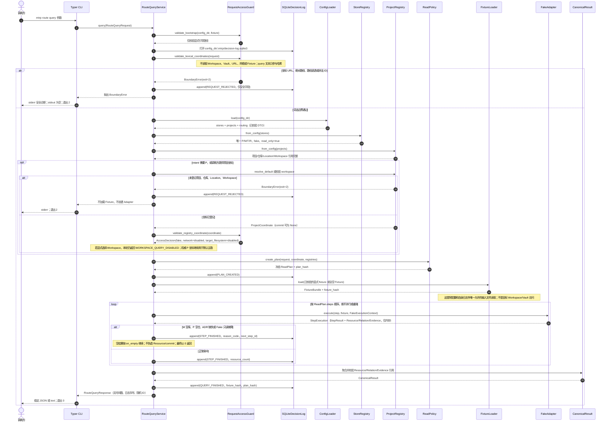
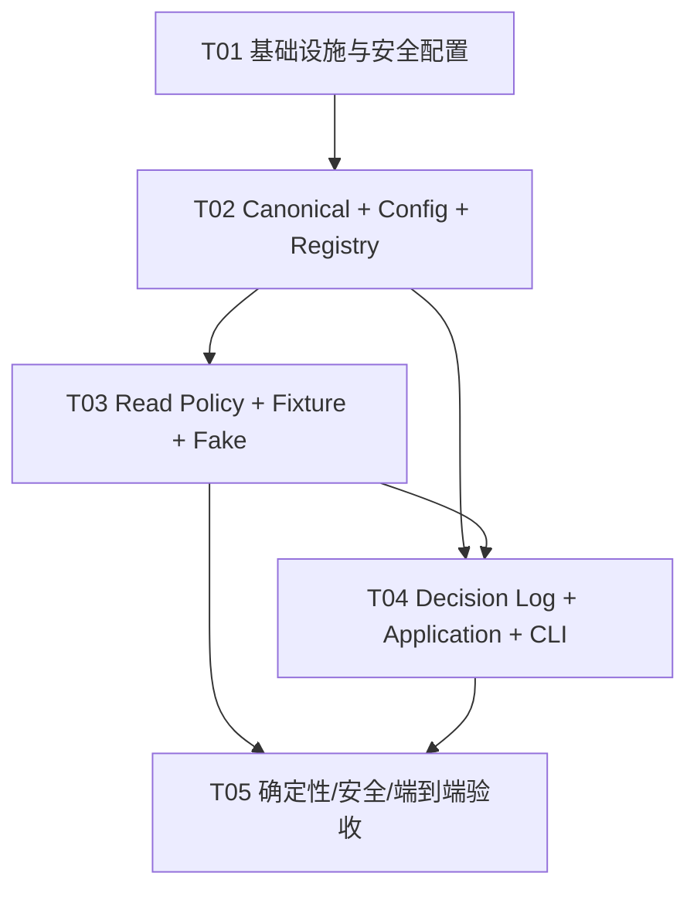

# MTR-P Hub 阶段 0 + 阶段 1 系统架构与实现任务

> 文档状态：架构设计，待工程实现  
> 上游依据：`docs/MTR-P数据中台及中间件开发实施计划.md`、`docs/prd-stage-0-1.md`  
> 本轮目标：Python 3.11 模块化单体、Canonical Model、Registry、版本化确定性 Read Policy、Fake Adapters、Decision Log、`mtrp route query` CLI。  
> 固定验收解释器：`D:/DevelopSoftwares/miniconda/python.exe`（实测 Python 3.11.11）；PATH 默认 Python 3.13.14 不作为本轮验收依据，也不要求更换系统默认 Python。  
> 实施仓事实：`origin=git@github.com:13Asix21/MTR-P-hub.git`；本地尚无提交且远端 `MTR-P-hub` 为空，不能作为已有可读 P 资产。
> 明确边界：本轮只有 Fake 数据闭环；没有真实 Adapter、真实查询、生命周期、审批/执行、外部写入、FastAPI/MCP，也不自动执行任何 Git 写操作。

---

# Part A：System Design

## 1. 实现方案与框架选型

### 1.1 核心技术难点与设计决策

| 难点 | 架构决策 | 可验证结果 |
|---|---|---|
| 相同请求、配置、规则必须逐字节确定 | 所有计划模型冻结；规范化 JSON 统一排序键、紧凑分隔符、UTF-8、禁止 NaN；所有 ID/哈希由内容派生；计划及 `route query` 输出禁止时间戳、随机 ID、日志序号和耗时 | 三个独立进程、不同 `PYTHONHASHSEED` 下 stdout 完全一致 |
| 必须在任何目标访问前拒绝越权坐标 | 两阶段 `RequestAccessGuard`：先做纯词法拒绝，再用内存 Registry 做登记校验；通过后才允许加载 Fixture 或创建 Fake Adapter | 未登记 Workspace、坐标 URL、绝对路径、路径逃逸均无目标 I/O、无 Adapter 调用 |
| 远程与本地、分支与快照不能混淆 | `ProjectCoordinate` 显式包含 `location_kind`、`location_id`、`workspace_id`、`ref`、`commit`；Evidence 以 `SnapshotRef` 和内容哈希定位 | 同名 `main` 不同 SHA 形成不同快照与证据；空仓 commit 保持 `None` |
| 空库/空仓是正常业务状态 | Adapter 返回 `StepExecution`，其中的 `StepResult + ReasonCode` 表达状态，不以异常替代空结果；Router 只按预设 `on_empty/on_unavailable` 继续 | `M_EMPTY`、`P_EMPTY`、`EMPTY_REPOSITORY` 退出 0，Resource 为空 |
| R 不得被普通查询隐式读取 | 路由规则显式版本化；普通 intent 仅在 `include_r=True` 时追加 R；`cold_detail` 固定 R→T；T/R 分别物化 `mtr/trial`、`mtr/rarely` | 五类 intent 及 R 开关都有 golden 测试 |
| Fake 不能变成真实访问后门 | Store 配置的 `adapter` 本轮只允许字面量 `fake`；`FakeAdapter.execute()` 不接收路径、URL、工具名或任意操作参数；Fixture `extra=forbid` | 禁网、无真实 Vault、无凭据时可完整验收 |
| 可解释但不能泄密 | Decision Log 只存请求哈希、登记 ID、计划/步骤状态、计数、原因码和 Fixture 哈希；原始 query、正文、秘密、未脱敏路径不写入 | 可按 request/plan hash 解释决策，日志检查不含敏感内容 |
| 阶段 1 与阶段 2 易混淆 | 本轮唯一可执行计划消费者是 FakeRunner；不实现 WorkBuddy `ExecutionManifest`/Executor，不生成外部工具调用参数 | Fake 成功不会标记为真实连接成功 |

### 1.2 架构模式

采用**模块化单体 + 单向依赖的端口/适配器轻量变体**，不引入微服务、事件总线或独立图数据库：

```text
Typer CLI
   │ 仅解析、呈现、映射退出码
   ▼
RouteQueryService（应用编排）
   ├── RequestAccessGuard（词法拒绝 → Registry 拒绝）
   ├── ConfigLoader → StoreRegistry / ProjectRegistry / RoutingPolicy
   ├── ReadPolicy（纯函数，生成不可变 ReadPlan）
   ├── FixtureLoader → FakeAdapter（仅内存执行）
   └── DecisionLog（SQLite，本地审计）
   ▼
CanonicalResult / RouteQueryResponse（稳定 DTO）
```

依赖约束：

1. `domain` 不 import CLI、SQLite、Fixture 文件读取或任何 Adapter 实现。
2. `routing` 只依赖 Domain、Registry 的只读接口，不做文件、网络、时钟或随机数调用。
3. `registry` 从已经解析的配置 DTO 构建；构建时验证引用，但不检查 Workspace 是否真实存在。
4. `adapters/fake.py` 只接收内存对象；没有 `requests`、SDK、subprocess、Git、socket、真实 Vault 路径等依赖。
5. `audit` 只接收经过脱敏的 Decision DTO，不能序列化整个 Request、Resource 或异常对象。
6. CLI 不承载路由规则；所有步骤只能由 `ReadPolicy` 生成。

### 1.3 框架与库选择

| 选择 | 用途 | 理由与边界 |
|---|---|---|
| Python 3.11.11 | 固定目标与验收解释器 | 使用 `D:/DevelopSoftwares/miniconda/python.exe` 创建 `.venv`，并由该 venv 执行安装、CLI 帮助和 Pytest；PATH 中 Python 3.13.14 不作为验收证据，也不要求更改系统默认 Python |
| Pydantic v2 | DTO、配置、Canonical Model、Fixture 校验 | `frozen=True`、`extra='forbid'`、字段约束和跨字段校验统一在一个边界 |
| Typer | `mtrp route query` 与只读日志查询入口 | 类型化参数、统一帮助和退出码；不注册任何写命令 |
| `ruamel.yaml` | YAML 配置和 Fixture Vault frontmatter 的只读解析 | 使用安全加载 API；本轮不写 YAML、不处理真实 Vault |
| SQLite（Python 标准库 `sqlite3`） | Decision Log 持久化 | 无需额外服务，支持 request/plan hash 索引查询；不用于保存 Registry 权威配置 |
| Pytest | 单元、契约、集成、安全回归 | 所有验收默认禁网、无真实 Vault、无凭据运行 |

不引入：FastAPI、MCP SDK、HTTP 客户端、Git SDK、Obsidian SDK、ORM、迁移框架、Graph/RDF、任务队列。

### 1.4 本轮与 ExecutionManifest 的边界

上游实施计划中的 `ExecutionManifest` 是阶段 2 的 WorkBuddy 外部工具执行契约。本轮做如下切分：

- **本轮实现**：`ReadPlan`，只描述逻辑 Store 顺序、坐标、标签视图、空结果策略和 `data_mode='fake'`。
- **本轮内部使用**：`FakeExecutionContext`，只携带 `request_hash/plan_hash/fixture_hash/access_decision`，不是外部执行清单。
- **本轮不实现**：`execution_id`、WorkBuddy 工具名/参数、Native Adapter、`ExecutionManifestExecutor`、白名单真实工具调用。
- **阶段 2 预留接口**：由独立 `ExecutionManifestCompiler.compile(ReadPlan, ResolvedSnapshots)` 派生不可变 Manifest；任何真实执行器都不得直接接受用户请求绕过 ReadPlan。该接口只作边界说明，不进入本轮文件和任务。

因此，本轮不会为了“预留”而提前创建 `execution/` 包。

---

## 2. 准确文件列表与职责

以下是本轮完成后的目标文件集。本次架构任务只创建本设计文档和两份 Mermaid 文件；其余文件由后续工程任务创建。

```text
.
├── pyproject.toml
├── .gitignore
├── .env.example
├── config/
│   ├── stores.example.yaml
│   ├── projects.example.yaml
│   └── routing.yaml
├── docs/
│   ├── architecture-stage-0-1.md
│   ├── class-diagram.mermaid
│   ├── sequence-diagram.mermaid
│   └── capability-matrix.md
├── src/mtrp_hub/
│   ├── __init__.py
│   ├── __main__.py
│   ├── cli.py
│   ├── application.py
│   ├── canonical.py
│   ├── errors.py
│   ├── security.py
│   ├── domain/
│   │   ├── __init__.py
│   │   ├── enums.py
│   │   ├── models.py
│   │   └── requests.py
│   ├── config/
│   │   ├── __init__.py
│   │   ├── loader.py
│   │   └── schemas.py
│   ├── registry/
│   │   ├── __init__.py
│   │   ├── stores.py
│   │   └── projects.py
│   ├── routing/
│   │   ├── __init__.py
│   │   ├── planner.py
│   │   └── policy.py
│   ├── fixtures/
│   │   ├── __init__.py
│   │   ├── loader.py
│   │   ├── schemas.py
│   │   └── vault.py
│   ├── adapters/
│   │   ├── __init__.py
│   │   ├── base.py
│   │   └── fake.py
│   └── audit/
│       ├── __init__.py
│       ├── models.py
│       └── sqlite.py
└── tests/
    ├── conftest.py
    ├── unit/
    │   ├── test_canonical.py
    │   ├── test_canonical_models.py
    │   ├── test_config_and_registries.py
    │   ├── test_decision_log.py
    │   ├── test_fake_adapters.py
    │   └── test_read_policy.py
    ├── contract/
    │   ├── test_cli_contract.py
    │   └── test_readonly_smoke_contracts.py
    ├── integration/
    │   └── test_route_query.py
    ├── security/
    │   ├── test_access_guards.py
    │   └── test_no_external_calls.py
    └── fixtures/
        ├── project-context.json
        ├── m-empty-p-empty.json
        ├── p-empty-repository.json
        ├── r-empty.json
        ├── unregistered-workspace.json
        ├── p-main-sha-a.json
        ├── p-main-sha-b.json
        ├── branch-missing.json
        ├── empty-response.json
        ├── permission-denied.json
        └── vault/
            ├── valid-t.md
            ├── valid-r.md
            ├── no-frontmatter.md
            └── invalid-yaml.md
```

### 2.1 源码文件职责

| 文件 | 单一职责 |
|---|---|
| `src/mtrp_hub/cli.py` | Typer 命令树、参数解析、stdout/stderr 呈现、退出码映射；不含路由规则 |
| `src/mtrp_hub/application.py` | `RouteQueryService` 编排完整顺序，保证校验先于 Fixture/Adapter，并记录 Decision Log |
| `src/mtrp_hub/canonical.py` | 规范化 JSON、SHA-256、稳定 ID、排序规则；唯一哈希实现位置 |
| `src/mtrp_hub/errors.py` | 安全错误 DTO、错误码和 0/1/2 退出码分类；不泄漏原始敏感值 |
| `src/mtrp_hub/security.py` | ID/坐标/路径词法检查、`RequestAccessGuard`、`AccessDecision` |
| `domain/enums.py` | Intent、StoreKind、LocationKind、状态、原因码、只读操作等封闭枚举 |
| `domain/models.py` | `Resource/Relation/Evidence/ProjectCoordinate/WriteProposal`、`SourceRef/SnapshotRef`、Registry 实体和 `CanonicalResult` |
| `domain/requests.py` | `RouteQueryRequest`、`ReadPlan/ReadStep`、`StepResult/StepExecution`、`RouteQueryResponse`；避免 CLI 与内部模型相互依赖 |
| `config/schemas.py` | YAML 原始 DTO；与 Domain 解耦，全部 `extra='forbid'` |
| `config/loader.py` | 只读取显式三个配置文件，安全 YAML 解析、跨文件校验和版本检查 |
| `registry/stores.py` | Store 唯一性、fake/read-only/T/R 标签约束与查询 |
| `registry/projects.py` | Project/Repository/Location/Workspace 索引、权威坐标和 Workspace 坐标解析 |
| `routing/policy.py` | 加载后的规则对象、v1 语义校验、规则指纹 |
| `routing/planner.py` | 纯函数 ReadPlan 物化、R 追加、终端空结果动作、计划哈希 |
| `fixtures/schemas.py` | Fake 数据判别联合，禁止路由、权限、Adapter、任意工具参数注入 |
| `fixtures/loader.py` | 显式 Fixture 读取、JSON/Pydantic 校验、Fixture 哈希；无目录扫描 |
| `fixtures/vault.py` | 纯文本 Markdown/frontmatter Fixture 解析，不写文件、不发现文件 |
| `adapters/base.py` | 本轮只读 Fake Adapter Protocol 和执行上下文 |
| `adapters/fake.py` | P/M/T/R 的固定场景执行、空结果降级、Resource/Evidence 构造 |
| `audit/models.py` | 脱敏 Decision DTO 和允许写入日志的字段白名单 |
| `audit/sqlite.py` | SQLite 初始化、事务追加、按 request/plan hash 只读查询 |

### 2.2 配置与忽略文件

- `pyproject.toml`：src 布局、Python 3.11、依赖、console script、Pytest 配置。
- `.gitignore`：至少覆盖 `.env`、`.env.*`（保留 `.env.example`）、`config/stores.yaml`、`config/projects.yaml`、`**/.mtrp/`、`*.sqlite3*`、`*.db*`、日志、缓存、构建产物和临时文件。
- `.env.example`：只有注释和空占位符；本轮代码不自动加载 `.env`，不读取真实凭据。
- `config/*.example.yaml`：不含真实空间 ID、账户、Vault 路径或有效 URL 凭据。
- `config/routing.yaml`：默认可审查的 `v1` 路由规则；语义变化必须升版。

---

## 3. 核心数据结构、类型与接口

### 3.1 全局模型约束

所有 Pydantic DTO 默认遵守：

1. `model_config = ConfigDict(frozen=True, extra='forbid', str_strip_whitespace=False)`；是否 trim 由具体字段显式处理，不做隐式全文改写。
2. ID 使用 ASCII 约束：`^[a-z0-9][a-z0-9._-]{0,63}$`，另禁止连续 `..`；查询文本不受此限制。
3. 仓库内 `path` 是 NFC 规范化、以 `/` 分隔的相对路径；拒绝空段、`.`、`..`、反斜杠、盘符、绝对路径、URL 和控制字符。
4. Git commit 本轮使用完整 40 位小写 SHA-1 字符串或 `None`；非空 Fake 使用明确标注为测试数据的合法 40 位值，禁止非法/截断占位值，空仓只能为 `None`。若未来支持 SHA-256，必须新增 Snapshot 类型和版本，而不是放宽后混淆。
5. 所有集合输出为 Tuple/List，不用无序 Set 参与序列化；steps 保持业务顺序，resources/evidence 按共享排序键排序。
6. `None` 在规范化 JSON 中保留为 `null`，避免不同字段默认值导致多种字节表示。
7. 不在 Domain 中调用 `datetime.now()`、`uuid`、随机数、`os.getenv()` 或任何 I/O。

### 3.2 类图

同一图另存于 `docs/class-diagram.mermaid`。

```mermaid
classDiagram
direction LR

class Intent {
  <<enumeration>>
  project_context
  general_knowledge
  method_skill
  decision_history
  cold_detail
}
class StoreKind {
  <<enumeration>>
  P
  M
  T
  R
}
class RouteQueryRequest {
  +query: str
  +intent: Intent
  +project_id: Optional[str]
  +repo_id: Optional[str]
  +workspace_id: Optional[str]
  +config_dir: BootstrapPath
  +fixture: Optional[BootstrapPath]
  +include_r: bool
  +format: OutputFormat
}
class SourceRef {
  +store: StoreKind
  +store_id: str
  +logical_key: str
}
class SnapshotRef {
  +kind: SnapshotKind
  +value: str
}
class ProjectCoordinate {
  +project_id: str
  +repo_id: str
  +location_id: str
  +location_kind: LocationKind
  +ref: str
  +commit: Optional[str]
  +path: Optional[RelativePath]
  +workspace_id: Optional[str]
  +repository_state: RepositoryState
  +validate_identity() void
}
class Resource {
  +resource_id: str
  +resource_type: ResourceType
  +title: str
  +content_ref: str
  +source_ref: SourceRef
  +snapshot_ref: Optional[SnapshotRef]
  +project_coordinate: Optional[ProjectCoordinate]
  +evidence_ids: Tuple~str~
}
class Relation {
  +relation_id: str
  +relation_type: str
  +from_resource_id: str
  +to_resource_id: str
  +evidence_ids: Tuple~str~
}
class Evidence {
  +evidence_id: str
  +source_ref: SourceRef
  +snapshot_ref: Optional[SnapshotRef]
  +project_coordinate: Optional[ProjectCoordinate]
  +path: Optional[RelativePath]
  +entry_id: Optional[str]
  +content_sha256: Optional[str]
  +request_hash: str
  +plan_hash: str
  +step_id: str
}
class CanonicalResult {
  +resources: Tuple~Resource~
  +relations: Tuple~Relation~
  +evidence: Tuple~Evidence~
  +validate_references() void
}
class ReadStep {
  +step_id: str
  +store: StoreKind
  +store_id: str
  +operation: ReadOperation
  +view_tag: Optional[str]
  +coordinate: Optional[ProjectCoordinate]
  +on_empty: EmptyAction
  +on_unavailable: EmptyAction
  +read_only: bool
}
class ReadPlan {
  +schema_version: str
  +intent: Intent
  +rule_version: str
  +policy_hash: str
  +registry_hash: str
  +request_hash: str
  +plan_hash: str
  +include_r: bool
  +read_only: bool
  +data_mode: str
  +project_coordinate: Optional[ProjectCoordinate]
  +steps: Tuple~ReadStep~
  +write_proposal: None
}
class WriteProposal {
  +proposal_id: str
  +target: ProjectCoordinate
  +operation: ProposalOperation
  +reason: str
  +base_snapshot: Optional[SnapshotRef]
  +status: ProposalStatus
  +approval_required: bool
  +executable: bool
  +validate_non_executable() void
}
class StepResult {
  +step_id: str
  +store: StoreKind
  +status: StepStatus
  +reason_code: Optional[ReasonCode]
  +coordinate: Optional[ProjectCoordinate]
  +resource_ids: Tuple~str~
  +evidence_ids: Tuple~str~
  +next_step_id: Optional[str]
}
class StepExecution {
  +step_result: StepResult
  +resources: Tuple~Resource~
  +relations: Tuple~Relation~
  +evidence: Tuple~Evidence~
}
class RouteQueryResponse {
  +plan: ReadPlan
  +fixture_id: str
  +fixture_hash: str
  +step_results: Tuple~StepResult~
  +result: CanonicalResult
  +write_proposal: None
}
class StoreDefinition {
  +store_id: str
  +kind: StoreKind
  +adapter: str
  +read_only: bool
  +vault_id: Optional[str]
  +view_tag: Optional[str]
}
class StoreRegistry {
  +stores: Tuple~StoreDefinition~
  +get(kind: StoreKind) StoreDefinition
  +fingerprint() str
}
class Location {
  +location_id: str
  +kind: LocationKind
  +role: LocationRole
  +remote: Optional[str]
  +state: RepositoryState
  +snapshots: Tuple~SnapshotPin~
}
class Workspace {
  +workspace_id: str
  +location_id: str
  +root_path: str
}
class Repository {
  +repo_id: str
  +default_branch: str
  +authoritative_location_id: str
  +adr_paths: Tuple~RelativePath~
  +locations: Tuple~Location~
  +workspaces: Tuple~Workspace~
}
class Project {
  +project_id: str
  +repositories: Tuple~Repository~
}
class ProjectRegistry {
  +projects: Tuple~Project~
  +resolve_default(project_id: str, repo_id: str) ProjectCoordinate
  +resolve_workspace(project_id: str, repo_id: str, workspace_id: str) ProjectCoordinate
  +fingerprint() str
}
class RoutingPolicy {
  +schema_version: str
  +rule_version: str
  +intents: IntentRules
  +optional_r: OptionalRRule
}
class ReadPolicy {
  +create_plan(request: RouteQueryRequest, coordinate: Optional~ProjectCoordinate~, stores: StoreRegistry, projects: ProjectRegistry) ReadPlan
  -materialize_steps(intent: Intent, include_r: bool) Tuple~ReadStep~
  -set_terminal_actions(steps: Tuple~ReadStep~) Tuple~ReadStep~
}
class RequestAccessGuard {
  +validate_bootstrap(request: RouteQueryRequest) void
  +validate_lexical_coordinates(request: RouteQueryRequest) void
  +validate_registry_coordinate(coordinate: ProjectCoordinate) AccessDecision
}
class AccessDecision {
  +request_hash: str
  +coordinate: Optional~ProjectCoordinate~
  +data_mode: str
  +network: str
  +target_filesystem: str
}
class ConfigLoader {
  +load(config_dir: BootstrapPath) LoadedConfig
}
class FixtureBundle {
  +schema_version: str
  +fixture_id: str
  +p: PFixture
  +m: MFixture
  +t: ViewFixture
  +r: ViewFixture
}
class FixtureLoader {
  +load(path: Optional~BootstrapPath~) FixtureBundle
}
class ReadOnlyAdapter {
  <<interface>>
  +execute(step: ReadStep, fixture: FixtureBundle, context: FakeExecutionContext) StepExecution
}
class FakeAdapter {
  +kind: StoreKind
  +execute(step: ReadStep, fixture: FixtureBundle, context: FakeExecutionContext) StepExecution
}
class DecisionRecord {
  +event_type: DecisionEventType
  +request_hash: str
  +plan_hash: Optional[str]
  +status: str
  +reason_code: Optional[str]
  +payload: DecisionPayload
}
class DecisionLog {
  <<interface>>
  +append(record: DecisionRecord) void
  +find(request_hash: Optional~str~, plan_hash: Optional~str~) Tuple~DecisionRecord~
}
class SQLiteDecisionLog {
  +append(record: DecisionRecord) void
  +find(request_hash: Optional~str~, plan_hash: Optional~str~) Tuple~DecisionRecord~
}
class RouteQueryService {
  +query(request: RouteQueryRequest) RouteQueryResponse
}
RouteQueryRequest --> Intent
Resource --> SourceRef
Resource --> SnapshotRef
Resource --> ProjectCoordinate
Evidence --> ProjectCoordinate
Relation "many" --> "many" Evidence : evidence_ids
StepExecution *-- StepResult
StepExecution *-- Resource
StepExecution *-- Relation
StepExecution *-- Evidence
CanonicalResult *-- Resource
CanonicalResult *-- Relation
CanonicalResult *-- Evidence
ReadPlan *-- ReadStep
ReadPlan --> ProjectCoordinate
ReadStep --> ProjectCoordinate
ReadStep --> StoreKind
RouteQueryResponse *-- ReadPlan
RouteQueryResponse *-- StepResult
RouteQueryResponse *-- CanonicalResult
WriteProposal --> ProjectCoordinate
WriteProposal --> SnapshotRef
Project *-- Repository
Repository *-- Location
Repository *-- Workspace
ProjectRegistry o-- Project
StoreRegistry o-- StoreDefinition
ReadPolicy --> RoutingPolicy
ReadPolicy ..> ReadPlan : creates
ReadPolicy --> StoreRegistry
ReadPolicy --> ProjectRegistry
RequestAccessGuard ..> AccessDecision : creates
FakeAdapter ..|> ReadOnlyAdapter
FakeAdapter --> FixtureBundle
FakeAdapter ..> StepExecution : creates
SQLiteDecisionLog ..|> DecisionLog
RouteQueryService --> RequestAccessGuard
RouteQueryService --> ConfigLoader
RouteQueryService --> StoreRegistry
RouteQueryService --> ProjectRegistry
RouteQueryService --> ReadPolicy
RouteQueryService --> FixtureLoader
RouteQueryService --> ReadOnlyAdapter
RouteQueryService --> DecisionLog
RouteQueryService ..> RouteQueryResponse : creates
```



### 3.3 六类 Canonical Model 字段契约

| 模型 | 必填字段与校验 | 禁止/可空规则 |
|---|---|---|
| `Resource` | `resource_id/resource_type/title/content_ref/source_ref` 必填；`evidence_ids` 至少一项；`source_ref` 由 Registry 和 Fixture 逻辑键构造 | `snapshot_ref` 仅在确有版本时存在；空结果不能创建 Resource；不存正文 |
| `Relation` | `relation_id/relation_type/from_resource_id/to_resource_id/evidence_ids` 必填 | `CanonicalResult` 校验两端均存在、Evidence 均存在；不能靠 Pydantic 单字段接受悬空引用 |
| `Evidence` | `evidence_id/source_ref/request_hash/plan_hash/step_id` 必填；`path` 与 `entry_id` 至少一个 | `snapshot_ref/content_sha256` 不可伪造；P 文件 Evidence 的 `project_coordinate` 必须含 repo、path 和可用时的 commit；非 P 坐标为 `None` |
| `ProjectCoordinate` | `project_id/repo_id/location_id/location_kind/ref/repository_state` 必填 | `EMPTY` 时 commit 必须为 `None`；GitHub 坐标禁止 workspace；LocalGit 必须引用已登记 workspace；path 只能为仓库相对路径 |
| `ReadPlan` | `schema_version/intent/rule_version/policy_hash/registry_hash/request_hash/plan_hash/include_r/steps` 必填；`read_only=True`、`data_mode='fake'`、`write_proposal=None` | 不含原始 query、当前时间、随机 ID、耗时、日志路径、真实工具名或执行参数 |
| `WriteProposal` | `proposal_id/target/operation/reason/status='draft'`；`approval_required=True`、`executable=False` | 只有数据契约；非 create 操作必须有 base snapshot；无 approve/apply/execute 方法，无 CLI 生成入口 |

补充规则：

- `SourceRef.logical_key` 是内部逻辑键，不接受 `http://`、`https://`、`file://`、盘符或绝对路径。远程 URL 即使出现在受信配置的 `Location.remote`，本轮也只作登记元数据，不进入 Adapter。
- `SnapshotRef.kind` 本轮支持 `git_commit`、`content_sha256`、`fixture_snapshot`；P 的 Git 快照使用 `git_commit`。
- `content_ref` 是 Fixture 内 opaque 内容引用，不是可读取路径；Resource 不包含 `body/content_text` 字段。
- `CanonicalResult` 在聚合时检查 Resource、Relation、Evidence ID 唯一性和全部交叉引用。相同 Resource 逻辑 ID 但不同 Snapshot 不得合并为一个证据。

### 3.4 Registry 实体与解析

#### StoreRegistry

每个逻辑库 `P/M/T/R` 恰有一个启用定义：

| 字段 | 约束 |
|---|---|
| `store_id` | 已登记 ID，步骤中引用它而不是请求注入名称 |
| `kind` | `P/M/T/R`，全局唯一 |
| `adapter` | 本轮只允许 `fake` |
| `read_only` | 必须为 `true` |
| `vault_id` | T/R 必填且必须相同；P/M 必须为 `None` |
| `view_tag` | T 固定 `mtr/trial`；R 固定 `mtr/rarely`；P/M 必须为 `None` |

未带 MTR 标签的 Fixture 文档返回 `unmanaged/needs_classification`，不会进入 T 或 R。

#### ProjectRegistry

- `Project(project_id, repositories)`；项目 ID 唯一。
- `Repository(repo_id, default_branch, authoritative_location_id, adr_paths, locations, workspaces)`；仓库 ID 在项目内唯一。
- `Location(location_id, kind, role, remote, state, snapshots)`；`role=authoritative/mirror/workspace`，每仓库恰有一个 authoritative，且必须与 `authoritative_location_id` 相互一致。
- `Workspace(workspace_id, location_id, root_path)`；`workspaces` 默认 `[]`。`root_path` 只在本地配置显式登记，**加载时不调用 exists/stat/resolve/glob/open**。
- `SnapshotPin(ref, commit)` 是受信配置中可选已知快照；空仓不得有 SnapshotPin。

解析接口：

| 方法 | 行为 |
|---|---|
| `resolve_default(project_id, repo_id)` | 找唯一权威 Location，使用 Repository 默认分支；有 SnapshotPin 则带 commit，否则 `commit=None` |
| `resolve_workspace(project_id, repo_id, workspace_id)` | 仅返回已登记 LocalGit Location + Workspace 的坐标；不探测磁盘 |
| `get_adr_paths(project_id, repo_id)` | 返回配置中的安全相对 ADR 路径，用于 `decision_history`，不接受请求传路径 |
| `fingerprint()` | 对规范化、按 ID 排序后的非秘密 Registry DTO 计算哈希 |

本轮 `route query` 的 P 主路始终使用权威默认坐标。`--workspace` 仅用于边界校验：未登记项报 `UNREGISTERED_WORKSPACE`；即使已登记，本轮也返回 `WORKSPACE_QUERY_DISABLED`，不会替换权威 Location。`resolve_workspace()` 仅为 Canonical/Registry 契约及后续阶段提供受控解析能力。

### 3.5 Read Policy 与固定步骤

`ReadOperation` 是封闭枚举，而非任意工具名：

- `PROJECT_READ`
- `KNOWLEDGE_SEARCH`
- `VAULT_VIEW_SEARCH`
- `ADR_SEARCH`

v1 物化结果：

| intent | 基础步骤 | `include_r=False` | `include_r=True` |
|---|---|---|---|
| `project_context` | P(`PROJECT_READ`) → M → T | 保持 | P → M → T → R |
| `general_knowledge` | M → T | 保持 | M → T → R |
| `method_skill` | M → T | 保持 | M → T → R |
| `decision_history` | P(`ADR_SEARCH`) → T → M | 保持 | P(ADR) → T → M → R |
| `cold_detail` | R → T | R → T | R → T，不重复 R |

规则：

1. 普通 intent 的 R 是**末尾补充检索**，不改变主路；这是 v1 的明确默认。
2. T/R 步骤分别填入 `view_tag='mtr/trial'/'mtr/rarely'`。
3. `step_id` 由最终顺序派生：`s01-p`、`s02-m` 等；不使用 UUID。
4. 所有非终端步骤的 `on_empty/on_unavailable=continue`；最终步骤为 `return_empty`。因此追加 R 时，原终端步骤会确定性地改为 `continue`。
5. `return_empty` 表示“当前最后步骤为空时正常结束并返回聚合结果”，不会删除前面步骤已经获得的 Resource。
6. `decision_history` 的 P 步骤带配置解析出的 ADR roots；ADR 缺失记 `ADR_MISSING` 并继续 T/M。
7. `rule_version` 只支持已实现的 `v1`，没有 `latest` 回退。v1 的 intent 顺序、操作和 R 规则必须与内置契约校验一致，防止只改 YAML 却不升版。

### 3.6 Fake 执行与响应 DTO

`ReadOnlyAdapter.execute()` 的返回类型统一为 `StepExecution(step_result, resources, relations, evidence)`；应用服务只从 `step_result` 决定降级，再把同一步携带的 Canonical 对象送入聚合校验。空结果时三个集合必须为空，不能出现“状态为空但有 Resource”的矛盾响应；非空时 `step_result.resource_ids/evidence_ids` 必须与集合中的 ID 完全一致。应用服务持有 `Mapping[StoreKind, ReadOnlyAdapter]`，只能按经过 StoreRegistry 校验的 `step.store` 选择 FakeAdapter，不接受 Fixture 提供 Adapter 名称。

`StepResult.status`：

- `OK`：有结果或契约动作成功。
- `EMPTY`：正常空结果；`reason_code` 可为 `M_EMPTY/P_EMPTY/EMPTY_REPOSITORY/R_EMPTY/T_EMPTY/ADR_MISSING`。
- `DEGRADED`：Fake 模拟的只读故障，例如 `BRANCH_NOT_FOUND/PERMISSION_DENIED/UNAVAILABLE/EMPTY_RESPONSE/INVALID_YAML`，按策略继续。

`ReasonCode` 与进程退出码分离：Fake 数据源的空、缺失、权限不足和不可用是**结果状态**，完整计划可降级时进程仍为 0；请求越权、配置/Fixture 结构非法才是进程错误 2。

`RouteQueryResponse` 在内部由 `plan + fixture_id/hash + step_results + CanonicalResult` 组成。JSON presenter 将 plan 字段展开到顶层，以保持 PRD 示例形态：

```json
{
  "intent": "project_context",
  "rule_version": "v1",
  "policy_hash": "<sha256>",
  "registry_hash": "<sha256>",
  "request_hash": "<sha256>",
  "plan_hash": "<sha256>",
  "include_r": false,
  "read_only": true,
  "data_mode": "fake",
  "project_coordinate": {
    "project_id": "example-project",
    "repo_id": "example-repo",
    "location_id": "remote-main",
    "location_kind": "github",
    "ref": "main",
    "commit": null,
    "path": null,
    "workspace_id": null,
    "repository_state": "unknown"
  },
  "steps": [],
  "step_results": [],
  "fixture": {"fixture_id": "example", "fixture_hash": "<sha256>"},
  "resources": [],
  "relations": [],
  "evidence": [],
  "write_proposal": null
}
```

实际 JSON 是按键排序的一行规范化 JSON 加末尾换行；上面仅为人读展开。stdout 不包含 Decision Log 路径、SQLite 序号或记录时间。

### 3.7 确定性哈希与排序算法

所有哈希由 `canonical.py` 统一计算：

| 值 | 输入 | 说明 |
|---|---|---|
| `request_hash` | NFC query、intent、project/repo/workspace 的已登记 ID或“提供了但未登记”的布尔标记、include_r | 原始 query 只参与 SHA-256，不出现在计划/日志；config-dir 和本地 Fixture 路径不进入哈希 |
| `registry_hash` | 规范化 StoreRegistry + ProjectRegistry 的非秘密 DTO | 排序项目/仓库/Location/Workspace；不保存 remote URL 到 Decision Log |
| `policy_hash` | 完整规范化 RoutingPolicy | 包含 rule_version，防止同版本不同语义被误认 |
| `plan_hash` | 除 `plan_hash` 自身外的完整 ReadPlan | 计划生成后冻结，重复计算必须一致 |
| `fixture_hash` | 完整规范化 FixtureBundle | 默认全空 Fixture 也使用固定 ID 和固定哈希 |
| `evidence_id` | source、snapshot、content hash、step、plan hash | 内容派生，不随机；不同请求可拥有不同追踪证据 |

规范化 JSON 统一使用：UTF-8、`ensure_ascii=False`、`sort_keys=True`、`separators=(',', ':')`、`allow_nan=False`、保留 `null`；哈希输入不带末尾换行，CLI stdout 恰好增加一个 `\n`。

Resource 排序键：`(store, resource_id, snapshot_ref.kind, snapshot_ref.value, content_ref)`；Evidence 按 `evidence_id`，Relation 按 `relation_id`。禁止依赖字典遍历、YAML 原始列表顺序或 Python hash randomization 决定业务顺序；routing steps 是唯一例外，因为其列表顺序本身就是规则语义。

---

## 4. 程序调用流程

### 4.1 主调用时序

同一图另存于 `docs/sequence-diagram.mermaid`。



### 4.2 “访问前拒绝”的具体切点

“磁盘访问”在本架构中区分**显式引导 I/O**与**受保护目标 I/O**：

- 显式引导 I/O 仅包括：用户指定的 `--config-dir` 下三个配置、该目录内自己的 Decision Log，以及通过校验的显式 `--fixture`。
- 受保护目标 I/O 包括：Workspace root、真实 Vault、坐标 URL、query 中 URL、任意仓库路径、Adapter 数据源。本轮这些目标完全不访问。

| 输入/威胁 | 检查与时机 | 错误码 | 后续动作 |
|---|---|---|---|
| `--project=https://...`、`--repo` 为 URL | 配置读取前的纯字符串检查 | `COORDINATE_URL_FORBIDDEN` | 无 Fixture、无 Adapter、无网络 |
| `--workspace=E:/not-registered/repo` | 配置读取前识别非 ID/绝对路径 | `UNREGISTERED_WORKSPACE` | 不 stat、不 open、不 resolve 该目标 |
| 任意坐标为 `/...`、`C:\...`、UNC | 同上 | `ABSOLUTE_PATH_FORBIDDEN`（Workspace 用上一项） | 无目标 I/O |
| ID/path 含 `..` 或路径逃逸 | 纯词法检查；配置中的 ADR path 在配置加载时再次检查 | `PATH_ESCAPE` | 不规范化到目标文件系统 |
| 合法 ID 但未登记 | 配置加载后的内存 Registry 查询，仍在 Fixture 加载前 | `UNKNOWN_PROJECT/UNKNOWN_REPOSITORY/UNREGISTERED_WORKSPACE` | 无 Adapter |
| 已登记 Workspace ID | Registry 可解析，但本轮应用层在 Fixture 加载前禁止本地路由 | `WORKSPACE_QUERY_DISABLED` | 不替换权威 Location，无目标 I/O、无 Adapter |
| 普通 query 含 URL | query 只 NFC + 哈希，不作为坐标 | 不报错 | 不抓取、不解析为授权、不调用网络 |
| Fixture 含 route/adapter/operation/write 字段 | Pydantic `extra=forbid` | `FIXTURE_INVALID` | 不改变规则、不执行 |
| 写动词命令 | 保留写动词 Guard 在 Typer 分派前拒绝；不注册实现命令 | `WRITE_DISABLED` | 退出 2，无写工具/Git 操作 |

注意：`--config-dir` 是必要的显式引导路径，允许为绝对路径；`--fixture` 本轮只接受相对当前工作目录的 `.json` 文件，禁止绝对路径、URL 和 `..`。这两个参数不能被当作 Workspace/Repository 坐标。Fixture 在 bootstrap 阶段只做不触盘的词法检查；必须等坐标和 Registry 全部通过后，`FixtureLoader` 才能解析其真实路径并再次要求位于 cwd 内，符号链接逃逸同样报 `PATH_ESCAPE`。因此安全拒绝路径上连 Fixture 元数据也不会读取。

### 4.3 空结果与降级流程

以 `project_context + m-empty-p-empty.json` 为例：

1. P 返回 `StepResult(status=EMPTY, reason_code=P_EMPTY, coordinate.commit=None, resource_ids=[])`。
2. `on_empty=continue`，`next_step_id` 指向 M；不构造伪 Resource。
3. M 返回 `M_EMPTY`，继续 T。
4. T 可为空或有 Fixture Resource；最终聚合并正常退出 0。
5. Decision Log 记录每一步原因码和下一步，stdout 顺序与内容保持确定。

若 P 是 `EMPTY_REPOSITORY`，坐标仍保留 project/repo/location/ref，但 commit 为 `None`，没有 README Evidence。若同一 `main` 在 A/B Fixture 中分别为不同 SHA，则两个 `ProjectCoordinate.commit`、`SnapshotRef`、Evidence ID 和内容哈希分别计算，不按 repo+branch 合并。

---

## 5. 工程细化、持久化与待明确事项

### 5.1 配置加载契约

#### 加载顺序

1. 对 config-dir 做引导路径校验，只接受显式目录；不自动搜索父目录、home、当前 Vault 或环境配置。
2. 固定读取 `stores.yaml`、`projects.yaml`、`routing.yaml`；缺少任何一个即 `CONFIG_NOT_FOUND`。
3. 使用 `ruamel.yaml` 安全 API；根节点必须是 mapping，禁止 YAML 对象构造和别名递归造成的非有限结构。
4. 分别解析 Config DTO，再做跨文件校验；所有额外字段拒绝。
5. 构建 StoreRegistry、ProjectRegistry、RoutingPolicy；按 ID 排序 Registry 实体，保留 routing steps 顺序。
6. 计算 `registry_hash/policy_hash`；之后配置对象只读，不被 Fixture 或请求修改。

#### `stores.example.yaml` 逻辑结构

```yaml
schema_version: "1"
stores:
  - {store_id: p, kind: P, adapter: fake, read_only: true}
  - {store_id: m, kind: M, adapter: fake, read_only: true}
  - {store_id: t, kind: T, adapter: fake, read_only: true, vault_id: fixture-vault, view_tag: mtr/trial}
  - {store_id: r, kind: R, adapter: fake, read_only: true, vault_id: fixture-vault, view_tag: mtr/rarely}
```

#### `projects.example.yaml` 逻辑结构

```yaml
schema_version: "1"
projects:
  - project_id: example-project
    repositories:
      - repo_id: example-repo
        default_branch: main
        authoritative_location_id: remote-main
        adr_paths: [docs/adr]
        locations:
          - location_id: remote-main
            kind: github
            role: authoritative
            remote: https://example.invalid/owner/repository
            state: unknown
            snapshots: []
        workspaces: []
```

`example.invalid` 是非生产占位符，不会被访问。真实 remote、账户、space ID、Vault/Workspace 路径只能进入 gitignored 本地配置。

#### `config/routing.yaml` 逻辑结构

```yaml
schema_version: "1"
rule_version: v1
terminal:
  on_empty: return_empty
  on_unavailable: return_empty
optional_r:
  position: append
  operation: vault_view_search
intents:
  project_context:
    steps:
      - {store: P, operation: project_read}
      - {store: M, operation: knowledge_search}
      - {store: T, operation: vault_view_search}
  general_knowledge:
    steps:
      - {store: M, operation: knowledge_search}
      - {store: T, operation: vault_view_search}
  method_skill:
    steps:
      - {store: M, operation: knowledge_search}
      - {store: T, operation: vault_view_search}
  decision_history:
    steps:
      - {store: P, operation: adr_search}
      - {store: T, operation: vault_view_search}
      - {store: M, operation: knowledge_search}
  cold_detail:
    implicit_r: true
    steps:
      - {store: R, operation: vault_view_search}
      - {store: T, operation: vault_view_search}
```

非终端步骤统一由 planner 物化为 `continue`，终端动作来自 `terminal`。`ReadPolicy` 对 v1 做完整语义校验；未知版本或“v1 名称 + 不同主路”均报配置错误。

### 5.2 CLI 与错误模型

#### 命令及参数

```text
mtrp route query
  --query TEXT                 必填，只作为问题文本及哈希输入
  --intent ENUM                必填，五类 intent
  --project ID                 P intent 必填
  --repo ID                    P intent 必填
  --workspace ID               可选边界输入；本轮不启用本地路由
  --config-dir PATH            必填，显式配置目录
  --fixture RELATIVE_JSON      可选；缺省为固定全空 Fixture
  --include-r                  普通 intent 显式加入 R
  --format json|text           默认 json
```

P1 只读检查入口：`mtrp route decisions --config-dir PATH (--request-hash HASH | --plan-hash HASH) [--format json|text]`。它只读自己的 SQLite，不读取 Fixture、Registry 目标或外部系统；其日志时间不属于 `route query` 确定性输出。

不存在 `write/approve/apply/publish/commit/push/merge` 实现命令、参数或 Callback。保留动词 Guard 只负责安全拒绝，不执行动作。

#### 错误分类

| 类别 | 错误码示例 | 退出码 | 输出/日志 |
|---|---|---:|---|
| 成功，包括空结果和允许降级 | 无；步骤可有 `M_EMPTY/P_EMPTY/...` | 0 | stdout 返回计划与 Fake 结果 |
| 输入边界 | `INVALID_INPUT/COORDINATE_URL_FORBIDDEN/ABSOLUTE_PATH_FORBIDDEN/PATH_ESCAPE/UNREGISTERED_WORKSPACE/WORKSPACE_QUERY_DISABLED/WRITE_DISABLED` | 2 | stdout 为空；stderr 安全错误；可启动日志时记录拒绝 |
| 登记/配置 | `UNKNOWN_PROJECT/UNKNOWN_REPOSITORY/DUPLICATE_ID/AUTHORITATIVE_LOCATION_INVALID/UNKNOWN_REFERENCE/RULE_VERSION_UNSUPPORTED` | 2 | 字段级安全诊断，不回显秘密/原始路径 |
| Fixture 结构 | `FIXTURE_NOT_FOUND/FIXTURE_INVALID/FIXTURE_PARSE_ERROR` | 2 | 不创建 Adapter |
| 内部错误 | `INTERNAL_ERROR/DECISION_LOG_WRITE_FAILED` | 1 | stderr 仅安全摘要，不默认输出 traceback |

异常基类可表示为 `MtrpError(error_code, safe_message, field=None, exit_code=...)`。不得把原始异常 args、配置全文、SQL 参数、Header 或环境变量直接拼入消息。Typer 自身参数解析错误使用退出 2；应用层统一捕获预期错误，未预期错误统一为 1。

### 5.3 Decision Log 持久化方案

#### 选择 SQLite 而非 SQLite Registry

本轮 Decision Log 使用 `<config-dir>/.mtrp/decision-log.sqlite3`。Registry 权威来源仍是 YAML，SQLite 不回写配置，也不承担生命周期/命中统计。

表结构（逻辑 DDL，不要求引入 ORM）：

| 列 | 类型 | 说明 |
|---|---|---|
| `seq` | INTEGER PRIMARY KEY AUTOINCREMENT | 仅日志内部排序，不进入 route query stdout |
| `recorded_at` | TEXT NOT NULL | SQLite 写入边界生成 ISO 8601 UTC；不进入 ReadPlan |
| `event_type` | TEXT NOT NULL | `REQUEST_REJECTED/PLAN_CREATED/STEP_FINISHED/QUERY_FINISHED` |
| `request_hash` | TEXT NOT NULL | 索引 |
| `plan_hash` | TEXT NULL | 索引；拒绝发生在计划前时为空 |
| `status` | TEXT NOT NULL | 成功、空、降级或拒绝 |
| `reason_code` | TEXT NULL | 封闭原因码 |
| `payload_json` | TEXT NOT NULL | 白名单 DTO 的规范化 JSON |
| `payload_sha256` | TEXT NOT NULL | 检测意外改动；不宣称防伪/防篡改 |

索引：`(request_hash, seq)`、`(plan_hash, seq)`。单次请求的全部事件在一个事务写入；使用 `foreign_keys=ON`、`journal_mode=WAL`、`synchronous=NORMAL`。`.sqlite3`、`-wal`、`-shm` 均被 gitignore。日志写入失败使本轮请求以 `DECISION_LOG_WRITE_FAILED` 退出 1，不把“无审计”伪装成完整成功。

#### 允许和禁止的 payload

| 事件 | 允许字段 | 禁止字段 |
|---|---|---|
| `REQUEST_REJECTED` | query SHA、intent、安全错误码、字段名、合法登记 ID、workspace_supplied 布尔值 | 原始 query、恶意绝对路径原值、URL 原值、配置全文、异常堆栈 |
| `PLAN_CREATED` | rule/policy/registry/request/plan hash、include_r、steps、坐标 ID/ref/commit、tags | config-dir、fixture 本地路径、remote URL、秘密 |
| `STEP_FINISHED` | step/store/status/reason/next、resource/evidence ID、resource_count、snapshot hash | Resource 标题/正文、Fixture 原文、API 响应 |
| `QUERY_FINISHED` | fixture_id/hash、总数、最终状态 | SQLite 连接信息、耗时进入计划、真实连接成功声明 |

原始 query 默认不持久化，仅保存 SHA-256；`recorded_at` 只存在于日志。Decision Log 可解释相同决策，但不要求不同运行日志逐字节相同。

### 5.4 Fake Fixture 结构与只读冒烟契约

#### Fixture 总结构

```json
{
  "schema_version": "1",
  "fixture_id": "m-empty-p-empty",
  "p": {"status": "empty", "repository": null, "resources": [], "relations": []},
  "m": {"status": "empty", "space_resolved": true, "resources": [], "relations": []},
  "t": {"status": "ready", "documents": [], "relations": []},
  "r": {"status": "empty", "documents": [], "relations": []}
}
```

约束：

1. 缺省 `--fixture` 使用程序内固定 `empty-default`，四类 Store 都为空；不是读取真实系统。
2. P 非空数据使用 `project_id/repo_id/location_id/ref/commit/path/content_sha256/title`；`status='empty'` 映射 `P_EMPTY`，`status='empty_repository'` 映射 `EMPTY_REPOSITORY`，两者均要求 `commit=null` 且 resources 为 `[]`。`m-empty-p-empty.json` 使用前者，`p-empty-repository.json` 使用后者。
3. M 使用逻辑 `entry_id/version/content_sha256/title`；空库与空响应是不同状态。
4. T/R 使用 `path/raw_markdown` 或解析后的只读文档 DTO；path 仅为 Fixture 内逻辑相对路径，不会打开该路径。
5. Fixture 不允许 `route`、`steps`、`adapter`、`read_only`、`allow_network`、`tool`、`operation`、`approve`、`apply` 等字段；也无法覆盖权威 Location。
6. Fixture 中的 URL 字符串默认非法；owner、space ID 等只作为逻辑数据，不触发 SDK。
7. Fixture 在 Adapter 创建前完成结构校验；格式错误是退出 2，Fake 文档内部 YAML 异常则作为该步骤的 `INVALID_YAML` 降级数据场景。

#### 三类阶段 0 冒烟契约

| 契约 | Fixture 入口 | 断言 | 明确不做什么 |
|---|---|---|---|
| Vault 可解析 | `vault/valid-t.md`、`valid-r.md` + 纯函数 `parse_fixture_markdown(text)` | frontmatter/tags 可解析；T/R 标签正确；输入字节哈希不变 | 不遍历 Vault、不写 frontmatter、不移动文件 |
| 乐享空间可解析、空库成功 | `m-empty-p-empty.json` | `space_resolved=true`、`M_EMPTY`、Resource=[]、退出 0 | 不调用乐享工具、不创建条目 |
| GitHub README 按 SHA 定位 | `project-context.json` | Resource/Evidence 同时含 repo、path、完整 commit；snapshot 为对应 SHA | 不访问 GitHub、不读取本地 dirty、不 clone |

P1 故障 Fixture：`branch-missing.json`、`empty-response.json`、`permission-denied.json`、`vault/no-frontmatter.md`、`vault/invalid-yaml.md`。无 frontmatter 文档为 `unmanaged/needs_classification`，不得默认为 T。

### 5.5 SQLite 与后续阶段的边界

本轮 SQLite 只有 Decision Log：

- 不存 Store/Project Registry 权威记录。
- 不存命中次数、`last_hit_at`、生命周期阈值。
- 不存 WriteProposal、Approval、Outbox。
- 不提供真实 Adapter 的认证、缓存或响应持久化。
- 不实现恢复服务；备份/恢复和 Audit 重放属于后续阶段。

这样可避免从阶段 1 提前滑向阶段 3/4/5，同时保留稳定的 DecisionLog 接口供以后替换或扩展。

### 5.6 待明确事项与非阻塞默认

| 待明确项 | 本架构采用的安全默认 | 影响 |
|---|---|---|
| 普通 intent 显式 R 的位置 | v1 固定追加到主路末尾；cold_detail 始终 R→T | 若需其他位置，必须升级规则版本 |
| 已登记 Workspace 是否能通过 CLI 查询 | 本轮不允许，`WORKSPACE_QUERY_DISABLED`；只实现 Registry 解析契约 | 阶段 2 如需 LocalGit Fake/真实查询，应单独定义路由语义，不能悄悄替换权威 P |
| 最早 CLI 解析错误无有效 config-dir 时写何处日志 | 不为审计自行选择 home/全盘默认路径，只输出安全 stderr；一旦 config-dir 可安全确定即记录 | 避免为了记录拒绝而制造新的未授权磁盘写入 |
| `--fixture` 是否允许任意绝对路径 | 本轮不允许，只接受 cwd 下无 `..` 的相对 `.json`；config-dir 是唯一可绝对指定的引导目录 | 满足任意目标绝对路径拒绝，同时保留显式测试输入 |
| 是否在 Decision Log 保存原始问题 | 默认只保存 SHA-256 | 后续如需全文需独立隐私决策，不改变 ReadPlan |
| 空库、权限不足等 Fake 故障是否使进程失败 | 可作为计划内降级时退出 0；配置/请求权限边界退出 2 | 区分数据源状态与调用方越权 |
| 真实只读冒烟和 G0–G3 | 均保持 PRD 默认，不在本轮自行执行或推断授权 | 不阻塞 Fake 架构实现 |

---

# Part B：Task Decomposition

## 6. Required Packages

运行依赖：

```text
pydantic>=2.10,<3       # Canonical Model、配置、Fixture 与跨字段校验
typer>=0.12,<1          # CLI 命令树和参数解析
ruamel.yaml>=0.18,<1    # 安全 YAML/frontmatter 只读解析
```

开发/测试依赖：

```text
pytest>=8,<9            # 单元、契约、集成、安全测试
pytest-cov>=5,<7        # 可选覆盖率报告，不作为功能替代品
```

构建依赖：`setuptools>=68`、`wheel`。SQLite、JSON、hashlib、pathlib、unicodedata 等均使用 Python 3.11 标准库。无需 HTTP、Git、乐享、Obsidian、FastAPI 或 MCP SDK。

目标环境命令（架构约定，不在本轮自动执行系统修改）：

```bash
D:/DevelopSoftwares/miniconda/python.exe --version
D:/DevelopSoftwares/miniconda/python.exe -m venv .venv
.venv/Scripts/python.exe --version
.venv/Scripts/python.exe -m pip install -e ".[dev]"
.venv/Scripts/python.exe -m mtrp_hub --help
.venv/Scripts/python.exe -m mtrp_hub route query --help
.venv/Scripts/python.exe -m pytest
```

验收命令或报告必须保留两个 `--version` 结果，证明引导解释器和实际运行安装、CLI 帮助、Pytest 的 venv 均为 Python 3.11（当前实测 3.11.11）；不得用 PATH 的 3.13.14 运行结果替代。`pyproject.toml` 建议 `requires-python='>=3.11'`，但本轮唯一实测/验收解释器为上述 Python 3.11.11，且不要求修改系统默认 Python。

## 7. 按依赖排序的任务列表

任务总数为 5；每个任务按功能模块交付并包含至少 3 个相关文件。测试随所属模块交付，T05 做跨模块验收而非把所有测试堆到最后。

### T01：项目基础设施与安全配置基线

- **Source Files**：
  - `pyproject.toml`
  - `.gitignore`
  - `.env.example`
  - `config/stores.example.yaml`
  - `config/projects.example.yaml`
  - `config/routing.yaml`
  - `src/mtrp_hub/__init__.py`
  - `src/mtrp_hub/__main__.py`
  - `src/mtrp_hub/cli.py`（仅命令树/帮助骨架，T04 完成）
  - `src/mtrp_hub/errors.py`
  - `tests/conftest.py`
  - `docs/capability-matrix.md`
- **Dependencies**：无
- **Priority**：P0
- **完成口径**：使用 `D:/DevelopSoftwares/miniconda/python.exe` 创建 Python 3.11.11 venv，并由 `.venv/Scripts/python.exe` 完成安装、CLI help 和 Pytest，保留实际版本证据；PATH 3.13.14 不参与验收。配置均为 fake/占位符；能力矩阵保留 2026-11-18 的 tested/available/not-tested/disabled 事实，并注明 origin 远端为空、不可作为 P 资产；本地配置、日志、DB、秘密均被忽略。

### T02：Canonical Model、配置加载与双 Registry

- **Source Files**：
  - `src/mtrp_hub/canonical.py`
  - `src/mtrp_hub/security.py`
  - `src/mtrp_hub/domain/__init__.py`
  - `src/mtrp_hub/domain/enums.py`
  - `src/mtrp_hub/domain/models.py`
  - `src/mtrp_hub/domain/requests.py`
  - `src/mtrp_hub/config/__init__.py`
  - `src/mtrp_hub/config/schemas.py`
  - `src/mtrp_hub/config/loader.py`
  - `src/mtrp_hub/registry/__init__.py`
  - `src/mtrp_hub/registry/stores.py`
  - `src/mtrp_hub/registry/projects.py`
  - `tests/unit/test_canonical.py`
  - `tests/unit/test_canonical_models.py`
  - `tests/unit/test_config_and_registries.py`
- **Dependencies**：T01
- **Priority**：P0
- **完成口径**：六类模型、引用完整性、路径/坐标校验、稳定哈希、Store/Project Registry 和默认坐标解析完成；重复 ID、多个权威 Location、悬空引用、空仓伪 SHA、未登记 Workspace 等测试通过；WriteProposal 只有不可执行数据契约。

### T03：版本化 Read Policy、Fixture 与 Fake Adapters

- **Source Files**：
  - `src/mtrp_hub/routing/__init__.py`
  - `src/mtrp_hub/routing/policy.py`
  - `src/mtrp_hub/routing/planner.py`
  - `src/mtrp_hub/fixtures/__init__.py`
  - `src/mtrp_hub/fixtures/schemas.py`
  - `src/mtrp_hub/fixtures/loader.py`
  - `src/mtrp_hub/fixtures/vault.py`
  - `src/mtrp_hub/adapters/__init__.py`
  - `src/mtrp_hub/adapters/base.py`
  - `src/mtrp_hub/adapters/fake.py`
  - `tests/unit/test_read_policy.py`
  - `tests/unit/test_fake_adapters.py`
  - `tests/contract/test_readonly_smoke_contracts.py`
  - `tests/fixtures/project-context.json`
  - `tests/fixtures/m-empty-p-empty.json`
  - `tests/fixtures/p-empty-repository.json`
  - `tests/fixtures/r-empty.json`
  - `tests/fixtures/unregistered-workspace.json`
  - `tests/fixtures/p-main-sha-a.json`
  - `tests/fixtures/p-main-sha-b.json`
  - `tests/fixtures/vault/valid-t.md`
  - `tests/fixtures/vault/valid-r.md`
- **Dependencies**：T02
- **Priority**：P0
- **完成口径**：五类 intent 顺序、R 开关、终端降级和 plan hash 稳定；M 空库/P 空仓/R 空、同名分支不同 SHA 有测试；三类 Fixture 只读冒烟契约通过；Adapter 无真实 I/O 能力。

### T04：Decision Log、应用编排与完整 CLI

- **Source Files**：
  - `src/mtrp_hub/audit/__init__.py`
  - `src/mtrp_hub/audit/models.py`
  - `src/mtrp_hub/audit/sqlite.py`
  - `src/mtrp_hub/application.py`
  - `src/mtrp_hub/cli.py`（完成 query、文本/JSON presenter、错误映射、P1 decisions 只读入口）
  - `tests/unit/test_decision_log.py`
  - `tests/contract/test_cli_contract.py`
- **Dependencies**：T02、T03
- **Priority**：P0（`decisions` 检查入口为 P1，不阻塞 P0 query）
- **完成口径**：编排顺序严格落实“词法拒绝 → 配置/Registry 拒绝 → Plan → Fixture → Fake”；0/1/2 退出码正确；Decision Log 可检索且无正文/秘密/原始恶意路径；stdout 无日志时间、序号、随机字段；没有任何写命令。

### T05：端到端确定性、安全回归与补充 Fixture 验收

- **Source Files**：
  - `tests/integration/test_route_query.py`
  - `tests/security/test_access_guards.py`
  - `tests/security/test_no_external_calls.py`
  - `tests/conftest.py`（补充禁网、I/O spy、CLI subprocess 公共工具）
  - `tests/fixtures/branch-missing.json`
  - `tests/fixtures/empty-response.json`
  - `tests/fixtures/permission-denied.json`
  - `tests/fixtures/vault/no-frontmatter.md`
  - `tests/fixtures/vault/invalid-yaml.md`
- **Dependencies**：T03、T04
- **Priority**：P0（补充故障 Fixture 中 P1 项不得挤占 P0 安全用例）
- **完成口径**：禁网、无真实 Vault/凭据下全量测试通过；三个独立进程 stdout 逐字节一致；所有越权用例证明 FixtureLoader/Adapter/目标路径未被访问；空库/空仓和 A/B SHA 验收通过；无自动 Git/外部写行为。

## 8. Shared Knowledge（跨文件共享约定）

1. **唯一序列化入口**：所有 hash 和稳定 JSON 必须调用 `canonical.py`；禁止模块自行 `json.dumps` 采用不同参数。
2. **唯一时间边界**：只有 `audit/sqlite.py` 可获取当前时间；Domain、Routing、Fake、Response 禁止时钟和随机数。
3. **唯一路由来源**：步骤只能由 `ReadPolicy` 从 `routing.yaml` 物化；Fixture、query、CLI 不得新增/删除/重排 Store。
4. **T/R 常量**：T 永远为 `mtr/trial`，R 永远为 `mtr/rarely`；`status/stale` 不等同 R；unmanaged 不默认进入 T。
5. **坐标白名单**：project/repo/location/workspace 只接受 Registry ID；URL、绝对路径和 `..` 永不作为解析依据。
6. **引导路径例外**：config-dir 和通过校验的 Fixture 是唯一显式输入文件；Workspace root 在 Registry 中只是数据，本轮绝不探测。
7. **空结果语义**：空库/空仓用 StepResult 表达，不抛内部异常、不伪造 Resource/commit；成功空结果退出 0。
8. **快照完整性**：`repo+ref` 不是快照；必须保留 commit。`EMPTY/unknown` 时 commit 为 `None`，不能用 40 个 0 或示例 SHA 填充。
9. **引用完整性**：Resource/Relation/Evidence 聚合后必须通过 `CanonicalResult` 校验，禁止孤立 Relation/Evidence。
10. **审计白名单**：Decision Log 只能序列化 `audit/models.py` 的 DTO，不能直接 dump Request、Resource、Fixture、Pydantic/ SQLite 异常。
11. **日志非输出依赖**：SQLite seq、recorded_at、DB 路径不得进入 route query stdout，避免三次运行不同。
12. **配置信任边界**：`--config-dir` 是受信管理输入；query、Fixture 和坐标是不受信输入。v1 规则仍需代码语义校验，不能只信任版本字符串。
13. **只读能力**：Store adapter 只能为 fake，`read_only=True`；WriteProposal 恒 `executable=False`，没有生成/审批/执行入口。
14. **无隐式环境行为**：不自动加载 `.env`、不搜索配置、不扫描磁盘、不自动 Git 操作、不根据 Fixture 中 URL/owner/space ID 发网络请求。
15. **错误安全**：stderr 和日志使用错误码 + 安全字段名，不回显秘密、正文、认证头或完整恶意路径。
16. **Python 入口**：console script 与 `python -m mtrp_hub` 必须走同一个 `main()`，确保错误码和输出一致。

## 9. Task Dependency Graph



## 10. 测试策略与验收映射

### 10.1 分层测试

| 层级 | 重点 | 关键用例 |
|---|---|---|
| 单元 | 纯模型、哈希、Registry、Policy、Fixture Parser | 缺字段/额外字段、悬空 Relation、非法 path、重复 ID、多个 authoritative、空 commit、五 intent、R 追加、哈希 golden |
| 契约 | 三类只读冒烟和 CLI 协议 | Vault 解析不改字节；M empty 成功；P repo+SHA+path；stdout/stderr/0/1/2 |
| 集成 | 从 CLI 到 Fake 聚合与 SQLite | 相同请求三进程一致；M/P empty 继续；A/B SHA 不合并；Decision Log 按 hash 重放解释 |
| 安全 | 在任何目标访问前拒绝和零外部能力 | URL/绝对路径/逃逸/未登记 Workspace；Loader/Adapter spy 未调用；socket/os.walk/subprocess/Git 被禁用仍通过 |

### 10.2 确定性验收

1. 使用同一 config-dir、Fixture、query，以 `.venv/Scripts/python.exe`（由指定的 Python 3.11.11 解释器创建）连续启动三个独立进程。
2. 分别设置不同 `PYTHONHASHSEED`，比较 stdout bytes，不只是比较解析后的 JSON。
3. 再比较 `request_hash/plan_hash/policy_hash/registry_hash/fixture_hash` 的固定 golden。
4. 确认两次运行的 SQLite `seq/recorded_at` 可不同，但这些值不出现在 stdout。
5. 改变路由语义时必须修改 `rule_version` 和 golden；不能只改 YAML 保留 v1。

### 10.3 安全验收的可证明方式

- 在 `RouteQueryService` 的依赖替身中为 `FixtureLoader.load`、`FakeAdapter.execute` 设置 spy；每类非法坐标都断言调用次数为 0。
- 对目标路径使用不存在的临时路径，并将其 `open/stat/resolve` 替身设为“一旦调用即失败”；Guard 必须在此之前返回 2。
- monkeypatch `socket.socket/create_connection`、`subprocess.run`、`os.walk`、目录 glob/rglob 和 Git 调用为失败；完整测试仍通过。
- 只读契约前后计算 Fixture Markdown 字节 SHA-256，证明无修改；禁止把真实 Vault 路径写入测试环境。
- 检查 `mtrp --help`、`mtrp route --help` 和源码依赖，不存在真实写入口、HTTP SDK 或 Git SDK。
- 扫描 SQLite payload、stderr 和稳定 JSON，确认不含原始 query、笔记正文、token/cookie/authorization、未脱敏恶意路径。
- M 空库、P 空仓、分支不存在、权限不足不得伪报真实连接成功；`MTR-P-hub` 空仓不得出现 README Resource。

### 10.4 验收门槛

只有以下全部满足，阶段 0+1 才完成：

- T01–T05 的 P0 项全部通过；安装、CLI 帮助和 Pytest 均由 `D:/DevelopSoftwares/miniconda/python.exe` 创建的 Python 3.11.11 venv 执行并保留版本证据，PATH 3.13.14 不作为验收依据，且无跳过核心安全用例。
- 禁网、无真实 Vault、无真实凭据、无远端 commit/push 时可完成全量验收。
- 五类 intent、R 规则、三次字节确定性、空库/空仓、A/B SHA、访问前拒绝、Decision Log 脱敏均有自动化证据。
- 能力矩阵仍明确：本轮是安全路由与 Fake 基线，不是真实外部集成，不是写入或生命周期能力。

---

**架构结论**：本轮以不可变 Canonical Model 为语言、YAML Registry 为白名单、纯函数 ReadPolicy 为唯一路由来源、无 I/O FakeAdapter 为执行边界、SQLite Decision Log 为解释层。确定性和访问前拒绝都由具体字段、调用顺序及自动化替身保证，而不是依赖调用方自律。任何真实连接、ExecutionManifest、生命周期或写入能力都必须经过后续阶段单独扩展，不能在本轮通过 Fixture 或配置旁路引入。
