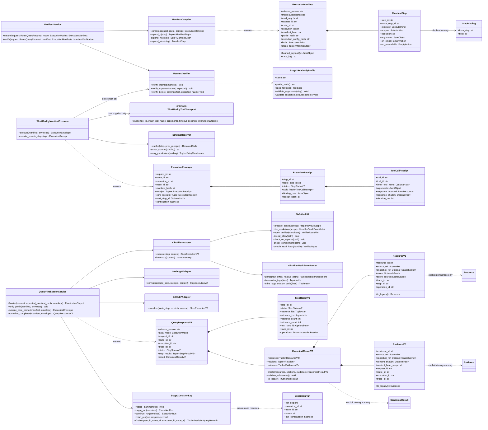
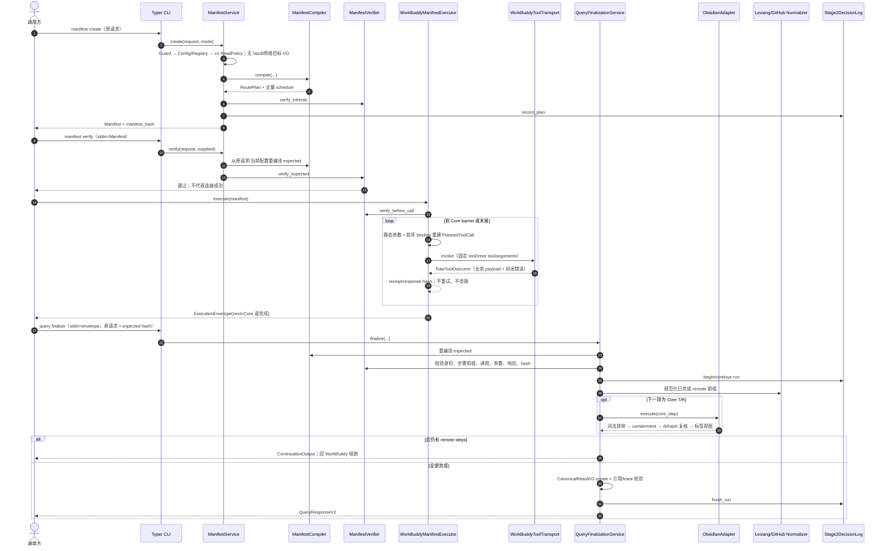
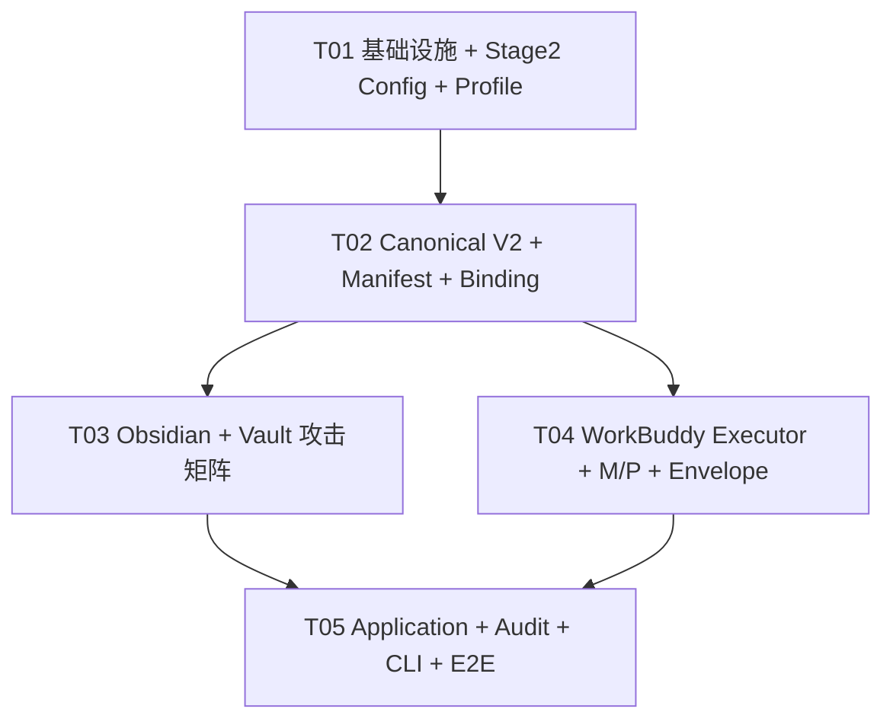

# MTR-P Hub 阶段 2 增量架构：真实只读查询闭环

> 文档状态：可实施架构设计；不包含实现代码，不代表真实 Vault/乐享/GitHub 已完成验收
> 基线：本地 `main` commit `188d3e2`，阶段 0+1 历史基线为 119 项测试、30 个 Python 模块；阶段 2 兼容验收为 118 项原样 + 1 项授权迁移
> 正式 origin：`git@github.com:13Asix21/MTR-P-hub.git`；截至本次同步远端仍无 refs，本地 `188d3e2` 未 push，不得据此声称远端已有该快照；本架构不执行 push
> 上游：`docs/prd-stage-2.md` 第 6/7/8/9 节、`docs/architecture-stage-0-1.md`、实施计划
> 强制边界：保留 `route query` v1 字节契约和 Fake golden；不做 Git 写操作、不实现 Native/LocalGit/FastAPI/MCP Hub，不进入阶段 3/4/5
> 工具调查边界：本次仅调用工具分类/Schema 元数据接口，没有执行真实 Vault 读取、乐享内容搜索或 GitHub 内容查询

---

# Part A：System Design

## 1. 实现方案与最小增量策略

### 1.1 核心技术难点与架构决策

| 难点 | 决策 | 可验证结果 |
|---|---|---|
| 旧 v1 输出不能被新字段或真实执行污染 | 旧 `RouteQueryService/RouteQueryResponse/ReadPlan/Resource/Evidence/StepResult` 保持原类型与原 presenter；新增独立 `application_stage2.py`、`domain/models_v2.py`、`execution/` 和新 CLI 命令树 | 118 条旧测试原样通过；仅获授权的 1 条“真实 Adapter 不存在”断言升级为全源码无外连审计；Fake golden 与 `route query` bytes 不变 |
| WorkBuddy 连接器不能由独立 Python CLI 继承 | Core 只编译/重编译/验证 Manifest；真实工具仅经宿主提供的 `WorkBuddyToolTransport` 调用。仓内只有 Fixture/Spy transport，没有 HTTP/SDK/subprocess transport | 对 CLI 禁用 socket/subprocess 后 Fixture 全套仍通过；真实调用只出现在 WorkBuddy 侧 |
| Manifest 可自校验但仍可能被整体替换 | `manifest verify` 和 `query finalize` 都用**原请求 + 当前受信配置重新编译 expected Manifest**，再逐字段比较；不只相信输入 Manifest 自报的 hash | 改库、仓库、ref、query、步骤、参数、hash、execution ID 均在目标访问前失败 |
| 路由中既有远端步骤又有 Core Vault 步骤 | Manifest 是全量有序 schedule；WorkBuddy 到 `executor=core` 的 barrier 必须停止，`query finalize` 执行连续 Core 步骤，若后仍有远端步骤则输出 continuation | `decision_history` 实际顺序仍是 P→T→M，不能为简化而预取 M；三个重点 intent 顺序也保持 v1 |
| 动态 commit/entry ID 不能让执行者自由补参 | 仅允许 `{"from_step":"...","field":"..."}`；commit 只接受完整 40 位小写 SHA，entry ID 只接受当前 profile 约定的完整 ID；绑定类型/空值/数量错误后禁止回退 branch latest | 工具 Spy 证明失败的 SHA 绑定后没有 `get_file_contents(ref=...)` 或省略 SHA 的调用 |
| Vault 路径校验与真实读取顺序 | 纯词法包含/排除 → managed root/父目录/`lstat`/重解析点 containment → `rb` 打开 → 文件身份及双重 bytes hash 复核；排除优先，绝不遍历 Vault 根 | 攻击路径在 `open` 前被拒绝；symlink/junction 目标无 `stat/open`；不会在 Vault 写日志 |
| 空结果、部分无效条目与真正异常不同 | 逻辑路由步骤聚合为 `OK/EMPTY/DEGRADED/REJECTED`；空搜索是 EMPTY，空响应/畸形响应是 DEGRADED，单条无效不拖垮其他合法条目 | M 空库继续 T；真实无 T/R 标签不是异常；合法部分结果与跳过计数同时可见 |
| 同一确定性 Manifest 可执行多次 | `request_id/route_id/execution_id/trace_id` 保持确定；SQLite `run_seq` 标识每次执行，continuation 以 hash 链接，时间和 seq 不进入 Canonical stdout | 三进程 Fixture 输出逐字节一致；审计中能区分多次执行 |
| 回执需复核但不能存原文 | envelope 中原始业务 payload 仅内存/stdin/stdout 交接；审计只保留 `receipt_hash/response_sha256`、计数、状态、原因和耗时，v2 OperationResult 只保留确定性 `receipt_hash` | QA 可现场重算两类 hash，并对照 WorkBuddy 调用证据；DB/报告无正文、token、Cookie、remote URL |

### 1.2 模块拓扑

```text
                       受信 YAML + 原请求
                              │
                              ▼
                ManifestService / ManifestCompiler
                 │  v1 ReadPolicy 仅提供逻辑路由
                 │  新增 Stage2RoutePlan + 全量 schedule
                 ▼
                ExecutionManifest（不可变、hash 绑定）
                  │                         │
       manifest verify（重编译）             │ WorkBuddy 仅执行 remote 段
                  │                         ▼
                  │              WorkBuddyManifestExecutor
                  │              stage2-readonly-v1（封闭）
                  │              WorkBuddyToolTransport（宿主）
                  │                         │
                  │                         ▼
                  │              ExecutionEnvelope（stdin/内存）
                  │                         │
                  ▼                         ▼
                  QueryFinalizationService（重编译 + 全量校验）
                     │              │
                     │              ├─ ObsidianAdapter（Core 本地只读）
                     │              ├─ LexiangMAdapter（仅规范化，无网络）
                     │              └─ GitHubPAdapter（仅规范化，无网络）
                     ▼
          CanonicalResultV2 + StepResultV2 + trace_id
                     │
                     ▼
          同一 SQLite 中兼容新增 stage2 表（白名单审计）
```

依赖规则：

1. `domain/models_v2.py` 不 import CLI、Adapter、SQLite 或 transport。
2. `execution/profile.py` 是唯一逻辑 operation→实际工具 ID/固定参数/响应契约映射；Manifest 不含可自由选择的 tool ID。
3. `adapters/lexiang.py` 和 `adapters/github.py` 是**逻辑规范化 Adapter**，不包含网络、SDK、凭据或 subprocess。
4. `adapters/obsidian.py` 是唯一真实 Vault 文件读取入口；`SafeVaultIO` 是唯一目标文件 I/O 边界。
5. `WorkBuddyToolTransport` 是宿主端口。仓内不提供真实实现，因此 CLI 无法绕过 WorkBuddy 自行访问 M/P。
6. `audit` 只接收白名单 DTO；不得接收原始请求、原始响应、Resource 标题或异常全文。
7. 旧 `fixtures/vault.py` 不改。其“行内标签不算 frontmatter 标签”的 v1 Fake 契约继续保留；真实 Obsidian 使用新 `adapters/obsidian_markdown.py`，避免改变旧 golden。

### 1.3 旧模块复用与不改动清单

| 旧模块 | 阶段 2 用法 | 最小变更策略 |
|---|---|---|
| `canonical.py` | 复用 `canonical_json/sha256_json/sha256_bytes/stable_id/request_fingerprint` | 不改序列化参数；新派生函数放 `execution/identity.py` |
| `security.py` | 复用 bootstrap、坐标词法 Guard、写动词 Guard | v1 行为不改；Vault 专用检查放 `SafeVaultIO` |
| `config/loader.py`、三个旧配置 | 继续生成 `LoadedConfig`、Store/Project Registry、v1 RoutingPolicy | 不要求旧命令读取第四份配置；新 `Stage2ConfigLoader` 组合旧 loader |
| `registry/projects.py` | 解析 project/repo/authoritative location/ref/ADR roots | 不增加 LocalGit 执行；stage2 GitHub owner/repo/path 由新增受信绑定表跨引用校验 |
| `registry/stores.py` | 继续提供逻辑 P/M/T/R ID 和 T/R tag/vault ID | `stores.yaml` 的 `adapter: fake` 不改；真实 stage2 模式由新配置显式选择，旧 CLI 不会自动切换 |
| `routing/policy.py`、`planner.py` | 生成既有五 intent 的 v1 ReadPlan | 不改 v1 步骤和 hash；在其外构造 `Stage2RoutePlan` |
| `fixtures/vault.py`、`adapters/fake.py` | 旧 Fake 测试继续使用 | 原文件保持行为；新解析器和新 Fixture 不注入旧 bundle |
| `domain/models.py`、`requests.py`、`enums.py` | 复用 `SourceRef/SnapshotRef/ProjectCoordinate/Relation` 等值对象 | 不给旧 Resource/Evidence/StepResult 添加字段；v2 独立模型并提供显式 downgrade |
| `application.py`、`cli.response_payload()` | v1 唯一 Fake 执行入口和字节 presenter | 不把 execution/trace/score 塞入 v1 JSON；新命令使用新 presenter |
| `audit/sqlite.py` | v1 继续写 `decision_log` 表 | 不 ALTER 旧列、不改旧查询返回；同库新增 `stage2_*` 表 |
| `errors.py` | 复用 `MtrpError` 的 0/1/2 映射与安全消息 | 只新增封闭错误码常量/原因枚举，不回显原异常或恶意值 |

### 1.4 框架选择

沿用 Python 3.11.11、Pydantic v2、Typer、`ruamel.yaml`、SQLite、Pytest。新增能力只用标准库：`os/scandir/lstat`、`pathlib/PurePosixPath`、`stat`、`hashlib`、`json`、`sqlite3`、`unicodedata`。

不新增 HTTP 客户端、Git SDK、乐享 SDK、Obsidian 插件、ORM、迁移框架、FastAPI、MCP SDK 或 Native 凭据依赖。Windows junction/reparse 检查使用 `lstat`、`is_symlink` 和可用时的 `st_file_attributes & FILE_ATTRIBUTE_REPARSE_POINT`；不借第三方库扩大文件系统能力。

---

## 2. 增量文件树与职责

以下只列阶段 2 新增或需修改的文件。`docs/architecture-stage-2.md` 和两份 Mermaid 是本次架构交付，其余由工程任务实现。

```text
.
├── pyproject.toml                              # 修改描述/版本；依赖尽量不变
├── .gitignore                                 # 增加 config/stage2.yaml、真实证据临时交接/原始响应排除
├── config/
│   └── stage2.example.yaml                    # 新增；fixture/disabled 安全默认，无真实路径/凭据
├── docs/
│   ├── architecture-stage-2.md
│   ├── class-diagram-stage-2.mermaid
│   ├── sequence-diagram-stage-2.mermaid
│   └── capability-matrix.md                   # 修改；分开 Fixture/真实/Native 状态
├── src/mtrp_hub/
│   ├── cli.py                                 # 修改；新增 manifest/query/trace 命令，旧 route query 不改
│   ├── application_stage2.py                  # 新增；ManifestService + QueryFinalizationService
│   ├── errors.py                              # 修改；仅新增安全错误码定义/映射
│   ├── domain/
│   │   ├── models_v2.py                       # 新增；Resource/Evidence/CanonicalResult V2
│   │   └── requests_v2.py                     # 新增；StepResult/StepExecution/QueryResponse V2
│   ├── config/
│   │   └── stage2.py                          # 新增；第四份配置 DTO、loader、跨 Registry 校验
│   ├── adapters/
│   │   ├── stage2_base.py                     # 新增；Stage2ExecutionContext/规范化端口
│   │   ├── obsidian.py                        # 新增；真实只读 ObsidianAdapter + SafeVaultIO
│   │   ├── obsidian_markdown.py               # 新增；真实 Markdown 标签解析，排除代码块
│   │   ├── lexiang.py                         # 新增；逻辑 M 响应规范化，无网络
│   │   └── github.py                          # 新增；逻辑 P 响应规范化，无本地 Git
│   ├── execution/
│   │   ├── __init__.py
│   │   ├── identity.py                        # request/route/execution/trace/hash 派生
│   │   ├── models.py                          # Manifest/Step/Binding/Limits/RoutePlan
│   │   ├── profile.py                         # stage2-readonly-v1 唯一封闭 profile
│   │   ├── compiler.py                        # v1 逻辑步骤展开为全量有序 schedule
│   │   ├── verifier.py                        # intrinsic + expected recompile 校验
│   │   ├── binding.py                         # 前序绑定、类型/数量/空前缀检查
│   │   ├── envelope.py                        # Envelope/Receipt/RawResponse/Continuation
│   │   └── executor.py                        # WorkBuddy executor + host transport Protocol
│   ├── fixtures/
│   │   ├── stage2_schemas.py                  # 新增；严格 Fixture 原始响应与 Vault 配置
│   │   ├── stage2_loader.py                   # 新增；cwd-confined Fixture JSON，重复键/NaN 拒绝
│   │   └── stage2_transport.py                # 新增；Fixture/Spy transport，零网络
│   └── audit/
│       ├── models_stage2.py                   # 新增；白名单 plan/run/step/receipt DTO
│       └── sqlite_stage2.py                   # 新增；同库兼容新增表、run_seq、trace 查询
└── tests/
    ├── conftest.py                            # 修改；stage2 禁网、临时 Vault、spy 公共工具
    ├── unit/
    │   ├── test_stage2_config.py
    │   ├── test_stage2_profile.py
    │   ├── test_execution_manifest.py
    │   ├── test_execution_bindings.py
    │   ├── test_obsidian_markdown.py
    │   ├── test_obsidian_adapter.py
    │   ├── test_lexiang_stage2.py
    │   ├── test_github_stage2.py
    │   └── test_stage2_audit.py
    ├── contract/
    │   ├── test_stage2_tool_contracts.py
    │   ├── test_stage2_envelope_contracts.py
    │   └── test_stage2_cli_contract.py
    ├── integration/
    │   ├── test_stage2_routes.py
    │   ├── test_stage2_continuation.py
    │   └── test_stage2_determinism.py
    ├── security/
    │   ├── test_no_external_calls.py             # 仅迁移第61–82行用例为全源码AST无外连审计，其余函数不改
    │   ├── test_stage2_vault_attacks.py
    │   ├── test_stage2_manifest_tampering.py
    │   ├── test_stage2_no_external_calls.py
    │   └── test_stage2_secret_scanning.py
    └── fixtures/stage2/
        ├── manifest-project-context.json
        ├── manifest-decision-history.json
        ├── lexiang-space.json
        ├── lexiang-text-empty.json
        ├── lexiang-text-nonempty.json
        ├── lexiang-vector-empty.json
        ├── lexiang-vector-nonempty.json
        ├── lexiang-entry-complete.json
        ├── lexiang-entry-no-version-score.json
        ├── lexiang-nonempty-unverified.json
        ├── github-branches-empty.json
        ├── github-branches-ready.json
        ├── github-commit-a.json
        ├── github-commit-b.json
        ├── github-readme-text.json
        ├── github-readme-invalid-header.json
        ├── malformed-responses.json
        └── vault/                            # 临时复制到 tmp_path 后测试，不触真实 Vault
            ├── 2-Permanent/中文目录/trial-inline.md
            ├── 2-Permanent/中文目录/rarely.md
            ├── 2-Permanent/unmanaged.md
            ├── 2-Permanent/tag-conflict.md
            ├── 2-Permanent/code-fences.md
            ├── 2-Permanent/invalid-yaml.md
            └── 2-Permanent/Resources/MTR-P-System/excluded.md
```

### 2.1 配置迁移策略

- 旧 `stores.yaml/projects.yaml/routing.yaml` 文件名、schema 和语义均不变。
- 只有 stage2 新命令读取第四份 `stage2.yaml`；`config/stage2.example.yaml` 使用 `mode: fixture`、占位 ID、`g1_confirmed: false`，复制后不能意外执行真实访问。
- 真实 `config/stage2.yaml` 必须 gitignored。真实 Vault 绝对路径、team/space/root entry ID、GitHub owner/repo 只允许在本地受信配置中；不新增 token。
- 正式工程 origin 仅记录为 `git@github.com:13Asix21/MTR-P-hub.git`；不得使用 `github-mtrp` 别名，也不得把本地 SSH 配置或 `188d3e2` 写成远端可读快照。Stage2 Registry 只物化 owner/repo/ref/path，不保存 SSH key/`core.sshCommand`，不执行 push。
- `config-dir` 和 `.mtrp` 必须位于真实 Vault 外。Stage2 服务在创建 SQLite 前完成 `CONFIG_INSIDE_VAULT/AUDIT_INSIDE_VAULT` 检查，避免为了审计而在 Vault 写文件。
- 旧 `route query` 即使没有 `stage2.yaml` 也照常运行；stage2 命令缺第四份配置时返回 `STAGE2_CONFIG_NOT_FOUND`，不回退到真实自动发现。

示例逻辑结构（不是可执行真实配置）：

```yaml
schema_version: "1"
obsidian:
  mode: fixture
  vault_id: fixture-vault
  vault_root: tests/fixtures/stage2/vault
  managed_roots:
    - {root_id: permanent, path: 2-Permanent}
  excluded_roots:
    - 2-Permanent/Resources/MTR-P-System
    - 2-Permanent/Areas/AI-Assets/_templates
  trial_tag: mtr/trial
  rarely_tag: mtr/rarely
  read_only: true
  follow_symlinks: false
  g1_confirmed: false
  max_file_bytes: 1048576
  max_scan_files: 5000
  max_results: 100
lexiang_m:
  mode: fixture
  team_id: "00000000000000000000000000000000"
  space_id: "00000000000000000000000000000000"
  root_entry_id: "00000000000000000000000000000000"
  read_only: true
  allow_empty: true
  search_modes: [text, vector]
  max_results: 5
  vector_threshold: 0.3
  max_entry_bytes: 262144
  timeout_seconds: 10
github_p:
  mode: fixture
  read_only: true
  timeout_seconds: 10
  max_file_bytes: 1048576
  repositories:
    - project_id: example-project
      repo_id: example-repo
      location_id: remote-main
      owner: example-owner
      repo: example-repo
      read_paths: [README.md]
      adr_files: []
workbuddy_manifest:
  schema_version: "1"
  tool_profile: stage2-readonly-v1
  max_steps: 32
  max_entry_reads: 10
  max_envelope_bytes: 16777216
  persist_raw_responses: false
```

硬约束：`read_only` 只能为 `true`、`follow_symlinks` 只能为 `false`、`persist_raw_responses` 只能为 `false`；`max_steps<=32`、`max_entry_reads<=10`、单搜索 `max_results<=5`、单文件/单条目/单信封均有上限。真实模式要求 `g1_confirmed=true`，且 `vault_root` 为显式本地绝对路径；fixture 模式只允许 cwd 相对 Fixture Vault。

---

## 3. 数据结构、接口与执行契约

### 3.1 全局不变量

1. 新 DTO 全部 `frozen=True, extra='forbid'`；`arguments` 虽为 JSON object，但必须再由 profile 按 operation 做精确键集合和嵌套 schema 校验，不能因字典而放过额外参数。
2. JSON 解析拒绝重复键、NaN/Infinity、超限输入；canonical JSON 继续 `sort_keys=True`、紧凑分隔符、UTF-8、`allow_nan=False`。
3. Manifest/Plan 不含时钟、随机数、SQLite seq、duration；真实 envelope 可含 duration，但 v2 Canonical stdout 不含 duration/run_seq。
4. query 只出现在需要它的 `keyword/filters.keyword` 和 Core Vault view 参数中；任何 URL 字符串在 query 中仍只是文本，不能变成 fetch 参数。
5. 除 GitHub 根目录读取的 profile 固定默认路径外，所有 repo/Vault path 都是 NFC、`/` 分隔的相对路径；拒绝反斜杠、盘符、UNC、URL、空段、`.`、`..`、控制字符。
6. 所有步骤严格串行。禁止以并行、预取、重试或自动改路优化为由改变 schedule。
7. 真实响应的标题、正文、remote URL、认证信息只能在受控内存/stdin 中出现；Decision Log 只接收显式安全 DTO。

### 3.2 ID、hash 与已确认的派生身份规则

| 值 | 精确派生规则 |
|---|---|
| `request_hash` | 复用 v1 `request_fingerprint`，不持久化原始 query |
| `request_id` | `"req_" + request_hash` |
| `plan_hash` | 对完整 `Stage2RoutePlan`（排除自身 `plan_hash`） canonical JSON 计算；其中含 v1 路由、Registry/policy hash、stage2 execution config hash 和 mode |
| `route_id` | `"route_" + plan_hash` |
| `manifest_hash` | 对完整 `ExecutionManifest` canonical JSON 计算，**排除派生字段 `execution_id` 与 `manifest_hash`**，其余所有字段均参与 |
| `execution_id` | `"exe_" + manifest_hash` |
| `trace_id` | `"trace_" + sha256_json({"request_id": request_id, "route_id": route_id, "execution_id": execution_id})`；不在 Manifest 内，避免再次形成循环 |
| `profile_hash` | 对 profile 名称、全部 operation、实际工具 ID、固定 schema、binding/response contract 版本计算；映射变化必须升 profile 版本 |
| `response_sha256` | 对完整 raw business response 计算，用于 envelope/审计完整性复核；只存 hash，不进入 v2 OperationResult |
| `receipt_hash` | 对 receipt 的 step/身份/status/reason/实际调用 tool/arguments 及 **per-operation 确定性响应投影**计算，排除 receipt 自身和 duration；投影只含第 3.5 节批准字段，不含随机 request_id、config、html_url、commit message、protected 或 header blob SHA |
| `continuation_hash` | 对当前完整 envelope（排除 `continuation_hash` 自身）计算；用于跨进程继续同一执行 |

**已确认的循环消解规则**：产品与主理人已正式确认，`execution_id` 与 `manifest_hash` 都是派生身份元数据，canonical Manifest 仅排除这两个字段；包括 `request_id/route_id`、坐标、步骤、操作和参数在内的其余字段全部参与 SHA-256。随后固定 `execution_id="exe_"+manifest_hash`。`manifest verify` 和每次执行前都必须重算 hash，并同时等值校验收到的 `manifest_hash` 与派生 `execution_id`。单独篡改 `execution_id` 同样在任何工具调用前拒绝；执行者无权自行重签，任何需要重算的变化都回 Router。该规则已同步至 PRD 第 6.3 节，不再是待确认项。

### 3.3 `ExecutionManifest` 字段

| 字段 | 类型/约束 | 说明 |
|---|---|---|
| `schema_version` | `Literal["1"]` | Manifest 自身版本，不是 Canonical v2 |
| `mode` | `fixture / obsidian-local / workbuddy-manifest` | Fixture 不冒充真实；obsidian-local 只允许无 M/P 的可行路由 |
| `read_only` | `Literal[true]` | 任何 false 都拒绝 |
| `request_id/route_id/execution_id` | 上述派生 ID | 全部重算核对 |
| `request_hash/plan_hash/manifest_hash` | 64 位小写 SHA-256 | hash 算法版本由 schema/profile 固定 |
| `tool_profile` | `Literal["stage2-readonly-v1"]` | 配置不能扩张 |
| `profile_hash` | 64 位 SHA-256 | 防止同名 profile 被悄悄改映射 |
| `execution_config_hash` | 64 位 SHA-256 | 包括 Vault 范围、M/P 坐标、path、limit、threshold、G1/mode 等所有执行语义；只存 hash，不存 Vault 根 |
| `limits` | `ExecutionLimits` | `max_steps/max_entry_reads/max_tool_calls/max_file_bytes/max_entry_bytes/max_envelope_bytes/max_scan_files/max_results` |
| `steps` | 有序 `ManifestStep[]`，1..32 | 同时含 remote 与 Core barrier；顺序即实际执行顺序 |

`ManifestStep`：

| 字段 | 约束 |
|---|---|
| `step_id` | 全局唯一、确定派生，如 `s01-p-02-resolve-ref` |
| `route_step_id` | 对应 v1 逻辑步骤，如 `s01-p`；多个工具步骤最后聚合为一个逻辑 StepResult |
| `executor` | `workbuddy` 或 `core`；core 只允许 Obsidian view step |
| `adapter` | `github-p / lexiang-m / obsidian-local` 封闭枚举 |
| `operation` | profile 中的逻辑 operation，不是任意 tool name |
| `arguments` | 精确 schema；动态值只允许 `StepBinding` |
| `on_empty/on_unavailable` | 从所属 v1 逻辑步骤继承，不由执行者改写 |
| `read_only` | 恒 `true` |

Core Obsidian step 的参数仅含 `{vault_id, view_tag, query, scope_sha256}`；**不含 `vault_root`、managed/excluded 绝对路径或本地文件路径**。WorkBuddy 因而无法代替 Core 扩大 Vault 范围。

### 3.4 前序绑定算法

唯一形式：

```json
{"from_step": "s01-p-02-resolve-ref", "field": "commit"}
```

或：

```json
{"from_step": "s02-m-02-search-text", "field": "entry_reads"}
```

允许的 source field 是 profile 封闭定义：

| 消费 operation | source field | 期望类型 | 失败行为 |
|---|---|---|---|
| `github_read_repository_root/github_read_file` | `commit` | 完整 40 位小写 SHA-1 字符串 | null、空串、7/8 位短 SHA、数组、数字均为 `BINDING_TYPE_INVALID/BINDING_EMPTY`；不得改用 ref/latest |
| `lexiang_read_entries` | `entry_reads` | `EntryCandidate[]` | 非列表、条目非对象、ID 缺失/非法、超过限制均失败；合法空列表才产生 EMPTY 且零读取 |

当前 profile 对 entry ID 采用与已登记乐享 ID 一致的 32 位小写十六进制完整值。若未来连接器允许其他 ID 形式，必须升级 profile，而不是执行器放宽猜测。

`EntryCandidate` 固定字段：`entry_id/title/score/score_source/version/revision/provider_content_sha256`。除 `entry_id/title` 外可空；score 只接受有限 `0..1` 数字，否则为 null 并记 `SCORE_UNAVAILABLE`，不 clamp、不归一化。

绑定静态校验在首次调用前完成：

1. `from_step` 必须存在且严格位于当前步骤之前，禁止 self/forward/cycle。
2. source operation 必须声明该 field；不允许任意 JSONPath、属性链、字典键注入或脚本表达式。
3. 所有 step ID 唯一，schedule 顺序、route_step_id 和 binding 依赖必须与 Router 展开结果一致。
4. `max_steps` 在编译和 verify 两次检查；`max_entry_reads` 是整次执行所有 `lexiang_read_entries` 的候选数总和，跨 text/vector 重复条目也计实际读取。
5. 配置须保证 `max_entry_reads >= 各启用搜索的 max_results 之和`，防止搜索后才必然超限。响应若超过请求 limit，则在任何 entry read 前以 `RESPONSE_CONTRACT_INVALID` 降级。
6. 同一搜索内重复 entry ID 由响应规范化按首次出现去重；跨普通/向量搜索不去重、不融合 score。每个 entry 固定先 `entry_describe_entry`、后 `entry_describe_ai_parse_content`，再处理下一条。

### 3.5 `stage2-readonly-v1` 精确工具白名单与真实响应契约

#### 已确认范围与状态定义

工具 ID 和输入 schema 来自只读元数据调查；乐享工具的元数据均标有 `readOnlyHint: true`。本架构师没有执行真实内容查询。主理人随后已在阶段 2 授权下完成真实只读契约探测，以下精确形态据此标为 `real-contract-tested`：

- 乐享空间解析、普通搜索的**真实空结果**、向量搜索的**真实空结果**；
- GitHub branches 数组、get_commit 顶层完整 SHA、root@commit 数组，以及 README@commit 的受控 UTF-8 text 形态。

`real-contract-tested` 只覆盖本文列出的响应形态，不表示同工具所有响应版本、所有文件类型或所有 nonempty M 数据都已实测。乐享 nonempty 搜索条目、score/version、`entry_describe_entry` 和 `entry_describe_ai_parse_content` 仍为 `Fixture-tested / real-not-tested`。不得把 Fixture 的条目结构写成真实契约。

完全未验证的 operation 在真实调用前仍以 `TOOL_CONTRACT_UNCONFIRMED` 拒绝。已经允许调用的 operation 若实际返回超出已验证形态，则在本次调用后标 DEGRADED + `RESPONSE_CONTRACT_INVALID`；若是 nonempty M 搜索，则标 `M_NONEMPTY_CONTRACT_UNCONFIRMED`，不得生成 entry binding，后续 describe/AI parse 调用数必须为 0，并按计划继续 T。空结果与未验证 nonempty 结果绝不能混为同一种 EMPTY。

#### 乐享：统一经固定 outer tool，内层名称也封死

Outer tool 永远是 `mcp__lexiang__call_tool`，其参数固定为：

```json
{"tool_name": "<profile 代码常量>", "arguments": "<下方精确参数>"}
```

Manifest 中没有 outer/inner tool name 字段，执行者不能选择其他 inner tool。

| 逻辑 operation | 固定 inner tool | 精确实际参数（除声明 binding 外均来自 Registry/profile） | 已确认 raw response → Core 投影 | 状态 |
|---|---|---|---|---|
| `lexiang_resolve_space` | `space_describe_space` | `{"space_id": configured_space_id}`；不传 `entry_id/with_config/with_team/with_trashed/_mcp_fields` | 实测 envelope 为 `{code:0,message:"success",data:{space:{id,root_entry_id,team_id,...},config:{...}},request_id:<random>}`。仅接受 code=0/message=success，并只映射 `data.space.id→space_id`、`root_entry_id`、`team_id`；三者必须等于配置。config、space 其他字段和随机 request_id 不进入确定性输出、receipt 投影或日志 | `real-contract-tested` |
| `lexiang_search_text` | `search_kb_search` | `{"keyword": query,"type":"doc","space_id": configured_space_id,"limit": max_results,"include_references":false,"highlight":false,"title_only":false}`；不传 filters/team_id/space_ids/page_token/sort_by/tag_ids | 实测空 envelope 为 `{code:0,message:"success",data:{},request_id:<random>}`。**code=0 且 data={} 是合法 EMPTY**，投影为 `SearchBatch{entry_reads:[],result_count:0,score_available_count:0}`，不是空响应或 DEGRADED；request_id 忽略。非零 code、null、空文本及其他非契约形态按安全错误处理 | 空形态 `real-contract-tested`；nonempty `real-not-tested` |
| `lexiang_search_vector` | `search_kb_embedding_search` | `{"filters":{"keyword":query},"space_id":configured_space_id,"limit":max_results,"threshold":vector_threshold}`；当前默认 threshold=0.3 | 与普通搜索相同，实测 `{code:0,message:"success",data:{},request_id:<random>}` 为合法 EMPTY；threshold 是输入过滤条件，绝不能当成结果 score | 空形态 `real-contract-tested`；nonempty/score `real-not-tested` |
| `lexiang_read_entries` | 第一调用 `entry_describe_entry` | 每个 candidate 固定 `{"entry_id": full_entry_id}`；不传可选 permission | Fixture 契约 `KnowledgeEntryMeta{entry_id,space_id,entry_type,name,version,revision,provider_content_sha256}`，space_id 必须匹配；真实字段路径未验证，不能据此执行真实 nonempty 解析 | `Fixture-tested / real-not-tested` |
| 同上，紧随其后的第二调用 | `entry_describe_ai_parse_content` | 同一 candidate 固定 `{"entry_id": full_entry_id}`；不传 `_mcp_fields` | Fixture 契约 `KnowledgeEntryContent{entry_id,content_format,content_text}`；真实 markdown/html/OCR 格式字段尚未验证 | `Fixture-tested / real-not-tested` |

普通搜索的 `type="doc"` 用来排除 folder/attachment；本轮不调用目录遍历、Ask AI、知识图谱、写条目、Block 写工具或文件上传/下载。普通搜索不做分页；向量搜索也不自动补页。nonempty M 契约未打开前，executor 只能确认搜索“不是已验证空形态”，不能猜测 entry ID、score 或 version，也不能为了获取真实样本而调用后续 entry 工具。

#### GitHub：直接固定只读工具

| 逻辑 operation | WorkBuddy 实际工具 ID | 精确实际参数 | 已确认 raw response → Core 投影 | 状态 |
|---|---|---|---|---|
| `github_list_branches` | `mcp__github__list_branches` | `{"owner":registry_owner,"repo":registry_repo,"page":1,"perPage":100}` | 实测数组 `[{name,sha,protected}]`；逐项只映射 `name/sha` 为 `BranchInfo{name,commit}`，protected 不进入确定性输出/日志。`[]` 为 EMPTY_REPOSITORY，不能伪造 commit；sha 必须是完整 40 位小写值 | `real-contract-tested` |
| `github_resolve_ref` | `mcp__github__get_commit` | `{"owner":owner,"repo":repo,"sha":registry_ref,"detail":"none","page":1,"perPage":1}` | 实测顶层包含完整 40 位 `sha` 以及 `commit/html_url`；只取顶层 `sha→commit`，commit message、html_url 和其余字段不进入确定性输出/日志。缺 SHA/短 SHA/未解析均 DEGRADED，不换分支 | `real-contract-tested` |
| `github_read_repository_root` | `mcp__github__get_file_contents` | `{"owner":owner,"repo":repo,"sha":Binding(commit),"fields":["type","name","path"]}`；省略 path，使用工具固定仓库根默认值；禁止 ref | 实测 root@commit 返回数组 `[{name,path,type}]`；只投影这三个字段为 `RepositoryRoot{entries}`，只验证该 commit 下根可读，不生成 Resource，不递归列库 | `real-contract-tested` |
| `github_read_file` | `mcp__github__get_file_contents` | `{"owner":owner,"repo":repo,"path":configured_relative_path,"sha":Binding(commit)}`；禁止 ref/fields/URL | 实测 README@commit 返回受控 text：首行 `successfully downloaded text file (SHA: <40位blob SHA>)`，换行后为 UTF-8 文本；严格去头得到 `GitHubFileData{path,content_text,content_sha256,content_hash_scope:"response_utf8"}`。响应不回显 path、无 base64，path 只能取自已验证 PlannedToolCall | 仅该 text 形态 `real-contract-tested` |

真实 P 契约探测还观察到：`13Asix21/MTR-P` 的 `main` 与 `get_commit` 均解析到 `c3a6c7b83ced99a01b2b51039e87a40ee29df6a5`，root 与 README@同一 commit 可读。该值只是本次契约证据，**不得写死为 Registry pin 或未来执行预期**；每次执行仍按 Manifest 重新 resolve，A/B SHA 不合并。

GitHub file text 的严格算法：

1. `RawResponse.kind` 必须为 text，且从第一个字符起匹配 `successfully downloaded text file (SHA: [0-9a-f]{40})`；首行后必须紧跟 `\n` 或 `\r\n`。前导说明、额外前缀、短 SHA、缺失换行、多个候选头或无法唯一去头均为 `RESPONSE_CONTRACT_INVALID`。
2. header 中 40 位值只是 connector 报告的 **blob SHA**，格式核对后即丢弃；不得赋给 commit/snapshot_ref，也不得把它当作本文内容的 SHA-256 或宣称 Git blob 原始 bytes 已读取。
3. 仅取首个换行后的剩余字符串为 `content_text`，不得 `strip()`、改换行、 NFC 规范化或再添加末尾换行。`content_sha256=SHA256(content_text.encode("utf-8"))`，`content_hash_scope=response_utf8`；hash 不包括 connector header，也不声称等于 Git 原始文件 bytes hash。空正文可以是合法空文件 Resource，不等于 P_EMPTY。
4. `path/ref/commit` 全部来自已验证 PlannedToolCall 与前序 commit binding；文件响应没有 path 回显，不得编造“path 已回显一致”的检查。正文 UTF-8 大小仍受 `max_file_bytes` 限制。

其余约束：

- 真实 P 链固定 `list_branches → resolve_ref → read_repository_root@commit → read_file@commit`；root/file 都绑定同一完整 commit。
- `read_repository_root` 省略 path 只表示 GitHub API 的仓库根，不是本地绝对路径，任何请求都不能提供该操作的路径。
- `list_branches` 最多一页，不为 `general_knowledge` 或普通 M 查询枚举 P。若首页包含目标 ref，其数组项 `sha` 与 resolve 顶层 `sha` 不同则记 `REF_SNAPSHOT_MISMATCH`，不混用两次快照；首页没有目标 ref 不构成失败，resolve 仍是权威解析。
- 没有专用、已确认的 `get_repository` 工具 ID，因此不虚构仓库元数据工具；仓库可见性由 bounded branches + 同 commit root read 证明。
- 禁止所有 create/update/delete/fork/push/PR/merge/release/issue 工具，禁止 search_repositories 代替 Registry，禁止任意 URL、本地 Git 和 dirty workspace。

### 3.6 WorkBuddy 执行信封与回执

`ExecutionEnvelope`：

| 字段 | 约束 |
|---|---|
| `schema_version` | `"1"` |
| `mode/request_id/route_id/execution_id/trace_id` | 与重编译 Manifest 及派生 trace 完全一致 |
| `manifest_hash/profile_hash` | 与已验证 Manifest 完全一致 |
| `receipts` | 只含已完成的 WorkBuddy steps；顺序与 schedule 前缀一致 |
| `core_receipts` | 只含已由 Core 完成的 T/R steps；continuation 时带回，下一进程重算比对 |
| `next_step_id` | 下一待执行 step，完成时为 null；不能跳过 core barrier |
| `continuation_hash` | 当前 envelope 内容 hash；用于恢复同一 run，不是随机 ID |

`ExecutionReceipt` 固定字段：`step_id/route_step_id/manifest_hash/execution_id/status/reason_code/calls/binding_data/receipt_hash`。每个 `ToolCallReceipt` 固定字段：

- `call_id/tool_id/inner_tool_name/arguments/arguments_sha256`；
- `response/response_sha256/status/reason_code/duration_ms`；
- `response` 是 `RawResponse{kind:"json",data}` 或 `RawResponse{kind:"text",text}`，只含业务 payload，不含 HTTP headers、Cookie、认证信息、transport 元数据；JSON hash 对 canonical JSON，text hash 对 exact UTF-8 text。

每个 operation 还必须定义 `receipt_projection`：space 只含三个逻辑 ID；空搜索只含规范化的 EMPTY SearchBatch；branches 只含 name/sha；get_commit 只含顶层 sha；root 只含 name/path/type；file 只含 planned path、前序 commit、去头正文的 content_sha256/hash_scope。`receipt_hash` 对该投影计算，因此随机 request_id 等传输字段不会改变 v2。完整 raw payload 仍用 `response_sha256` 绑定并供 QA 复核，但 response_sha256 只留在 envelope/审计，不进入 v2 OperationResult。忽略字段不得影响路由、snapshot、score 或任何业务决策。

回执验证顺序：

1. stdin 限量读取和严格 JSON/schema 校验；超过 `max_envelope_bytes` 直接 `ENVELOPE_TOO_LARGE`。
2. 重编译 expected Manifest，比较所有执行身份、profile、mode 和 hash。
3. 根据 `next_step_id` 推导**唯一合法前缀**：缺失、重复、额外、重排 step 均拒绝；未来 step 不得提前有 receipt。
4. 逐步从 Manifest + 前序 `binding_data` 重建 `PlannedToolCall[]`，逐调用比较 tool ID、inner name、完整 arguments 和调用顺序；执行者附加或省略参数都失败。
5. 重算 argument/response/receipt/continuation hash；OK 调用必须有响应，空响应不能伪装成 OK。
6. 校验 EMPTY/DEGRADED 的 calls 是否合法：正常空搜索可有一次搜索调用、零 entry read；上游失败后的依赖 step 必须显式为 DEGRADED + `UPSTREAM_BINDING_FAILED` 且零调用，不能直接“消失”。
7. 验证 response contract 和 binding_data，再由对应逻辑 Adapter 规范化。原始异常文本不参与错误消息或日志。

`REJECTED` 用于执行边界拒绝；连接器 timeout/permission/rate limit/not-found/unavailable/畸形响应是安全 DEGRADED。传输层只返回封闭 `ToolErrorKind`，未知错误统一 UNAVAILABLE，不把原始错误字符串带入 Core。

### 3.7 Core barrier、continuation 与职责分界

Manifest `steps` 覆盖完整 v1 顺序，而不是只列 M/P。WorkBuddy 遇到 `executor=core` 必须停止并交回 envelope；它不能读取 Vault、代替 Core 执行 T/R，也不能跳过 barrier 预取后续 M。

`query finalize` 是状态机入口，输出二选一：

- `ContinuationOutput{output_kind:"continuation",envelope}`：Core barrier 已处理，下一项仍是 remote；完整 envelope 仅通过 stdout 交回 WorkBuddy。
- `QueryResponseV2`：schedule 全部完成，输出 Canonical v2。

这样可以严格处理：

| intent | 实际 schedule |
|---|---|
| `project_context` | P remote 全段 → M remote 全段 → T Core |
| `general_knowledge/method_skill` | M remote 全段 → T Core |
| `decision_history` | P remote 全段 → T Core → continuation → M remote 全段 |
| `cold_detail` | R Core → T Core；WorkBuddy 初始 envelope 零调用 |

每个 continuation 都重新携带原始响应，供下一进程复核，不默认写文件。DB 只保存上一 `continuation_hash`；下一次 finalize 通过 `(execution_id, continuation_hash, IN_PROGRESS)` 找唯一 run。若完全相同的并发执行在同一 barrier 产生相同 hash，无法安全区分则报 `EXECUTION_RUN_AMBIGUOUS`，不得合并。阶段 2 不支持这种并发续跑；顺序重复执行不受影响。

`run_seq` 只在 DB 内部生成，不序列化到 continuation 或 v2，因此 Fixture 三进程输出仍确定。某次执行中断只留下 IN_PROGRESS/拒绝记录，不能写成完整成功。

职责分界：

- **WorkBuddy**：执行已验证 remote 调用、限定 timeout、返回业务 payload 和封闭错误类型；不能决定库、工具、参数、路由、Vault 范围、score、snapshot 或最终 Canonical ID。
- **Core executor 库（可在宿主进程中使用）**：profile、参数物化、binding、调用计划、receipt hash 和响应基础契约。
- **Core `query finalize`**：重编译、前缀/篡改校验、执行 T/R、完整规范化、稳定排序、引用完整性、trace 和审计。
- **独立 QA**：在受控内存交接时重算 hash，核对真实 WorkBuddy 调用记录、v2 `OperationResult.receipt_hash` 和 SQLite run/events。当前 MCP 没有签名工具溯源，hash 能证明内容一致与检测改动，不能证明恶意宿主一定真实调用过工具；因此真实验收必须保留宿主侧调用证据，不能仅凭自签 receipt 宣称真实连通。

### 3.8 ObsidianAdapter：精确安全读取流程

#### A. 配置与纯词法阶段（任何 Vault stat/resolve/open 前）

1. `managed_roots` 非空，每项 `{root_id,path}`；root_id 唯一，path 是安全相对路径，不能为 Vault 根本身，避免“扫描整个 Vault”。嵌套/重复 managed roots 拒绝，防止重复扫描。
2. excluded roots 使用**路径段包含**，不是字符串前缀。例如排除 `A/B` 会排除 `A/B/c.md`，不会误排 `A/B2/c.md`。
3. 候选相对路径必须满足 `candidate ∈ 任一 managed_root` 且 `candidate ∉ 任一 excluded_root`；排除优先。只接受 `.md`（suffix casefold 比较）。
4. managed root 若被 excluded root 完整覆盖，配置直接失败；T/R 的 trial/rarely 配置只能为题定字面值，`status/stale` 无特殊映射。
5. 真实模式要求 `read_only=true/follow_symlinks=false/g1_confirmed=true`，config-dir 与 audit-dir 均在 Vault 外。fixture 模式只能使用显式 cwd 相对 Fixture Vault，且不要求 G1。
6. `scope_sha256` 对 vault_id、managed root IDs/相对路径、excluded roots、tag、limits 计算；绝对 `vault_root` 只进入 execution config hash，不进入日志或 Core step arguments。

#### B. 文件系统 containment（打开文件前）

1. 仅对已配置 `vault_root` 和各 managed root 做 `lstat/resolve(strict=True)`；managed resolved path 必须位于 resolved Vault root 内，且 managed root 自身不得是 symlink/junction/reparse point。Vault root 是用户显式信任锚点，其 resolved root 成为后续唯一边界。
2. 用 `os.scandir` 显式栈遍历 managed roots，不用全盘搜索、不调用 Vault 根 `rglob`。目录进入前做 `lstat`、symlink/reparse 检查和 resolved parent containment。
3. Windows 同时检查 `Path.is_symlink()`、`os.lstat()` 和可用时的 `st_file_attributes & FILE_ATTRIBUTE_REPARSE_POINT`，覆盖 junction；POSIX 使用 `lstat`，可用时用 `O_NOFOLLOW` 加强打开约束。
4. 任何 symlink/junction（即使声称指向 Vault 内）都跳过并计数；不对其目标 `stat/open/resolve`。managed root 本身是链接则拒绝整个配置。排除目录内的链接不做目标检查，因为根本不会进入。
5. 文件必须是 regular file；候选 actual path 与 NFC 逻辑相对路径分别保存。I/O 使用 actual path，SourceRef 使用 NFC 逻辑路径。两个 actual path NFC 归一后冲突时报 `VAULT_PATH_COLLISION`，不任选一个。

#### C. 最后才 `rb` 打开与变化复核

1. 预检大小超过 `max_file_bytes` 则跳过；打开后仍最多读 `max_file_bytes+1`，防止文件增长。
2. 记录打开前 `(dev,ino,size,mtime_ns)`，打开后 `fstat` 比较身份/类型/大小；父目录再次 resolve containment。若平台身份字段不足或发生变化，保守跳过 `VAULT_FILE_CHANGED`。
3. 第一次读取 exact bytes 并计算 SHA-256；随后同一 handle `seek(0)` 第二次限量读取并重新计算。两次 hash、大小和 `fstat` 必须一致，再做路径 `lstat` 复核。任何变化均不生成 Resource。
4. hash 永远针对原始 bytes，包含 BOM 和原始换行；解析时可移除 UTF-8 BOM，但不得改变 hash。非 UTF-8（允许 UTF-8 BOM）记 `INVALID_ENCODING`，不做容错解码。
5. 只以 `rb` 打开，不调用 write/mkdir/chmod/rename/remove/backup/atomic replace。文件只读位不需要修改；只读文件必须能正常读取。
6. 标准库跨平台无法彻底消除恶意本地进程的 TOCTOU 竞态；本设计以 no-follow、reparse 检查、handle/path 身份对比和双读 hash  fail-closed。不得宣称能抵御拥有任意写权限的恶意内核/进程。

#### D. 标签解析与单文件故障

- frontmatter 只认文件开头（允许 BOM）的 `---` 块，安全 YAML 解析；`tags` 接受字符串或字符串列表，与 Fixture 形式一致。
- 行内标签只认带 `#` 的完整 `mtr/trial` 或 `mtr/rarely`，普通文本 `mtr/trial` 不算。扫描时排除三反引号/三波浪号及以上 fenced code、缩进代码块和 inline backtick code；frontmatter 块不重复扫描。
- 合并 frontmatter 与行内标签后：仅 T 为 trial，仅 R 为 rarely；双标签记 `MTR_TAG_CONFLICT` 并跳过；两者都无则 `unmanaged/needs_classification`；`status/stale` 不进入 R。
- 某文件 YAML 异常、不可读、超限、编码非法或发生变化，只增加该文件 error/skipped 计数并继续同一授权范围；不转去其他目录、不扩大 roots、不写标签。
- `VAULT_VIEW_SEARCH` 本轮是**固定标签视图枚举**，不是全文/语义重排，score 恒 null。无有效命中且没有读取故障为 `T_EMPTY/R_EMPTY`；有文件故障则 DEGRADED。部分合法结果可保留，逻辑 StepResult 标 DEGRADED + `VAULT_PARTIAL_FAILURE`，计数与引用必须一致。
- `max_scan_files/max_results` 超限时不能静默截断并冒充完整结果；该 view 以 `VAULT_SCAN_LIMIT_EXCEEDED` 降级，不产生不完整命中集。

### 3.9 M/P 规范化与路由降级

#### LexiangMAdapter（无网络）

每个 M 逻辑 route step 展开为：

```text
resolve_space
→ search_text → read_entries(text candidates)
→ search_vector → read_entries(vector candidates)
```

配置可关闭一种搜索，但真实验收必须两种均执行；顺序固定 text 后 vector，YAML 列表顺序不能改变路由。

- space/team/root ID 不匹配：`SPACE_MISMATCH`，整个 M DEGRADED，继续下一逻辑步骤。
- 普通/向量都返回已验证 `code=0,data={}`：`EMPTY + M_EMPTY`，不是异常；空字典在这里是连接器明确定义的空结果，不能按“空响应”处理。
- 真实搜索若出现 nonempty data，但 nonempty 契约尚未验证：该搜索为 DEGRADED + `M_NONEMPTY_CONTRACT_UNCONFIRMED`，不生成 `entry_reads`，其 read_entries 为 DEGRADED + `UPSTREAM_BINDING_FAILED` 且零调用；不能把 data 非空当作已解析命中，也不能伪称 M_EMPTY。
- 只有在 Fixture 或未来已验证 nonempty 契约中，“一空一命中”才保留命中；一空一故障为 DEGRADED，仍继续 T。
- 已验证契约下搜索有候选但全部条目无效：`M_ENTRIES_INVALID`，是 DEGRADED 而不是 M_EMPTY。
- 单条 describe/parse 失败：跳过该条，增加 skipped/error count；其他合法条目保留。部分成功为 DEGRADED + `M_ENTRY_SKIPPED`。
- `content_format` 选择只能按契约固定优先级 markdown→html→OCR text；不对 HTML 再清洗后冒充原文。content hash 对 exact received text 的 UTF-8 bytes 计算，`content_hash_scope=response_utf8`。
- M `snapshot_ref` 只有真实响应明确提供 entry version/revision/content hash 时才设置；version/revision 使用 `entry_version`，provider content hash 使用 `content_sha256` 并在可计算时与正文 hash 核对。**没有版本/revision/provider hash 时为 null，不能用本地正文 SHA 冒充 entry version。** Evidence 的 `content_sha256` 仍可记录实际收到正文的 SHA。
- score 来自普通或向量搜索且确为 0..1 数字时填写，`score_source=text_search/vector_search`；否则 null + `not_provided`。普通与向量各自保留，不做跨量纲融合。

#### GitHubPAdapter（无本地 Git）

- branches 成功空列表：`EMPTY + EMPTY_REPOSITORY`，commit=null，跳过 dependent steps，继续 M/T。
- 分支不存在/ref 未解析：`BRANCH_NOT_FOUND` 或 `REF_UNRESOLVED`，DEGRADED；不选择其他分支。
- root/file 读取失败或 file header 无法严格去除：`FILE_READ_FAILED/RESPONSE_CONTRACT_INVALID`；不得退回 ref 或 latest。文件 Resource 的 commit 只来自 resolve binding，path 只来自 PlannedToolCall；header blob SHA 不参与 snapshot。
- 多配置文件中部分成功可保留，逻辑 P 为 DEGRADED + `P_PARTIAL_FAILURE`；全部失败但 ref 已解析时可保留 StepResult 的 resolved commit，不能生成文件 Resource。
- P `snapshot_ref` 恒为完整 `git_commit`；Evidence 同时包含 logical project/repo/location 与 `owner/repo:path` source key、ref、commit、path。`repo+ref` 永不作为 snapshot。
- P 精确按路径读取 score=null；A/B 两次执行同 ref 不同 commit 产生不同 resource/evidence ID，聚合键含 commit，绝不合并。本地 dirty 没有任何输入入口。

#### 逻辑步骤聚合

- 每个 v1 `ReadStep` 产出一个 `StepResultV2`；其 `operations[]` 保留每个 Manifest step 的状态、计数、score 可得性和 receipt hash。
- 所有非终端 EMPTY/DEGRADED 按 v1 `on_empty/on_unavailable=continue`；终端 return_empty 只表示正常返回聚合结果，不删除前面 Resource。
- `cold_detail` 即使 R 命中也继续 T，保持 v1；未来“R 命中即停止”必须升级规则版本。
- 最终状态：任一 REJECTED→REJECTED；否则任一 DEGRADED→DEGRADED；否则至少一个 OK→OK；全 EMPTY→EMPTY。计划内 EMPTY/DEGRADED 查询退出 0，真实能力验收另看证据。

### 3.10 Canonical v2 字段与旧模型兼容

#### `ResourceV2`

在旧 Resource 语义上新增独立 DTO，字段为：

- 旧语义：`resource_id/resource_type/title/content_ref/source_ref/snapshot_ref/project_coordinate/evidence_ids`；
- 新增：`score: float|null`、`score_source: text_search|vector_search|not_provided`、`trace_id`、`step_id`、`operation_id`。

`content_ref="cnt_<hash>"` 是 opaque 引用，不是路径/URL。默认 v2 不含正文。`title` 可来自真实响应，但绝不写 Decision Log；真实验收摘要默认使用安全逻辑名而非标题。

#### `EvidenceV2`

字段为旧 Evidence 的 `evidence_id/source_ref/snapshot_ref/project_coordinate/path/entry_id/content_sha256/request_hash/plan_hash/step_id`，新增：

- `operation_id/request_id/route_id/execution_id/trace_id`；
- `content_hash_scope: raw_bytes|response_utf8`；
- 可选 `content_format: markdown|html|ocr_text|utf8_text`。

`source_ref.logical_key` 固定形式：

| Store | 形式 |
|---|---|
| P | `{owner}/{repo}:{repo_relative_path}`；同时 `project_coordinate` 保留 project/repo/location/ref/commit/path |
| M | `{team_id}/{space_id}/{entry_id}`；`entry_id` 字段同时填写 |
| T/R | `{vault_id}:{vault_relative_path}`；`path` 为 NFC Vault 相对路径，绝不出现绝对根 |

#### `StepResultV2`

字段：`step_id/store/status/reason_code/coordinate/resource_ids/evidence_ids/resource_count/evidence_count/next_step_id/request_id/route_id/execution_id/trace_id/operations/skipped_count`。`resource_count=len(resource_ids)`、`evidence_count=len(evidence_ids)` 由 validator 保证；DEGRADED 可带合法部分资源，EMPTY/REJECTED 不得带资源。

`OperationResult`：`step_id/status/reason_code/resource_count/skipped_count/tool_call_count/receipt_hash/score_available_count`，不含 duration、标题、正文、raw arguments。

内部 `QueryResponseV2.result` 只是聚合容器；CLI presenter 与 PRD 示例一致，将其展开为顶层 `resources/relations/evidence`，并并列输出 `schema_version="2"/data_mode/request_id/route_id/execution_id/trace_id/manifest_hash/status/step_results`。`data_mode=workbuddy-manifest` 时可用只读 `local_data_mode=obsidian-local` 表明 T/R 载体；Fixture 则为 `data_mode=fixture`。顶层不输出 `result` 包装、run_seq、recorded_at、duration 或原始 envelope。

#### ID、排序和引用完整性

- `resource_id=res_<sha256(source_ref,snapshot_ref,content_sha256,step_id,operation_id,trace_id)>`；content hash 缺失时以 locator/version 明确参与，不允许不同资源碰撞成同一 ID。
- `evidence_id=ev_<sha256(source_ref,snapshot_ref,content_sha256,request_id,route_id,execution_id,trace_id,step_id,operation_id)>`。
- Resource 排序：`(store, logical_key, snapshot.kind, snapshot.value, operation_id, resource_id)`；Evidence 按 `evidence_id`，Relation 按 `relation_id`，StepResult 保持 v1 route 顺序。score 不参与跨库排序。
- 校验 Resource/Evidence/Relation ID 唯一、所有 evidence 引用存在、无孤儿 Evidence、所有 trace/execution 身份一致；同一逻辑 route step 内同 path 出现两个 commit 是 `SNAPSHOT_CONFLICT`，不合并。

兼容方式：保留旧 `CanonicalResult` 不动，提供显式 `ResourceV2.to_legacy()/EvidenceV2.to_legacy()/CanonicalResultV2.to_legacy()` 用于契约测试或未来消费者，丢弃 v2 新字段并构造旧模型。**旧 CLI 不调用 downgrade，也不使用 v2 presenter**，因此不会增加 `score/trace_id` 或改变 null 字段。

### 3.11 审计模型与兼容迁移

继续使用 `<config-dir>/.mtrp/decision-log.sqlite3`，旧 `decision_log` 表不动；新增：

| 表 | 关键列 |
|---|---|
| `stage2_plan_log` | `seq,recorded_at,request_id,route_id,execution_id,request_hash,plan_hash,manifest_hash,profile_hash,mode,status,reason_code,payload_json,payload_sha256` |
| `stage2_execution_run` | `run_seq PK AUTOINCREMENT,started_at,finished_at,request_id,route_id,execution_id,trace_id,manifest_hash,mode,status,reason_code,next_step_id,last_continuation_hash,resource_count,evidence_count,step_count,duration_ms` |
| `stage2_execution_event` | `event_seq PK,run_seq FK,recorded_at,event_type,step_id,route_step_id,store,operation,status,reason_code,next_step_id,resource_count,evidence_count,skipped_count,tool_call_count,duration_ms,receipt_hash,response_sha256,payload_json,payload_sha256` |

索引：`(request_id,run_seq)`、`(route_id,run_seq)`、`(execution_id,run_seq)`、`(trace_id,run_seq)`、`(execution_id,last_continuation_hash,status)`。`execution_id` 故意不唯一。

迁移只 `CREATE TABLE IF NOT EXISTS` 和设置 `PRAGMA user_version=2`；不 drop/rename/重建旧表，不改变旧 `DecisionRecord` 查询结果。更高未知版本 fail-closed。写事件使用事务、WAL、foreign keys；审计失败退出 1。

允许的 payload：intent/rule/mode、逻辑 project/repo/location/ref/commit、step/store/operation、hash、计数、next、状态、封闭原因、scan counters。禁止：原始 query、标题、正文、remote URL、Vault 绝对/真实相对路径（默认审计不存）、完整 arguments/response、token/Cookie/Header、异常堆栈、DB 连接信息。

新增只读 `mtrp route traces` 支持且仅支持一个 `--request-id/--route-id/--execution-id/--trace-id`，返回 run_seq、recorded_at 和安全事件；相同 trace 的多次运行按 run_seq 排列。旧 `route decisions --request-hash/--plan-hash` 输出保持不变。

### 3.12 类图

同一图另存于 `docs/class-diagram-stage-2.mermaid`。图中 `WorkBuddyToolTransport` 是宿主端口，不是 Core Native 实现；`LexiangMAdapter/GitHubPAdapter` 仅负责规范化。



---

## 4. 程序调用流程与 CLI 契约

### 4.1 主时序

同一图另存于 `docs/sequence-diagram-stage-2.mermaid`。



### 4.2 CLI 命令

```text
mtrp manifest create --mode workbuddy-manifest
  --config-dir PATH --query TEXT --intent INTENT
  [--project ID --repo ID] [--include-r] --format json

mtrp manifest verify --mode workbuddy-manifest
  --config-dir PATH --query TEXT --intent INTENT
  [--project ID --repo ID] [--include-r]
  # Manifest 从 stdin 限量读取

mtrp query fixture --config-dir PATH --fixture RELATIVE_JSON
  --query TEXT --intent INTENT [--project ID --repo ID] [--include-r]
  # 显式 Fixture transport + 临时 Fixture Vault；data_mode=fixture

mtrp query finalize --mode workbuddy-manifest|obsidian-local
  --config-dir PATH --query TEXT --intent INTENT
  [--project ID --repo ID] [--include-r]
  --expected-manifest-hash SHA256
  # Envelope 从 stdin 读取；输出 continuation 或 Canonical v2

mtrp route traces --config-dir PATH
  (--request-id ID | --route-id ID | --execution-id ID | --trace-id ID)

mtrp manifest diff --left FIXTURE_JSON --right FIXTURE_JSON   # P1，仅 fixture manifest
```

安全约束：

- stage2 新命令必须显式 mode；`route query` 不增加 mode，仍执行旧 Fake。
- `manifest create/verify` 不做 Vault stat/open 或外部工具调用；`verify` 成功不等于连接成功。
- `query finalize` 重新读取原请求与配置，因此原请求 query 不会因“只提供 envelope”而失去身份绑定。
- `--expected-manifest-hash` 只是额外断言，不能代替 expected recompile；两者不一致均拒绝。
- 真实原始响应只能通过 stdin/内存/continuation stdout。CLI 不提供 raw response output 文件参数，不调用 HTTP/SDK/subprocess，不创建真实 response cache。
- P1 `manifest diff` 只接受 cwd 下 fixture Manifest，输出字段路径、before/after hash 和 step ID，不输出 query/argument 原值，不执行工具。

### 4.3 退出码与输出

| 情况 | 退出码 | stdout/stderr |
|---|---:|---|
| Canonical 查询完成，含 EMPTY 和计划内 DEGRADED | 0 | stdout v2；整体状态如实标记 |
| continuation 尚未完成 | 0 | stdout `output_kind=continuation`，不是完成证据 |
| 输入/配置/G1/Manifest/Envelope/绑定结构/访问边界拒绝 | 2 | stdout 为空，stderr 安全错误码；目标访问前停止 |
| 运行时 Vault containment 拒绝 | 2 | 可有安全 REJECTED 状态；停止后续步骤，不降级继续越权 |
| 未预期内部错误、审计写入失败、run 冲突无法安全恢复 | 1 | 不宣告完整成功，不输出 traceback/敏感值 |

真实冒烟中“连接器不可用但按路由降级退出 0”只说明查询降级契约成立，对应真实能力仍必须记 `blocked/not-tested`。

---

## 5. 待明确项、阻塞项与假设

**已关闭决策**：Manifest 双派生字段排除规则已获产品与主理人确认，不再是阻塞；G1 也已于 2026-11-19 按限定范围确认。下表只保留仍需契约证据、真实执行前置或明确架构假设的事项。

| 项 | 当前结论/安全默认 | 对验收影响 |
|---|---|---|
| 乐享 nonempty entry/score/version/AI parse | space 的 data.space 三 ID、普通/向量 `code=0,data={}` 已为 real-contract-tested，不再是阻塞；nonempty 条目、score/version、describe 和 AI parse 仍未真实验证 | 真实空搜索正常 EMPTY；nonempty data 标 `M_NONEMPTY_CONTRACT_UNCONFIRMED` 且 entry 工具零调用，非空 M 只能 Fixture-tested / real-not-tested |
| GitHub 其他 raw 响应形态 | branches 数组、get_commit 顶层 sha、root 数组、README 受控 text 头已为 real-contract-tested，不再是这些形态的契约阻塞 | 实现后仍须用真实回执验收运行闭环；其他文件/包装形态 fail-closed，不能用本地 `188d3e2`、header blob SHA 或猜测 base64 代替 |
| 真实 G1 范围 | G1 已于 2026-11-19 明确确认：仅 `2-Permanent`，排除题定两个目录，可只读正文/hash；本架构未读取真实 Vault。真实模式仍须本地配置逐项一致并设 `g1_confirmed=true` 作为范围核对 | G1 不再是授权阻塞；配置缺失/不一致、试图扩大范围或排除项缺失仍拒绝，真实 Vault 项只有在实际冒烟后才可标 tested |
| WorkBuddy provenance | 当前工具回执无签名；假定 WorkBuddy 宿主是受信执行边界，hash 用于完整性而非防伪证明 | QA 必须对照宿主实际调用记录，不能只信 receipt |
| Git SHA 格式 | 沿用 v1 的完整 40 位小写 SHA-1；未来 SHA-256 仓库需新 Snapshot/profile 版本 | 短 SHA、其他长度均失败，不自动扩展 |
| Obsidian 查询语义 | 本轮固定标签视图枚举，不实现全文/语义排序；score=null | 若产品要关键词过滤/排名，需另立明确规则，不能暗中改变 v1 |
| continuation 并发 | 相同 execution 在同一 continuation hash 上只支持一个 IN_PROGRESS；冲突拒绝 | 不支持多租户/并发调度，属本轮明确边界 |
| 内存清零 | 原始响应不持久化并缩短引用生命周期，但 Python 字符串无法承诺物理清零 | 不宣称提供内存取证级擦除 |
| 真实 M 为空 | 空搜索/空库可作为真实连接与空结果证据；非空 describe/AI parse 只能 Fixture-tested / real-not-tested | 不创建 M 数据，不以此阻塞“空库闭环”，但能力矩阵必须保留限制 |
| 真实 P 仓库 | 从 Registry 选择已登记且实际非空的 `13Asix21/MTR-P` 等；正式 origin 统一为 `git@github.com:13Asix21/MTR-P-hub.git`，不使用 `github-mtrp` 别名。截至同步该远端无 refs，本地 `188d3e2` 未 push，不能把它当作远端快照 | 无可用非空仓库则真实 P 项 blocked；本地 SSH/ls-remote 验证不属于产品 Adapter 能力，不执行 push |

---

# Part B：Task Decomposition

## 6. Required Packages

运行依赖保持现有版本，不新增网络或 Git 依赖：

```text
pydantic>=2.10,<3       # frozen Manifest/Envelope/Canonical V2/配置校验
typer>=0.12,<1          # 新 manifest/query/trace 命令；旧 route query 保持
ruamel.yaml>=0.18,<1    # stage2 YAML 与真实 frontmatter 安全只读解析
```

开发/测试依赖：

```text
pytest>=8,<9
pytest-cov>=5,<7         # 可选，不替代安全与真实证据
```

构建依赖仍为 `setuptools>=68`、`wheel`。标准库覆盖 SQLite、hash、UTF-8 text、文件系统和 JSON。没有 `requests/httpx/aiohttp/GitPython/pygit2/obsidian-sdk/FastAPI/MCP SDK`。

验收仍使用由 `D:/DevelopSoftwares/miniconda/python.exe`（实测 3.11.11）创建的 `.venv/Scripts/python.exe`；PATH 的 Python 3.13 不作为验收依据。

## 7. 按依赖排序的任务列表（5 个）

### T01：项目基础设施、Stage2 配置与封闭工具 Profile

- **Source Files**：
  - `pyproject.toml`
  - `.gitignore`
  - `config/stage2.example.yaml`
  - `src/mtrp_hub/config/stage2.py`
  - `src/mtrp_hub/execution/__init__.py`
  - `src/mtrp_hub/execution/profile.py`
  - `src/mtrp_hub/errors.py`
  - `src/mtrp_hub/cli.py`（只注册新命令骨架，旧 handler/presenter 不改）
  - `tests/unit/test_stage2_config.py`
  - `tests/unit/test_stage2_profile.py`
  - `docs/capability-matrix.md`
- **Dependencies**：无
- **Priority**：P0
- **完成口径**：第四份配置严格校验、跨 Registry 坐标绑定、G1/audit-outside-vault 规则和固定上限完成；白名单只含本文工具 ID，outer/inner 均固定，已验证响应按第 3.5 节标记 real-contract-tested，剩余未确认 nonempty M response contract 显式 fail-closed；118 条旧测试原样通过，授权迁移的 1 条全源码无外连审计通过。

### T02：Canonical V2、不可变 Manifest、编译/验证与前序绑定

- **Source Files**：
  - `src/mtrp_hub/domain/models_v2.py`
  - `src/mtrp_hub/domain/requests_v2.py`
  - `src/mtrp_hub/execution/identity.py`
  - `src/mtrp_hub/execution/models.py`
  - `src/mtrp_hub/execution/compiler.py`
  - `src/mtrp_hub/execution/verifier.py`
  - `src/mtrp_hub/execution/binding.py`
  - `tests/unit/test_execution_manifest.py`
  - `tests/unit/test_execution_bindings.py`
  - `tests/fixtures/stage2/manifest-project-context.json`
  - `tests/fixtures/stage2/manifest-decision-history.json`
- **Dependencies**：T01
- **Priority**：P0
- **完成口径**：五 intent 的完整 schedule、hash/ID、profile hash、重编译验证、已确认的双派生字段排除规则、引用完整性和 v2 downgrade 完成；改任意字段（含单独改 `execution_id`）、forward/self binding、短 SHA、非法 entry ID、超限均零工具调用拒绝；v1 golden 不变。

### T03：真实只读 Obsidian Adapter 与临时 Vault 攻击矩阵

- **Source Files**：
  - `src/mtrp_hub/adapters/stage2_base.py`
  - `src/mtrp_hub/adapters/obsidian.py`
  - `src/mtrp_hub/adapters/obsidian_markdown.py`
  - `tests/unit/test_obsidian_markdown.py`
  - `tests/unit/test_obsidian_adapter.py`
  - `tests/security/test_stage2_vault_attacks.py`
  - `tests/fixtures/stage2/vault/2-Permanent/中文目录/trial-inline.md`
  - `tests/fixtures/stage2/vault/2-Permanent/中文目录/rarely.md`
  - `tests/fixtures/stage2/vault/2-Permanent/unmanaged.md`
  - `tests/fixtures/stage2/vault/2-Permanent/tag-conflict.md`
  - `tests/fixtures/stage2/vault/2-Permanent/code-fences.md`
  - `tests/fixtures/stage2/vault/2-Permanent/invalid-yaml.md`
  - `tests/fixtures/stage2/vault/2-Permanent/Resources/MTR-P-System/excluded.md`
- **Dependencies**：T02
- **Priority**：P0
- **完成口径**：实现词法→containment→open 的顺序、中文/NFC、排除优先、symlink/junction、只读文件、双读 raw bytes SHA、frontmatter+行内标签/代码块排除、冲突/unmanaged、单文件失败隔离和扫描摘要；I/O spy 证明禁区零 open、Vault 零写；不读取真实 Vault。

### T04：WorkBuddy Executor、Envelope、逻辑 M/P Adapter 与 Fixture Transport

- **Source Files**：
  - `src/mtrp_hub/execution/envelope.py`
  - `src/mtrp_hub/execution/executor.py`
  - `src/mtrp_hub/adapters/lexiang.py`
  - `src/mtrp_hub/adapters/github.py`
  - `src/mtrp_hub/fixtures/stage2_schemas.py`
  - `src/mtrp_hub/fixtures/stage2_loader.py`
  - `src/mtrp_hub/fixtures/stage2_transport.py`
  - `tests/contract/test_stage2_tool_contracts.py`
  - `tests/contract/test_stage2_envelope_contracts.py`
  - `tests/unit/test_lexiang_stage2.py`
  - `tests/unit/test_github_stage2.py`
  - `tests/security/test_stage2_manifest_tampering.py`
  - `tests/fixtures/stage2/lexiang-space.json`
  - `tests/fixtures/stage2/lexiang-text-empty.json`
  - `tests/fixtures/stage2/lexiang-text-nonempty.json`
  - `tests/fixtures/stage2/lexiang-vector-empty.json`
  - `tests/fixtures/stage2/lexiang-vector-nonempty.json`
  - `tests/fixtures/stage2/lexiang-entry-complete.json`
  - `tests/fixtures/stage2/lexiang-entry-no-version-score.json`
  - `tests/fixtures/stage2/lexiang-nonempty-unverified.json`
  - `tests/fixtures/stage2/github-branches-empty.json`
  - `tests/fixtures/stage2/github-branches-ready.json`
  - `tests/fixtures/stage2/github-commit-a.json`
  - `tests/fixtures/stage2/github-commit-b.json`
  - `tests/fixtures/stage2/github-readme-text.json`
  - `tests/fixtures/stage2/github-readme-invalid-header.json`
  - `tests/fixtures/stage2/malformed-responses.json`
- **Dependencies**：T02
- **Priority**：P0
- **完成口径**：宿主 transport Protocol 是唯一外部调用端口；真实工具参数、binding、回执、空/错误/畸形响应、M/P 快照/score 和 A/B SHA 契约完成；写工具、URL/命令/绝对路径、缺失/重复/额外/篡改回执均零后续调用拒绝；仓内无真实 HTTP/SDK/subprocess transport。

### T05：应用编排、兼容审计、完整 CLI 与端到端验收

- **Source Files**：
  - `src/mtrp_hub/application_stage2.py`
  - `src/mtrp_hub/audit/models_stage2.py`
  - `src/mtrp_hub/audit/sqlite_stage2.py`
  - `src/mtrp_hub/cli.py`（完成新命令，旧 route query 保持）
  - `tests/conftest.py`
  - `tests/security/test_no_external_calls.py`（仅迁移指定不存在断言，其余函数不改）
  - `tests/unit/test_stage2_audit.py`
  - `tests/contract/test_stage2_cli_contract.py`
  - `tests/integration/test_stage2_routes.py`
  - `tests/integration/test_stage2_continuation.py`
  - `tests/integration/test_stage2_determinism.py`
  - `tests/security/test_stage2_no_external_calls.py`
  - `tests/security/test_stage2_secret_scanning.py`
  - `docs/capability-matrix.md`
- **Dependencies**：T03、T04
- **Priority**：P0（trace/diff 等 P1 不得挤占 P0 安全用例）
- **完成口径**：Manifest create/verify、query fixture/finalize、Core barrier continuation、五 intent、同库兼容审计、四类 ID 查询、三进程字节确定性通过；118 条旧测试原样通过，另 1 条按授权迁移为“阶段 2 白名单模块存在性 + 全源码无外连审计”并通过，LocalGit/Native 仍无实现或真实 transport import；真实证据只由后续授权 QA 获取，缺前置条件明确 blocked，不把 Fixture 提升为真实 tested。

## 8. Shared Knowledge（工程共享约定）

### 8.1 跨模块约定

1. 所有 hash/canonical JSON 只走 `canonical.py` 与 `execution/identity.py`，禁止模块自行决定序列化。
2. 只有 audit 边界可取当前时间/生成 run_seq；Manifest、Plan、Resource ID、trace 和 v2 stdout 禁止时钟/随机数/run_seq/duration。
3. v1 逻辑路由只能来自既有 `ReadPolicy`；stage2 compiler 只能展开工具子步骤，不能换 Store 顺序或 R 规则。
4. 任何实际工具调用前必须通过 intrinsic + expected hash + profile + binding 校验；任何 Core Vault 读取前必须验证完整 envelope 前缀和 Vault scope。
5. `mcp__lexiang__call_tool` 的 inner `tool_name` 是 profile 代码常量，Manifest/配置/响应文本均不能提供工具名。
6. M/P owner/repo/space/path 只能由 Registry/Stage2 受信绑定物化；executor 只物化声明 binding，不能补 owner、repo、ref、path、limit、threshold、entry ID。
7. `manifest verify` 只证明结构/hash/权限，不证明外部连接；Fixture execution ID 不是 WorkBuddy 真实执行证据。
8. 空结果不能构造 Resource；空 snapshot/score 用 null，不用 0、1、空字符串、40 个 0 或本地 commit 填充。
9. T/R 只用原始 bytes SHA；P 只用完整 commit；M 无真实 version/revision/provider hash 时 snapshot=null。
10. v2 可以保留合法部分资源并标 DEGRADED；EMPTY/REJECTED 不得有资源。所有引用和计数必须一致。
11. 原始响应、正文、标题、remote URL、原始 query、异常全文不能进入 SQLite/默认报告；stdout 的 Manifest/envelope 也是受控交接，不默认重定向到真实文件。
12. `config-dir`、审计目录和临时文件不得在 Vault 内；Vault 内不创建日志、备份、缓存或标签。
13. 旧 `route query` 及其 `response_payload` 是冻结兼容面；新增字段只能出现在 v2。
14. 阶段 3/4/5 的标签更新、命中统计、审批、回写、LocalGit、Native、FastAPI/MCP 不得提前创建入口。

### 8.2 新错误码分类

| 类别 | 错误码（封闭集合，可按语义细分） | 行为 |
|---|---|---|
| 配置/G1 | `STAGE2_CONFIG_NOT_FOUND/STAGE2_CONFIG_INVALID/G1_SCOPE_UNCONFIRMED/CONFIG_INSIDE_VAULT/AUDIT_INSIDE_VAULT/VAULT_SCOPE_INVALID/GIT_REGISTRY_INVALID` | 退出 2，无目标读取 |
| Manifest | `MANIFEST_INVALID/MANIFEST_HASH_MISMATCH/MANIFEST_IDENTITY_MISMATCH/MANIFEST_CONTEXT_CHANGED/MANIFEST_INTEGRITY_FAILED/MANIFEST_STEP_LIMIT_EXCEEDED/TOOL_PROFILE_UNSUPPORTED` | 首次外部调用前退出 2 |
| 工具/参数 | `TOOL_CONTRACT_UNCONFIRMED/TOOL_FORBIDDEN/ARGUMENT_FORBIDDEN/ARGUMENT_SCHEMA_INVALID/URL_FETCH_FORBIDDEN/COMMAND_FORBIDDEN/ABSOLUTE_PATH_FORBIDDEN` | 退出 2，Transport spy=0 |
| 绑定结构 | `BINDING_INVALID/BINDING_NOT_EARLIER/BINDING_FIELD_FORBIDDEN/ENTRY_READ_LIMIT_EXCEEDED` | Manifest 拒绝，退出 2 |
| 绑定响应数据 | `BINDING_TYPE_INVALID/BINDING_EMPTY/UPSTREAM_BINDING_FAILED/REF_UNRESOLVED` | 当前 P/M DEGRADED，无 latest fallback，按计划继续后续逻辑步骤 |
| Envelope | `ENVELOPE_INVALID/ENVELOPE_TOO_LARGE/RECEIPT_STEP_MISSING/RECEIPT_STEP_EXTRA/RECEIPT_STEP_DUPLICATE/RECEIPT_ORDER_INVALID/RECEIPT_TOOL_MISMATCH/RECEIPT_ARGUMENT_MISMATCH/RECEIPT_RESPONSE_MISSING/RECEIPT_RESPONSE_INVALID/RECEIPT_INTEGRITY_FAILED/RECEIPT_PREFIX_MISMATCH/EXECUTION_RUN_MISMATCH/EXECUTION_RUN_AMBIGUOUS/CORE_STATE_CHANGED` | 退出 2；不执行新的 Vault/外部读取 |
| Vault | `PATH_ESCAPE/SYMLINK_ESCAPE/VAULT_ROOT_UNAVAILABLE/VAULT_PATH_COLLISION/VAULT_FILE_CHANGED/VAULT_FILE_TOO_LARGE/VAULT_SCAN_LIMIT_EXCEEDED/VAULT_READ_FAILED/INVALID_ENCODING/INVALID_YAML/MTR_TAG_CONFLICT/VAULT_PARTIAL_FAILURE` | 路径逃逸 REJECTED/退出 2；单文件数据故障安全跳过或 DEGRADED |
| M/P 数据状态 | `M_EMPTY/M_TEXT_EMPTY/M_VECTOR_EMPTY/M_NONEMPTY_CONTRACT_UNCONFIRMED/M_ENTRIES_INVALID/M_ENTRY_SKIPPED/SPACE_MISMATCH/SCORE_UNAVAILABLE/P_EMPTY/EMPTY_REPOSITORY/BRANCH_NOT_FOUND/REF_SNAPSHOT_MISMATCH/FILE_READ_FAILED/P_PARTIAL_FAILURE/PERMISSION_DENIED/RATE_LIMITED/TIMEOUT/UNAVAILABLE/EMPTY_RESPONSE/CONNECTOR_UNAVAILABLE/RESPONSE_CONTRACT_INVALID` | EMPTY 或 DEGRADED；不伪造成功，不自动重试/改路；nonempty M 未验证时后续 entry 调用为 0 |
| 审计/内部 | `DECISION_LOG_WRITE_FAILED/DECISION_LOG_READ_FAILED/EXECUTION_RUN_CONFLICT/INTERNAL_ERROR` | 退出 1，不宣告完整成功 |

### 8.3 能力矩阵更新要求

- 将 `Obsidian Adapter` 拆成 `obsidian-local / Fixture-tested`、`obsidian-local / real-smoke` 两行；后者只有 G1 真实证据才能 tested。
- 将 `ExecutionManifest/Executor` 标为 Fixture-tested；另设 `WorkBuddy connector contract` 记录主理人契约探测：乐享 space、普通空搜索、向量空搜索以及 GitHub branches/get_commit/root/README-text 可标 `real-contract-tested（仅第3.5节形态）`，这不自动等于新实现已 real-smoke。
- M 非空 entry describe/AI parse/score/version 若真实为空或尚未验证，必须写 `Fixture-tested；real-not-tested`，不能写完整真实 M 已测；普通/向量 `code=0,data={}` 的真实 EMPTY 可单独标 tested。
- GitHub 新实现只有实际完成 registered repo → branches → ref/full SHA → root@SHA → file@SHA 才标 real-tested，并保留 repo/ref/commit/path；file content hash 标 response_utf8，header blob SHA 不得写成 commit 或原始 bytes hash。
- `workbuddy-manifest` 的实测不提升 `native`；Native 仍 not-tested/disabled，FastAPI/MCP Hub 仍 disabled。
- 外部写、生命周期、G2/G3、LocalGit/dirty query 继续 disabled。
- 任一前置条件未满足，或对应 operation/响应形态的 raw response contract 仍未确认，只有该真实能力项写 `blocked/not-tested` 和安全原因；第 3.5 节已标 real-contract-tested 的形态不再重复列为契约阻塞，也不能用退出码 0 或 Fixture 成功替代新实现真实回执。

## 9. Task Dependency Graph



---

## 10. 测试、真实验收与证据交接

### 10.1 Fixture 自动化矩阵

| 层 | 必测内容 | 关键断言 |
|---|---|---|
| 基线回归 | **118 条旧测试原样 + 1 条授权迁移**：仅 `tests/security/test_no_external_calls.py::test_no_real_adapter_or_external_sdk_implementation_exists` 不再沿用阶段 0+1 的 stage2 文件不存在断言 | 迁移语义上，`obsidian.py/lexiang.py/github.py/execution/` 等阶段 2 白名单模块允许存在；**阶段 2 完成验收时应正向断言架构文件树要求的这些模块已经交付并存在**。`local_git.py` 仍必须不存在，不得引入 LocalGit/Native 实现或真实 transport import。该用例还须 AST 遍历全部 `src/mtrp_hub/**/*.py`，同时检查 `ast.Import` 与 `ast.ImportFrom` 的根模块，禁止 `requests/httpx/aiohttp/urllib/socket/subprocess/git/gitpython/pygit2/mcp`。其余旧测试函数和 Fake golden 不动，`route query` 输出 bytes 不变；不得借此允许工具 ID 字符串之外的真实 MCP/SDK import |
| Config/Profile | 缺文件、额外字段、真实模式 false flag、非法坐标、未确认 response contract | 无 Vault/Transport 调用；真实配置不能扩张白名单 |
| Manifest | 每字段篡改（含单独篡改 `execution_id`）、整体替换、重新计算自报 hash、step 重排、写工具、URL/命令/绝对路径、profile 变化 | 同时重算并等值核对 manifest_hash/execution_id；expected recompile 拒绝；Transport spy=0 |
| Binding | 短/空/null/错误类型 SHA、forward/self/cycle、未知 field、非法/重复/过多 entry、空搜索 | 无 branch latest；合法空列表零 entry 调用；上限不静默截断 |
| Envelope | 缺失/重复/额外/重排 step，改 tool/args/response/hash，缺响应，错误 empty+resource，跨 continuation 改前缀 | 无新工具/Vault 调用；run continuation 不串联到别的执行 |
| Vault 词法 | `..`、绝对/URL roots、Vault 根作为 managed root、重叠 roots、排除段边界、中文/NFC 冲突 | 在任何目标 `stat/open` 前拒绝；`A/B` 不误排 `A/B2` |
| Vault 文件系统 | file/dir symlink、内部链接、外部链接、junction/reparse、替换竞态、增长、删除、权限、只读、超限 | 不跟随、不 open 目标；文件变化无 Resource；其他合法文件继续 |
| Markdown | 无 frontmatter、string/list tags、仅行内 T/R、双标签、status/stale、普通文本提及、 fenced/缩进/inline code、异常 YAML、BOM/CRLF | T/R/unmanaged/conflict 精确；代码内标签不算；原始 bytes hash golden |
| M 契约 | data.space 三 ID 与随机 request_id/config 忽略、普通/向量 `code=0,data={}`、nonempty-unverified、Fixture nonempty、无 score/version、非法 score、重复 entry、缺字段、畸形 AI parse | data={} 是 EMPTY；空文本/非零 code 是 DEGRADED；真实 nonempty 未验证时 entry 工具零调用；无 score/version 为 null；Fixture 部分无效不拖垮合法项 |
| P 契约 | branches name/sha、get_commit 顶层 sha、root name/path/type、空仓、缺分支、短 SHA、严格 text header、前导/重复/错误 header、无 path 回显、A/B commit、同路径不同快照 | commit 只取 resolve sha，path 只取 PlannedToolCall；header blob SHA 不当 commit/content hash；去头正文 hash_scope=response_utf8；无 latest fallback；A/B 不合并；无本地 dirty/base64 假设 |
| 路由 | 五 intent、M 空继续 T、R 空回 T、R 命中仍按 v1 继续 T、decision_history barrier | P→M→T、M→T、R→T、P→T→M；general 无 P；cold 无 P/M/unmanaged |
| 审计/秘密 | 注入 token/Cookie/auth/body/query/title canary，重复 Manifest 执行，run_seq 查询 | DB/stderr/报告无 canary；同 trace 多 run 由 seq 区分；正文/URL 不入库 |
| 确定性 | 三独立进程、不同 PYTHONHASHSEED、含 continuation 的 Fixture | stdout bytes 完全一致；DB seq/time 可不同但不在 stdout |
| 零外部能力 | monkeypatch socket/subprocess/Git/write/rename/chmod/mkdir（审计目录除外） | 全套离线 Fixture 通过；外部写调用数为 0 |

### 10.2 真实只读冒烟前置与 blocked 规则

G1 已于 2026-11-19 明确确认，不再是真实 Vault 只读冒烟的授权阻塞；确认范围仅为 `2-Permanent` 并排除题定两个目录，不扩展到其他目录，也不授权写文件或补标签。真实执行仍须具备与 G1 完全一致的有效本地 `stage2.yaml`、审计在 Vault 外；涉及 M/P 时 WorkBuddy 对应连接器可用且目标 raw response contract 已确认；P 另须选择已登记非空仓库。缺少这些剩余前置条件中的任一项，对应能力记 `blocked/not-tested`。

| 真实项 | 必做证据 | 不能冒充 |
|---|---|---|
| Vault/G1 | 仅授权 roots；pre/post `(relative_path,content_sha256)` 清单聚合 hash 一致；扫描/命中/unmanaged/conflict/error 计数；无 Vault 内新文件 | 无真实 T/R 标签时只能证明范围查询和 EMPTY，不能宣称真实正文命中 |
| 乐享空间+普通+向量 | 三个 operation 的真实回执、receipt/response hash、状态、计数、score 可得数、耗时；space 逻辑 ID | 空结果可证明连接+权限+EMPTY，不证明非空条目解析 |
| M 非空条目（条件） | 只有已有可读条目且 nonempty/describe/AI parse 契约已另行授权确认后，才允许执行并记录 entry ID、版本/无版本、content hash、格式 | 当前为空或契约未确认均标 `Fixture-tested/real-not-tested`；不得为测试发布 M，也不得借 nonempty 搜索擅自后续读取 |
| GitHub 非空全链 | registered repo → branches(name/sha) → resolve 顶层 full SHA → root(name/path/type)@commit → 严格去头 file@commit；保存 repo/ref/commit/path/content hash/response_utf8 | 本地 `188d3e2` 不等于远端存在；不得以 branch 名/header blob SHA 代替 commit，不得把 response_utf8 hash 写成 Git 原始 bytes hash |
| project_context | P→M→T 的实际 operation/step 顺序，M 空仍到 T | 退出 0 不等于每个连接器都成功 |
| general_knowledge | M→T；P tool_call_count=0 | 不得枚举 P 全分支 |
| cold_detail | R→T；R 只含 mtr/rarely，P/M=0，unmanaged_read=0 | 无 R 标签只能证明 EMPTY+回 T，不能冒充真实 R 正文命中 |

### 10.3 回执给独立 QA 的方式

1. WorkBuddy 将最终 envelope 通过同一次受控内存/stdin 交接提供给 Core；QA 在该现场读取原始业务响应并重算 response/receipt/continuation hash。
2. Core v2 的每个 `OperationResult` 带 `receipt_hash`；SQLite 对应事件保存同一 hash、response hash、计数、状态、原因和耗时。QA 以 `request_id/route_id/execution_id/trace_id + run_seq` 对照 Manifest、WorkBuddy 实际工具调用记录、v2 和 DB。
3. QA 证据文件只写 `evidence_schema/mode/IDs/hashes/run_seq/step IDs/logical P 坐标/计数/状态/原因/耗时/limitations`；不得复制 envelope、raw query、标题、正文、remote URL 或完整响应。
4. 若 envelope 太大，QA 分步现场复核每个 raw response 后只保留 hash；不得为了方便把真实 raw response 写入临时 JSON 再提交。
5. 证据报告显式记录 `real-contract-tested（限定形态）/ tested / fixture-tested-real-not-tested / blocked-not-tested` 及原因。真实空 M 的非空条目限制、nonempty M 未确认工具契约和连接器不可用必须单列；契约探测证据与新实现真实冒烟证据不得互相冒充。

### 10.4 PRD 第 6/7/8/9 节落实映射

| PRD | 本架构落点 |
|---|---|
| 第 6 节 CLI/Manifest | 第 3.2–3.7 的字段、hash、binding、白名单、envelope、continuation；第 4 节命令/退出码/时序 |
| 第 7 节配置 | 第 2.1 节第四份配置、字段/默认/上限/G1、Registry 物化、audit-outside-vault 和迁移策略 |
| 第 8 节 Fixture/真实验收 | T01–T05 测试文件、10.1 攻击与契约矩阵、10.2 真实矩阵、10.3 QA 证据和 blocked 规则 |
| 第 9 节安全 | 访问前 expected recompile、封闭 outer/inner 工具、Vault 三阶段读取、双 hash、无 latest fallback、秘密零日志、真实/Fixture/Native 分离和零写入口 |

---

**架构结论**：阶段 2 采用“旧 v1 完全隔离 + 新 v2 DTO + 全量不可变 schedule + 重编译验证 + WorkBuddy/Core barrier 交替执行”。真实 M/P 只能经封闭 WorkBuddy profile，T/R 只能经 Core 的受限 Vault I/O；所有结果才进入同一 Canonical v2 和审计链。乐享 space/真实空搜索与 GitHub 已测全链具有限定形态的 real-contract-tested 契约；剩余阻塞仅是 nonempty M 条目/score/version/AI parse 的真实契约和各自实际执行前置，不能以猜测或 Fixture 冒充真实完成。基线验收为 118 条旧测试原样加 1 条授权的全源码无外连审计迁移，不再要求 119 条逐字不变。
