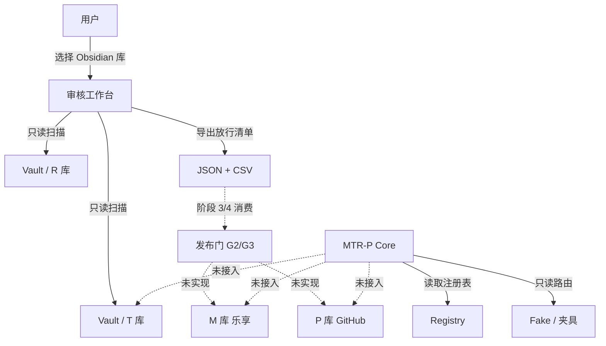
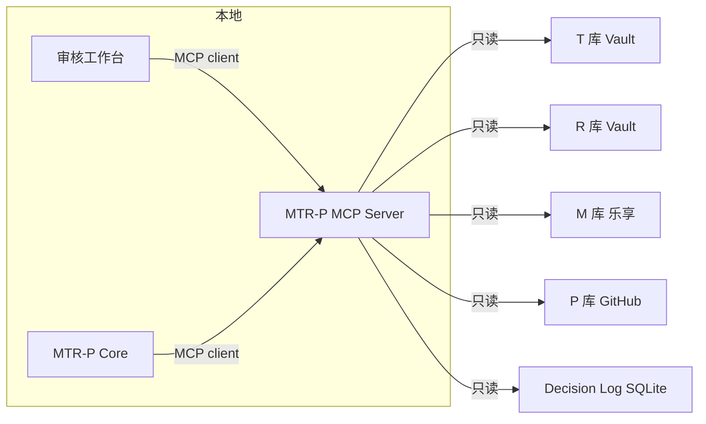

# MTR-P 审核工作台与整体体系结构

> 事实口径：2026-11-23 基于当前工作区源码核实。
> 标注约定：**已实现 / 已验收** 表示代码存在且测试或实测通过；**仅设计** 表示只有文档和数据结构，没有运行代码；**未实现** 表示明确关闭。
> 本文不把方案写成已完成的能力。
> 同日另有一份独立盘点 `docs/CURRENT-STATUS.md`（含未提交文件清单与待解决问题分级）；两份口径一致，本文偏结构说明，那份偏问题追踪。

## 1. 一句话现状

已经跑通的只有**一条人工审核流水线**：把 Obsidian 库（只读）→ 人工审核 → 导出 JSON/CSV 放行清单。
MTR-P 主仓的 M/T/R/P 四库只读路由能跑，但只接受内存 Fake 数据和受控夹具；**四库与审核工作台之间目前没有任何 MCP 连接**，连接器仍然是 WorkBuddy 会话级的。

## 2. 当前代码存放位置

仓库根：`E:\ASoftwareManage\Agithub\MTR-P-hub`（GitHub `13Asix21/MTR-P-hub`，main）

| 位置 | 作用 | 状态 |
| --- | --- | --- |
| `src/mtrp_hub/` | MTR-P Core：Canonical Model、Registry、确定性路由、执行清单、审计 | 已实现（只读、Fake/夹具） |
| `src/mtrp_hub/routing/` | 五类 intent 的确定性 ReadPlan（v1 规则） | 已实现 |
| `src/mtrp_hub/execution/` | ExecutionManifest、预期重编译、Envelope、Executor、verify | 已实现（夹具 + run3 真实全链） |
| `src/mtrp_hub/adapters/` | Obsidian / 乐享 / GitHub / Fake 只读适配器 | Obsidian 有真实只读冒烟；乐享、GitHub 走 WorkBuddy manifest |
| `src/mtrp_hub/approval/models.py` | G2/G3 冻结决策与单次审批数据契约 | 已实现（数据结构） |
| `src/mtrp_hub/lifecycle/__init__.py` | 阶段 3 T↔R 生命周期 | **仅声明导出，子模块缺失，导入即报错** |
| `apps/connect-panel/` | 本地 FastAPI 面板 + 审核工作台 | 已实现并验收（面板 136 项） |
| `apps/connect-panel/online/` | 零构建静态浏览器审核工作台 | 已实现、已发布公网链接 |
| `apps/connect-panel/packaging/` | Windows 便携目录（PyInstaller） | 已构建、真实 EXE 冒烟通过 |
| `apps/connect-panel/docs/manual/` | 图文使用说明书 | 已完成 |
| `docs/` | 各阶段 PRD、架构、能力矩阵 | 已归档 |
| `scripts/` | Vault 断链扫描与修复脚本 | 已实现（未入库，属独立专项） |

## 3. 已实现功能清单

### 3.1 主仓 Core（`python -m mtrp_hub`）

| 命令 | 能力 | 边界 |
| --- | --- | --- |
| `route query` | 生成 ReadPlan 并对内存 Fake 数据执行 | 不触网、不读真实库 |
| `route decisions` | 按 request/plan hash 查本地白名单 Decision Log | 只读 SQLite |
| `route traces` | 按完整链路身份读取阶段 2 运行记录 | 只读 |
| `manifest` | 创建与校验不可变只读执行清单 | 篡改拒绝 |
| `query fixture` | 用合成夹具跑完 v2 状态机 | 离线 |
| `query finalize` | 校验受控 envelope、处理 Core barrier | 不写外部 |

### 3.2 本地审核工作台（FastAPI，`127.0.0.1:8765`）

- 四库连接状态面板：M（乐享）、T/R（Obsidian Vault）、P（GitHub）、本地 Git。
- 单遍扫描同时产出聚合统计与逐篇清单；只读，不写 Vault。
- 审核：通过 / 拒绝 / 跳过 / 撤销、理由、批量（≤500）、快捷键、按人台账。
- 导出 JSON + CSV 到数据目录 `exports/`，返回真实绝对路径。
- 多用户档案 `users.json`，显式迁移旧档，原子发布（`os.link`）。
- 验收：专项 64 项、面板 136 项、主仓 225 项通过。

### 3.3 浏览器静态审核工作台（`online/`）

- 只读目录授权，递归遍历 Obsidian 库所有子目录，自动跳过 `.obsidian/.trash/.git` 等。
- 审核状态机、SHA-256 现算、STALE 检测、批量、JSON+CSV 浏览器下载。
- IndexedDB 本地台账、PWA 应用壳、离线恢复。
- 双引擎对拍：45 篇 + 6 篇，Python/JS 差异 0。
- 公开链接：`https://mtrp-review-workbench.app.workbuddy.host/?sharecode=R6JHCUP2WX`

### 3.4 本轮新增

| 变更 | 说明 |
| --- | --- |
| 整库扫描 | 默认 managed roots 从 `2-Permanent` 改为 `.`（库根），兼容 PARA / Zettelkasten / 扁平 / 纯中文结构 |
| 隐藏目录排除 | 新增 `.obsidian`、`.trash`、`.git`、`.github`、`.obsidian-git` |
| 根校验放宽 | 不再要求库内存在 `2-Permanent`；只校验“是可遍历目录” |
| 按钮文案 | “选择 Vault 文件夹”→“选择 Obsidian 库文件夹” |
| Python 侧对齐 | `panel/vault_check.py` 接受 `.`；`panel/settings.py` 默认根改为 `.` |
| 导出库标识 | `onlineVaultId` 改用实际扫描根，不再写死 `2-Permanent` |

## 4. MTR-P 整体体系



实线 = 已实现；虚线 = 仅方案或未接入。

### 4.1 四库定位

| 库 | 定位 | 当前接入方式 | 写入 |
| --- | --- | --- | --- |
| **M** | 长期知识（乐享知识库） | WorkBuddy 乐享 MCP 连接器（`lexiang`） | 关闭 |
| **T** | 试运行区（Vault 内 `mtr/trial`） | Obsidian 本地只读 Adapter / 浏览器目录 API | 关闭 |
| **R** | 冷区（Vault 内 `mtr/rarely`） | 同上 | 关闭 |
| **P** | 项目资产（GitHub 仓库） | WorkBuddy GitHub MCP 连接器 | 关闭 |

### 4.2 数据流（当前真实可跑）

1. 人工在审核工作台选择 Obsidian 库（只读授权）。
2. 递归扫描全部子目录，解析 frontmatter、标签、链接，现算 SHA-256。
3. 人工逐篇或批量决定，写入本地台账（浏览器 IndexedDB 或本机 `users.json`）。
4. 导出 JSON + CSV 放行清单，落盘到受控目录。
5. 后续发布仍由人执行，工作台不发布。

## 5. 与 MCP 的连接方案

### 5.1 现状：为什么现在“没连起来”

- 主仓阶段 2/3 PRD 明确写明**不引入 FastAPI/MCP Hub**，四库只通过 WorkBuddy 会话级连接器访问。
- 因此 M/T/R/P 的读取发生在对话里，而不是在工作台里；工作台与 Core 之间没有共享进程或协议。
- 当前 `~/.workbuddy/mcp.json` 仅配置了 `arxiv` 和 `ragflow`；乐享与 GitHub 是会话连接器，不在该配置中。

### 5.2 目标形态

把四库统一收口到一个**本地 MCP 服务**，工作台和 Core 都通过它读数据：



### 5.3 建议暴露的 MCP 工具（只读优先）

| 工具 | 入参 | 返回 | 风险 |
| --- | --- | --- | --- |
| `mtrp_scan_library` | `root`、`include_hidden=false` | 清单、统计、每篇 SHA | 只读 |
| `mtrp_get_note` | `path` | frontmatter、正文、SHA | 只读 |
| `mtrp_list_decisions` | `vault_id` | 审核台账 | 只读 |
| `mtrp_export_approved` | `vault_id`、`format` | 导出文件路径 | 只写导出目录 |
| `mtrp_search_m` | `query`、`space_id` | 乐享检索结果 | 只读 |
| `mtrp_read_p` | `repo`、`path`、`ref` | 文件内容与 SHA | 只读 |

写入类（改标签、发布 M、推送 Git）**不建议**在这一轮开放，继续保持 G2/G3 门。

### 5.4 分步落地建议

| 阶段 | 内容 | 前置 |
| --- | --- | --- |
| S1 | 用 Python 实现只读 MCP Server，先只对接 T/R（本地文件） | 无外部凭据 |
| S2 | 增加 Decision Log 读取与导出工具 | S1 通过回归 |
| S3 | 接入乐享 M 与 GitHub P（凭据从环境变量注入） | 需要 MCP 凭据管理方案 |
| S4 | 工作台改为 MCP client，去掉自身的目录 API | S1–S3 稳定 |
| S5 | 评估写入类工具 | 需 G2/G3 明确放行 |

### 5.5 接入 WorkBuddy 的配置形态

在 `~/.workbuddy/mcp.json` 增加一个本地服务条目（示例，未生效）：

```json
{
  "mcpServers": {
    "mtrp": {
      "command": "E:/ASoftwareManage/Agithub/MTR-P-hub/.venv/Scripts/python.exe",
      "args": ["-m", "mtrp_hub.mcp_server", "--vault", "C:/Users/<you>/Obsidian Vault"],
      "env": {}
    }
  }
}
```

注意：该模块**尚不存在**，此配置只是目标形态示意；写入后需要在连接器管理中手动信任才会启用。

## 6. 当前边界（不要外推）

- 四库与工作台**没有** MCP 连接，只有人工审核 + 导出这一条链路真实可跑。
- `lifecycle` 只有 `__init__.py`，导入子模块直接报错，阶段 3 未实现。
- 审核工作台不发布、不写 Vault、不写乐享、不推送 Git。
- 公开链接是静态页面：无账号、无云台账，各浏览器台账互不可见。
- 尚未验收：真实个人 Vault 全量、原生系统目录选择器、跨浏览器、安装/卸载、真实升级保留。

## 7. 相关文档

- 本地版说明：`apps/connect-panel/README.md`
- 浏览器版说明：`apps/connect-panel/online/README.md`
- 图文说明书：`apps/connect-panel/docs/manual/使用说明书.md`
- 本地 QA 报告：`apps/connect-panel/docs/qa-local-runtime.md`
- 能力矩阵：`docs/capability-matrix.md`
- 阶段 2 架构：`docs/architecture-stage-2.md`
- 阶段 3 PRD：`docs/prd-stage-3.md`
